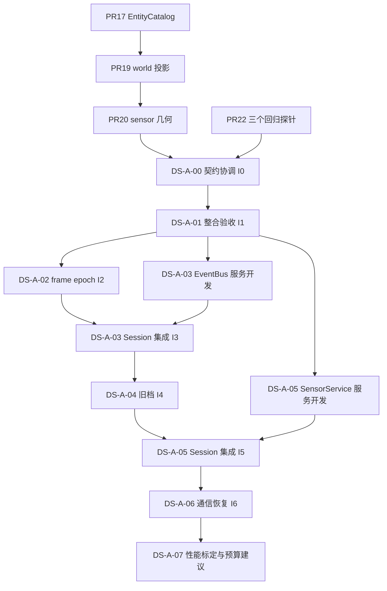

# DeepSeek Phase A：近期队列与首批任务卡

日期：2026-10-25（Asia/Shanghai）  
规划：Sol；执行目标：DeepSeek v4.1 Flash；独立审查：Astra  
状态：任务规格已发布为 GitHub Issues #23–#30，尚待实施；仅 DS-A-00 可立即开始，其余按依赖解锁。写卡不代表已启动 DeepSeek，也不代表任何实现获准合并。

## 1. 需求与证据

项目负责人已确认本轮依据为 [40 系统复核与队列](https://github.com/HATO-24/ghost-track-apsis/blob/4b0b102c2c99e6d71a9378a25f9d2d45fb1286ea/docs/40_系统完成度复核与开发任务队列.md) 和 [56 Astra 开发需求](56_Astra_开发需求_交6Sol.md)。56 对近期顺序、测试契约和范围的细化优先；40 的 Phase A–E 总路线继续有效。[54 Phase 0 报告](https://github.com/HATO-24/ghost-track-apsis/blob/4b0b102c2c99e6d71a9378a25f9d2d45fb1286ea/docs/54_Phase0_验收报告.md)、[55 A0 调查](https://github.com/HATO-24/ghost-track-apsis/blob/4b0b102c2c99e6d71a9378a25f9d2d45fb1286ea/docs/55_PhaseA0_物理与信息权威基线调查.md) 是带提交背景的历史证据，不能当作当前整合结果。

本次核对 GitHub 文件、PR、评论和 Actions；**未运行 Godot**。主工作区 `D:\GHOST TRACK_APSIS` 仍为旧 main `62356da5d863326e77b070953eca55ba5833e49a`，带未提交模型、近景、HUD、mockups 和 refs。执行者使用干净分支/工作区，从下表锁定的远端提交开始；本目录现有改动不得带入实现。

| 代号 | 本轮查到的精确提交 | 状态/用途 |
| --- | --- | --- |
| S0 | `4b0b102c2c99e6d71a9378a25f9d2d45fb1286ea` | GitHub main；开发启动前重新读取 |
| P17 | `5bb763dfdd8a938d9b4935cbbad93ea73223842b` | [PR #17](https://github.com/HATO-24/ghost-track-apsis/pull/17)，open；base `f3f51583a962120da0e91e5f7934eb2eff49a637`，EntityCatalog 与安全显示 |
| P19 | `8c1483a9bde9ca0ba3e5648ecdb4be1b96b900d1` | [PR #19](https://github.com/HATO-24/ghost-track-apsis/pull/19)，open；base=P17，WorldState 运动副本同步 |
| P20 | `7a4f3255023c9823137c97b1413c3c047c7f84e2` | [PR #20](https://github.com/HATO-24/ghost-track-apsis/pull/20)，open；base=P19，物理几何提供者 |
| T22 | `8bf7517cef32ca14699cca1b048ef3398b9eb88d` | [PR #22](https://github.com/HATO-24/ghost-track-apsis/pull/22)，open；base=S0，三个 Phase A 探针与门禁 |

P20 已包含 P17/P19，不得重复移植同一功能。推荐候选分支从最新确认的 S0 接入 P20，再接入 T22，协调共享的 `probe_matrix.json` 和 `.github/workflows/tests.yml`。这只是候选构建，不合并远端 main。

现行 CI 证据：[P17 run](https://github.com/HATO-24/ghost-track-apsis/actions/runs/39936218138) 为 73 cases/65 PASS/8 FAIL；[P19 run](https://github.com/HATO-24/ghost-track-apsis/actions/runs/39998354274) 为 74/66/8；[P20 run](https://github.com/HATO-24/ghost-track-apsis/actions/runs/40089646809) 为 75/67/8，均按既有失败基线成功。[T22 run](https://github.com/HATO-24/ghost-track-apsis/actions/runs/40107759205) 的 Phase 0 为 6/6，完整矩阵 75/64/11，Phase A 为红。各分支成功不相加为整合通过。候选预计有 78 cases，仍以去重后的 manifest 和实际执行为准。

已修复的审查意见不再派工：P17 嵌套 `source_id` 显示泄漏；P19 `updated/mismatched` 语义；P20 已绑定 provider 后的旧几何输出、部分绑定误报权威和 frame 原因。T22 旧 head 的 EMCON/非空通道/完整通道比较等四项意见已体现在现 head；REST 评论不能证明所有 review 线程均关闭。DS-A-00 仍须核对最新意见与契约。

## 2. 队列与调度

| 顺序 | 卡 | 当前状态 | 前置及输出 |
| --- | --- | --- | --- |
| 0 | [DS-A-00 契约协调](tasks/phase_a/DS-A-00_contracts.md) · [#23](https://github.com/HATO-24/ghost-track-apsis/issues/23) | READY | 冻结 PR heads、断言映射和整合候选 I0 |
| 1 | [DS-A-01 实现链整合验收](tasks/phase_a/DS-A-01_integration.md) · [#24](https://github.com/HATO-24/ghost-track-apsis/issues/24) | WAIT A-00 | 同一提交验证已有链及剩余缺口，输出 I1 |
| 2 | [DS-A-02 frame/epoch 与消费者来源](tasks/phase_a/DS-A-02_frame_epoch.md) · [#25](https://github.com/HATO-24/ghost-track-apsis/issues/25) | WAIT I1 | 统一明确的时间/坐标语义，输出 I2 |
| 3 | [DS-A-03 事件历史与续写](tasks/phase_a/DS-A-03_event_continuity.md) · [#26](https://github.com/HATO-24/ghost-track-apsis/issues/26) | WAIT I1；集成在 I2 后 | EventBus 恢复接口、序号/ID 连续性，输出 I3 |
| 4 | [DS-A-04 旧档迁移与去重](tasks/phase_a/DS-A-04_legacy_save.md) · [#27](https://github.com/HATO-24/ghost-track-apsis/issues/27) | WAIT I3 | 旧档策略与超缓冲边界，输出 I4 |
| 5 | [DS-A-05 传感器持久化](tasks/phase_a/DS-A-05_sensor_persistence.md) · [#28](https://github.com/HATO-24/ghost-track-apsis/issues/28) | WAIT I1；集成在 I4 后 | EMCON/雷达/通道续跑一致，输出 I5 |
| 6 | [DS-A-06 HUD 通信恢复](tasks/phase_a/DS-A-06_comms_restore.md) · [#29](https://github.com/HATO-24/ghost-track-apsis/issues/29) | WAIT I5 | 先复现 no_route，再修恢复并验收，输出 I6 |
| 7 | [DS-A-07 长时成本标定](tasks/phase_a/DS-A-07_save_cost.md) · [#30](https://github.com/HATO-24/ghost-track-apsis/issues/30) | WAIT I6 | 可复跑成本曲线与预算建议；优化另卡 |

I0–I6 是未来交付物的名字，**不是已存在 SHA**。每张卡开始前必须把其前置交付物解析为完整 40 位 SHA，记入任务执行报告，并更新该卡的执行基线；依赖未完成时不得宣称已具备可执行基线。若 main/PR 有新提交，A-00 重新核对变化后重建候选；后卡不得凭短 SHA 或“最新分支”运行。



可并行的是 A-03 的 `event_bus.gd` 服务接口和 A-05 的 `sensor_service.gd` 服务接口，两者各自使用独立 probe；A-02 同期只改坐标/时间相关段。`game_session.gd` 的集成顺序固定为 **A-02 → A-03 → A-04 → A-05 → A-06**。A-03/A-05 的并行分支只提交服务和独立测试，Session 集成另提交并重放到规定基线。不得两个任务各自重写整段 `save_state/load_state`。若只有一个 DeepSeek 执行器，按表顺序执行即可。

## 3. 全卡共同契约

1. PhysicsWorld 是运动学写者；EntityCatalog 是静态实体信息来源；WorldState 的位置/速度是按明确边界更新的投影。合成视图说明字段来源，不要求复制全部静态字段。TrackTable 只接观测/证据；玩家 contacts/HUD 遵守证据可见性。
2. 本批物理输入为 `bary_rot`、km、km/s、模拟秒；既有支持转换为 `earth_eci/earth_rot` 时必须调用集中转换器。`t_s` 是相对模拟时间；scenario UTC 历元与 CR3BP 相位基准分别说明，禁止隐式混用。A-02 完成前，未接入 scenario epoch 是公开缺口。
3. 同源投影误差沿用 P19：位置 ≤`1e-9 km`、速度 ≤`1e-12 km/s`；同 tick 时间差 ≤`1e-6 s`。P20 provider 几何距离/方位核对 ≤`1e-6 km`/`1e-6 deg`。这些是复制/确定性几何误差，不能当作真实传感器精度。测量误差使用可追溯模型参数，不能要求有噪声航迹等于真值。
4. 元数据负例必须包含缺实体、ID 归属错位、无证据匿名目标、静默 friend 回退，以及嵌套显示事件泄漏。`batch/rcs/radius/has_pd` 属于真值/内部消费者信息，无证据不得自动进入玩家字段；本舰和设施公开记录的例外须标来源。
5. JSON 数字检查数值语义、有限性和有效范围；恢复后按有契约的字段检查实际运行时类型。不得全局递归把数字转 int，不得为载体类型断言任意改存档格式。
6. 拟真验收用 `orbital_sim`，有限弹药、正常授权。默认仍 `full`；Phase 0 的 6 项与既有门禁语义保持原样。没有显式许可不得合并 main；完成一张卡不等于完成整个 Phase A。

## 4. 可复跑命令与报告

从**干净执行仓库根目录**运行，Godot 4.7.2。根目录入口为 `run_tests.ps1`，参数是 `-GodotBin/-Only/-Gate/-ResultsDir`，不使用不存在的 `-Names/-GodotPath/-OutputDir`。引擎自动发现顺序为 `GODOT_BIN`、`tools/godot/*console.exe`、PATH 的 `godot/godot4`；如需指定路径，用有效的 `-GodotBin`。卡中单项 probe 命令均在同一仓库根目录运行。

```powershell
git rev-parse HEAD
git status --short
pwsh -NoProfile -File ./run_tests.ps1 -Gate phase0 -Ci -ResultsDir .test-results/phase-a/cards/phase0
pwsh -NoProfile -File ./run_tests.ps1 -Gate phaseA -Ci -ResultsDir .test-results/phase-a/cards/phaseA
pwsh -NoProfile -File ./run_tests.ps1 -Ci -Baseline game_v17/tests/known_baseline_failures.json -BaselineExtra game_v17/tests/phasea_baseline_failures.json -ResultsDir .test-results/phase-a/cards/full
```

每次运行在指定目录下生成 `<yyyyMMdd-HHmmss-shortcommit>/summary.json`、`report.md`、`import.log`、`logs/<case-id>.log`。卡专属复现、差异和人工核对报告放 `.test-results/phase-a/cards/<卡号>/`；在提交的任务报告中列出完整命令、环境、SHA、artifact/CI URL 和摘要，原日志随 PR artifact 保留。

专项 `-Only` 或 `-Gate phaseA` 不带全量 baseline；否则严格完整性检查会因未选中既有失败条目而失败。完整矩阵才使用上面的双 baseline。`-AllowPartialBaseline`、跳过失败、吞异常、放宽精度、`continue-on-error` 均不得用于放行。A-00 协调后如文件/参数变化，先同步此处并真实验证命令。

当前 runner 拒绝空的 `failures[]`。当 Phase A 三项登记失败都经证据审查移除时，完整回归和 CI **去掉 `-BaselineExtra`**，只传仍有真实条目的 legacy baseline，不能保留空文件参数、保留已转绿条目或放宽严格检查。A-06/A-07 列的是这个最终命令；若仍有 Phase A 失败，继续运行双 baseline 诊断并保持任务未完成。legacy 条目若也清零，同理去掉 `-Baseline` 后按全量零失败验收。

Phase A 探针在全部切片完成前仍可能为红。每卡分别报告“本卡目标是否通过”“全 Phase A 是否通过”“是否无新增回归”。完整 baseline 模式成功只表示失败集合与计数精确符合登记，仍展示真实 FAIL 数。旧失败转绿、失败数变化、新失败分别列出；保留旧 baseline 与原始非零日志，经逐条证据审查后用独立提交更新对应条目，禁止自动刷新期望值。Phase 0 gate 仍须 6/6。

测试、源码和 baseline 的最终证据必须指向同一完整提交；后续发生源码、断言或 baseline 修改即重跑相关门禁和完整矩阵。本次文档交付只做文档与引用核对，不把上述待执行命令写成已通过。

## 5. 后续进入条件

| 阶段 | 仍在队列的工作 | 进入条件 |
| --- | --- | --- |
| Phase A 后续 | 身份/威胁/授权语义、IFF/ELINT/手动证据冲突与过期、EW 实际消费者；legacy 显示来源 | I6 和性能证据可用，基础事实链及恢复稳定；另写小卡，不在本批顺手实现 |
| Phase B | 正式入口发现→识别→解算→授权→发射→弹道/反制→损伤→报告，含战斗中存读档 | 相关 A 契约完成，有限资源和负例可验收 |
| Phase C | 许可/队列/进近/对接/服务/离港与物理和资源原子性 | 唯一运动权威与控制写路径有证据 |
| Phase D | 改装改变实际能力；HUD 只读视图；态势图层和资产 | 相关 A–C 数据接口稳定；行为、截图和集成分别验收 |
| Phase E | 渐进拆分、版本化内容与迁移、mod/story 接口 | 基础闭环与回归稳定；避免整类重写 |

本批交付只包含任务文档与交接卡，不把模型展示、历史 PASS、截图或误派工事件实验当作完成证据。规格经过独立静态复核，修正了测量用例超出 TrackTable 字段范围、新回归与新发现旧缺陷的区别，以及旧档去重 fixture 的日志入口；没有运行 Godot。各卡实现最终仍需 Astra 独立审查；项目负责人决定取舍与合并。
