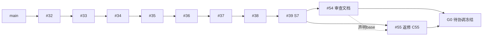
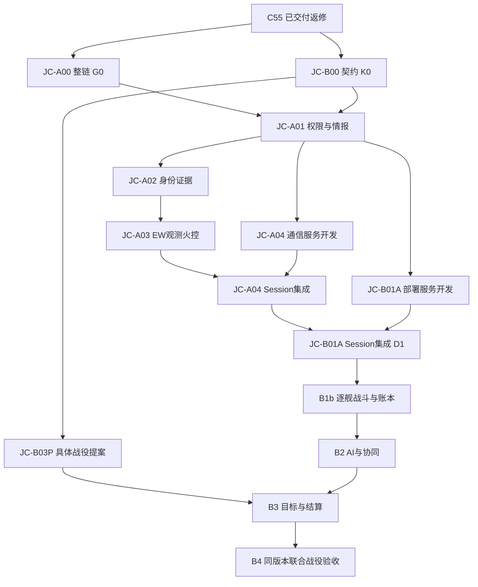

# 联合战役 Demo R2：范围、复核与下一批任务卡

日期：2026-10-25（Asia/Shanghai）；需求：Astra；规划：Sol；实现目标：DeepSeek v4.1 Flash。

延续[40号审计与原路线图](40_系统完成度复核与开发任务队列.md)的权威/测试契约；以下以56 R2更新产品范围，并用当前提交和本轮复核替换40号文档的历史状态判断。

## 2026-10-26 R6独立复核更新

[PR #65 R6已关闭项与剩余返修](reviews/pr65_r6_20261026/review.md)：被审`5d7208b82ebae81da874e059c2d88286317c6483`。11专项通过；旧150tick移动跟踪、原八条导入反例、K0主要旧反例与P0三条变异已关闭，保留修复。TWS完整状态/旧档策略、比较器allocator和投递输出、K0参战资格/共享来源及P0旗舰预算/友军能力/主案归一仍需收尾。**G0/K0尚未放行，P0先归一后产品核对，继续原#56/#57/#63**。下方R5和2026-10-25记录为历史，不代表本候选状态。

## 2026-10-26 返修复核更新

[PR #65 第五轮独立复核与原卡返修清单](reviews/pr65_r5_20261026/review.md)：被审候选`dc3821eda91d25f14e44dd9f57e6f5a985e04a9c`。原200/400tick反例转绿，10专项通过；持续跟踪、原子导入、比较器仍有缺口，K0权限/引用及P0目录/目标轨迹语义也未通过。**G0/K0尚未获独立放行，P0保留草案**；继续原#56/#57/#63，#58–#62核心集成未解锁。下方2026-10-25表格保留历史起点，不作为本次候选已冻结的证明。

## 1. 一页范围表

本轮以 [56 R2 原文](56_Astra_开发需求_交6Sol.md) 为需求依据。该文件来自用户更新后的主工作区，SHA256=`5ED8C0C7080860381731253324679F6E119CAE4AC6D87645BAD0727FAF7CABA1`；源文件未由 Sol 改写。R2 与本次用户明确答复优先于旧版57/58的产品口径；旧工程证据保留其原提交背景。

| 分类 | 项目 | 本轮明确口径 |
| --- | --- | --- |
| 用户已确认 | 产品 | 主线剧情之外、全面战争背景下的一场联合战役；单人＋AI友军 |
| 用户已确认 | 玩家循环 | 简报→自由组舰→部署→协调→交战/撤离→结束→战报；组舰和协同实际改变结果 |
| 用户已确认 | 胜利范围 | **阶段性战区行动**；解除第33舰队某战区部队的有组织作战能力，不宣告整个第33舰队已去军事化 |
| 用户已确认 | 指挥权 | **自有舰队直控＋友军协同请求**；独立AI友军按任务、资源和链路接受或拒绝 |
| 用户已确认 | 基础约束 | 有限弹药/燃料、正常授权、不完整且有延迟的情报；战役内存档与继续运行；至少两套有效编制 |
| 用户已确认 | 剧情边界 | 暂停主线扩写；战役简报、目标、协同通信和结算属于必需内容；story=false不关闭战役裁决 |
| Sol首版建议 | 技术场景 | `jc_sector_01` 独立架空模拟场景；复用舰型和基础资产；主线存档与模拟器存档分域 |
| Sol首版建议 | 组舰 | 从批准的舰级/可用舰池选择，采用指挥容量＋资源预算；角色作为能力标签，不强制填满旧8槽；命名舰唯一，重复通用舰体需生成独立实例ID |
| Sol首版建议 | 规模起点 | 标定档位：玩家2–4舰、友军1支/2–3舰、敌方3–5舰，加至多2个目标/保护节点；这是性能提案，不是用户已批准兵力或正典 |
| Sol首版建议 | 协同原语 | 支援指定目标、掩护本舰组、协助撤离三类请求；先不做任意战术计划编辑器 |
| 待用户决定 | 内容 | 战区/参战单位名称、架空年月、选择池与预算具体点数、最终目标对象和失能阈值；由JC-B03P提交具体方案后核对 |
| 待测后冻结 | 性能 | 总舰数、弹体上限、时间跨度、AI频率与发布预算；不得用建议档位冒称已跑过的联合战役 |
| 后续范围 | 扩展 | 跨战役持续损失/补给、持续战略地图、经济生产、联网多人、完整港口/船坞/政治外交、完整投降/占领系统、资产细化 |

两项新增产品确认来自本次聊天中的明确选择：阶段性战区行动、自有舰队直控＋友军请求。本批不再就这两点请求确认。具体兵力、目标判据和剧情时间尚未获批，执行卡不得将提案写成既定设定。

## 2. 上一批交付复核与剩余缺口

| 基线 | 精确值 | 使用方式 |
| --- | --- | --- |
| GitHub main | `4b0b102c2c99e6d71a9378a25f9d2d45fb1286ea` | 本轮已刷新，仍未包含联合战役与上一批堆叠实现 |
| S7旧候选 | `af5b92471a0f12f1ab95c7defda88360e171e277` | 原审查7个反例的来源，保留为历史 |
| C55返修候选 | **`30b8d33dae9787aadf89bb206757cafb2cad7bd3`** | [PR #55](https://github.com/HATO-24/ghost-track-apsis/pull/55)，本批读代码/设计/隔离服务工作的起点，不等同已合并main |
| #55当前base | `codex/phase-a-review-next-batch-20261025` @ `c558f30846fcd9ab7e5943684e31311debb55ac0` | 描述中承认尚未将返修分散回原PR，也未整合#54审查分支；须用实际祖先和树核对 |
| 当前CI | [run 40174245081](https://github.com/HATO-24/ghost-track-apsis/actions/runs/40174245081) | 精确head=C55，Phase0/PhaseA/full三个job成功；full仍有7项历史FAIL |

本轮在C55/Godot4.7.2隔离工作区独立执行8个相关probe：**8/8 PASS、0 TIMEOUT/NOT RUN**；用原审查诊断脚本复跑，**violations=0、退出0**，原seq64/68已变为34/34。证据见 [复核报告](reviews/r2_20261025/recheck.md) 和 [专项摘要](reviews/r2_20261025/targeted-summary.json)。完整84项本轮未独立重跑；84=77 PASS/7历史FAIL来自上述CI。R05长时测量本轮未重跑，不复制其报告为本轮运行结果。

8/8指断言/退出码结果，不等于stderr为空：两个probe仍有诊断字符串格式错误，若干HUD probe有退出时对象/资源残留；其余可见拒绝/坏JSON日志与负例对应。原始stderr全部归档，JC-A00补格式/失效说明并核对资源残留，不因这些日志抹掉已通过断言或声称零错误。

当前PR依赖快照（均为open，顺序不是已合并记录）：

| PR | head | 声明base |
| --- | --- | --- |
| #32 | `882e058e2a0550684ade73f6978122fef46d42d7` | main |
| #33 | `26f1d5398a4ed6654b057f23a27819e4bf700b31` | #32分支 |
| #34 | `7b5691482929d493467aec12eddbe20f3782f35e` | #33分支 |
| #35 | `f842b3db6158d08bb6da5221252745882a2cc858` | #34分支 |
| #36 | `b04726641057aa80ccc83829e8da00b973f2f733` | #35分支 |
| #37 | `0a66ea2ca45e36739e3c92da80f742526b8b24cb` | #36分支 |
| #38 | `10a48653f9ff5b07517d6eb39c06dbdffb09104e` | #37分支 |
| #39 | `af5b92471a0f12f1ab95c7defda88360e171e277` | #38分支 |
| #54 | `c558f30846fcd9ab7e5943684e31311debb55ac0` | #39分支 |
| #55 | `30b8d33dae9787aadf89bb206757cafb2cad7bd3` | #54分支；实际返修从S7派生，须协调树内容 |



#31仍携带旧版R1派工材料，不将其直接覆盖本轮R2；旧文档可作历史证据，不作为最新产品定义。

**不再派工重做** R01玩家selected过滤、R02显式/自动ID碰撞与缺seen_ids、R03分数版本/丢backend及观测序号差、R04未知outcome降为旧档等已复现修复。R05已修字节口径、逐样本调用与provenance，但代码仍主要检查ID集合大小/seq下界、少量sensor字段；故障钩子直接调用FAIL，不能充分证明第二/第三样本的真实状态差异会被比较器发现。JC-A00只补这些验收缺口和整链基线。

其余待做事项已有代码依据，不能因模块同名视作完成：

- `fleet_formation.gd` 管理名册/编制，`fleet_assign/move`发事件，尚未把选择转为完整参战实体部署。
- `request_fire(opts.shooter_id)`已有入口，但显式无效ID会退回旗舰；弹药/解算仍取单一`combat_service`，操作日志未完整保留发射上下文。多舰战斗尚未完成。
- `plot_positions`/snapshot有系统真值用途，不能直接交给不同情报拥有者；当前缺少可验收的指挥权/分方情报域。
- IdentityService有冲突/衰减逻辑，TrackTable也直接写身份；assessment目前不回写统一操作性结果，`manual_confirm`及多来源仍需收敛。
- EW三个effect接口目前仅有Session包装，未发现实际Sensor/Comms消费者；CombatService解算质量主要由武器精度和距离计算，尚无相应信息质量消费。
- 旧Mission阶段机绑定scenario/world/story参考，不能直接当story=false下的联合战役目标运行层。

## 3. 本批队列与依赖

G0、K0等是未来任务交付物的名字，当前不是有效SHA。每张卡解锁时必须将前置交付物写成40位SHA并记录执行基线；远端head有变化先审diff，不使用“最新分支”作为证据。

| 卡 | 状态 | 前置/输出 | 目标 |
| --- | --- | --- | --- |
| [JC-A00](tasks/joint_campaign/JC-A00_integration_closeout.md) · [#56](https://github.com/HATO-24/ghost-track-apsis/issues/56) | READY | C55→G0 | 返修整链冻结及验收补齐，复用#55 |
| [JC-B00](tasks/joint_campaign/JC-B00_contracts.md) · [#57](https://github.com/HATO-24/ghost-track-apsis/issues/57) | READY设计 | C55；最终对齐G0→K0 | 多舰队数据、指挥与情报契约，B0规格与schema fixtures |
| [JC-A01](tasks/joint_campaign/JC-A01_authority_intel.md) · [#58](https://github.com/HATO-24/ghost-track-apsis/issues/58) | WAIT G0/K0 | →A1 | 指挥权限及分方情报读写隔离 |
| [JC-A02](tasks/joint_campaign/JC-A02_identity.md) · [#59](https://github.com/HATO-24/ghost-track-apsis/issues/59) | WAIT A1 | →A2 | 身份证据单一出口、IFF/ELINT/光学/人工一致性 |
| [JC-A03](tasks/joint_campaign/JC-A03_ew_observation.md) · [#60](https://github.com/HATO-24/ghost-track-apsis/issues/60) | WAIT A2 | →A3 | EW进入真实观测与火控消费者 |
| [JC-A04](tasks/joint_campaign/JC-A04_ew_comms.md) · [#61](https://github.com/HATO-24/ghost-track-apsis/issues/61) | 服务可在A1后；Session接入在A3后 | →A4 | EW进入实际通信，保留恢复与权限语义 |
| [JC-B01A](tasks/joint_campaign/JC-B01A_deployment.md) · [#62](https://github.com/HATO-24/ghost-track-apsis/issues/62) | WAIT A1/K0，最终集成在A4后 | →D1 | 两套合法编制转为独立、可恢复的部署实例；多舰发射仍属后续B1b |
| [JC-B03P](tasks/joint_campaign/JC-B03P_scenario_proposal.md) · [#63](https://github.com/HATO-24/ghost-track-apsis/issues/63) | READY内容设计 | 先用B00草案，最终对齐K0→P0 | 具体战区、目标判据、简报/战报方案，交用户核对 |



可并行的是B00规格、B03P内容提案、独立的Comms/部署服务；不是同时修改大段GameSession。核心接入顺序固定：**A00→A01→A02→A03→A04→B01A**。事件/消息共享字段先冻结，再在独立提交中接入；禁止两张卡各自重写save/load。

## 4. 共同行为、单位与回归契约

PhysicsWorld写运动学；EntityCatalog写静态来源；编制/部署服务写参战实例与归属；TrackTable/指定证据入口写操作性航迹；EventBus分配ID；各服务写自己的资源/运行态。阵营关系、指挥授权、情报拥有者、交战许可分开，friend不等于直控或获得全部观测。

运动学用bary_rot、km、km/s、模拟秒；与scene UTC历元分开。physics后采样；同一采样时刻差≤1e-6s；同源投影位置≤1e-9km、速度≤1e-12km/s；确定性几何≤1e-6km/deg。新延迟链必须分`observed_t`与`received_t`：几何保留采样时刻，融合/路由时间单调，不能用投递时真值替换旧观测。延迟/ETA/到期为秒；质量/置信度在[0,1]，确定性数值比较≤1e-9。阈值用于复制/路由检验，不冒充传感器物理精度。

旧舰队名册mass/fuel为t，PhysicsWorld为kg，转换明确为×1000且只做一次；Δv统一km/s。稳定entity_id关联单舰，fleet_id不是entity_id替代品；实例字典/资源容器不得共享可变引用。JSON数字按语义/安全范围校验，恢复后契约整数是真int，不全局转int。

每卡从规定基线保存红证据（或证明行为已实现），再提交最小实现；正负例、旧seed/旧档、同tick/连续运行与可见性按卡执行。下面称**C回归**，均在执行仓库根目录运行，Godot4.7.2；`<卡号>`仅为结果目录占位：

```powershell
pwsh -NoProfile -File ./run_tests.ps1 -Gate phase0 -Ci -ResultsDir .test-results/jc-r2/<卡号>/phase0
pwsh -NoProfile -File ./run_tests.ps1 -Gate phaseA -Ci -ResultsDir .test-results/jc-r2/<卡号>/phaseA
pwsh -NoProfile -File ./run_tests.ps1 -Ci -Baseline game_v17/tests/known_baseline_failures.json -ResultsDir .test-results/jc-r2/<卡号>/full
```

专项`-Only`不带全量baseline；先`-List`确认选择，0 case/NOT RUN/超时不能算通过。结果自动包含run-id目录内summary.json/report.md/import.log/logs。每卡报告完整SHA、实际命令、退出码、断言计数、环境及CI/artifact；保存原红灯和日志。源码/断言/基线最终证据指向同一最终提交。

旧失败转绿、FAIL数漂移和新失败逐项报告。只有证明原条目被修复才独立删除/调整对应baseline，不能自动刷新；新增缺陷不能登记为历史。所有旧条目清零后去掉-Baseline而非传空failures[]。保持默认full、orbital_sim有限资源/正常授权、Phase0仍6个case；不跳过失败、不吞异常、不放宽精度、不continue-on-error。

## 5. 与已有卡的衔接

| 既有卡 | 处理 |
| --- | --- |
| #40–#44 R01–R05 | 实现已在#55；由JC-A00关闭整链/证据残项，不重做已有修复，不依据报告直接自动关闭 |
| #45 H01毁伤/舰级 | 保留并提高为B1逐舰战斗前依赖；包含3个共同档案契约case，不另开重复任务 |
| #46 H02 legacy TWS/显示 | 保留；A01/A02核对其与产品链关系，必要的本舰ID/来源修复并入明确服务边界，历史证据不抹掉 |
| #47 H03设施事故、#48 H04旧主线文本 | 保留后排维护；不因主线暂停而删除，但不挡无关联的联合战役实现 |
| #49 S01恢复优化 | 保留固定A-07负载的1500000B/250ms/5000ms目标，不重开；新战役负载另测，不偷换fixture |
| #50平台、#51渲染、#52长时成本 | 保留；#51与B4实际游玩接轨，#52复用已参数化的测量器；平台范围未确认前不宣称全平台完成 |
| #53真实RF/光学研究 | 后续规格研究；当前EW采用可测抽象模型并标明近似，不挡首版联合战役 |

## 6. B0–B4待细化包与成本判断

以下成本为基于代码复用情况的**相对复杂度**，不是工期/完成百分比；开发、联调、测试和内容分列。G0/K0出来后再用明确切片与实际执行耗时排工程日，避免把模块存在直接算成已完成。

| 包 | 拆分与已有复用 | 开发 | 联调 | 测试 | 内容/调优 | 进入/退出条件 |
| --- | --- | --- | --- | --- | --- | --- |
| B0 | 本批B00；复用EntityCatalog/Formation/事件schema，新增舰队/指挥/情报/目标契约 | 中 | 中 | 中 | 低 | K0独立审查；三方/两套编制/旧档fixture可校验 |
| B1 | B01A部署；后续B1b逐舰火控/授权/弹药/冷却/预测/重放；B1c舰组跟随/护卫与最小操作UI | 高 | 高 | 高 | 中 | 不再共享旗舰账本；有效选择逐舰出击；非法发射者拒绝；H01相关缺陷关闭 |
| B2 | B2a规则型敌我任务执行；B2b请求/回执/失联/受损；B2c按链路共享情报与最低协同UI | 高 | 高 | 高 | 中 | 至少1支独立友军真实行动；敌我AI只读各自情报，协同改变态势 |
| B3 | 本批B03P提案；后续B3a目标运行层与裁决/玩家视图分离，B3b简报/阶段/战报 | 中 | 高 | 高 | 高 | 目标对象/阈值获用户核对；story=false仍可胜/败/撤离，不重复裁决/发奖 |
| B4 | 两套编制、协同正负例、敌方响应、战斗中读档、性能、非headless实际试玩及交付 | 低 | 高 | 高 | 高 | 同一版本正式入口完整流程、性能与人审证据齐全；不能只看probe数量 |

主要风险在逐舰CombatService账本、分方情报融合、AI任务执行与战役裁决的交汇，预计联调和负例验证不能压缩成一次最终冒烟。多人、持续战争经济和全套港口/资产不计入本表。

## 7. 首版建议与测量预算

建议标定档位为总计≤14个活动舰/目标实体、≤32个在途弹体、3个指挥域，AI决策周期2模拟秒；两套玩家编制用2–4舰体现传感器/火力取舍。具体舰型/组合点数由B00/B03P对照ShipCatalog提出，未实测前不承诺最大规模。

联合战役的**待测预算提案**：参考机与引擎记录完整，1×时每1模拟秒推进耗时≤100ms、3指挥域每次AI决策总耗时≤10ms；1080p实际渲染p95帧耗时≤33.3ms，命令本地受理反馈≤100ms（不含模拟通信延迟）。B4须留足样本再评价p95；当前AI/联合战役尚未实现，相关数值均NOT RUN。

存档沿#49保留旧fixture的硬目标；新战役另记UTF-8体积、保存/恢复、完整状态与恢复后行为，建议恢复体验目标仍≤5s，但新负载大小/保存预算须在部署与AI接入后依据实测冻结。不能把当前7实体的结果当成14实体＋AI＋目标的已达标证据，也不能通过删历史ID或关系统降成本。

JC-B03P先提交可审查的目标组合：例如解除2个指定军事作战单位的本场有效射击能力，并解除1个明确军事指挥节点的行动能力；只有已实现且本场不可自行恢复的机制才可计入，暂时干扰/失联不算永久失能。对象、阈值、友军阵容、失败/撤离/时限和保护目标均为提案，待用户核对后才进入B3实现。

首版验收口径始终是“自组舰队＋独立AI友军＋阶段性去军事化目标的一场联合战役”，不退回单旗舰开火测试，也不扩大成持续战略战争。
