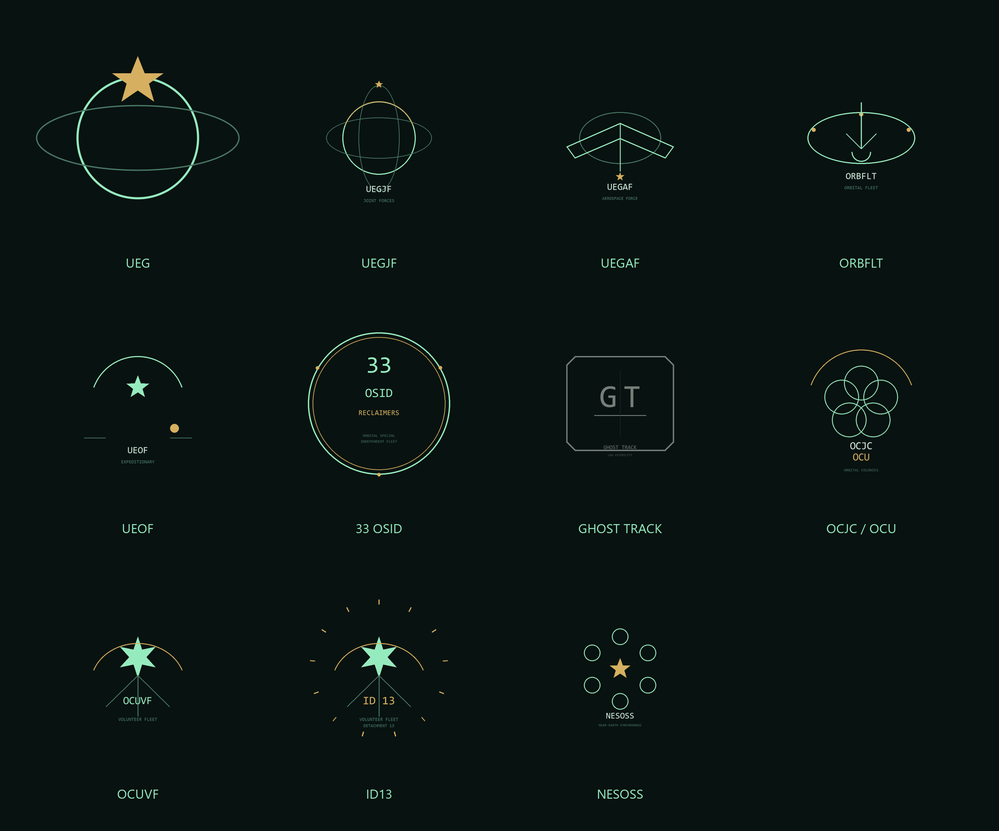

# GHOST TRACK · 世界设定全书

> 2193 年，地月系。一份关于世界、势力、舰船、技术与人的设定总集。

## 目录

- 第 1 章 · 历史与现状
- 第 2 章 · 地月系地理与站点
- 第 3 章 · 势力与政治
- 第 4 章 · 经济与工业
- 第 5 章 · 人物
- 第 6 章 · 舰船
- 第 7 章 · 技术与装备
- 第 8 章 · 命名与术语
- 第 9 章 · 军语与通信

---

# 第 1 章 · 历史与现状

## 概述

2193 年，地月系处于战争后方。地球联合政府（UEG）的主力舰队深陷火星，地月系只剩下巡逻舰、海关艇、训练舰和一支正在扩权的独立舰队。UEG 以《轨道宪章》和第七号轨道紧急托管令为依据，将关键轨道基础设施纳入中央控制；轨道殖民地联合（OCU）及其志愿舰队（OCUVF）则以自治和居民安全为名进行抵制。

冲突的核心在于：谁有权在地月系宣布紧急状态、接管基础设施，并定义什么是合法武装。

## 前史（2024–2051）

### 第二次航天竞赛（2024–2034）

第三次世界大战始终没有出现。20 世纪中叶以后，战争主要以局部冲突的形式出现在第三世界，大国之间维持着脆弱的核威慑与代理人竞争。

2020 年代中期，可复用重型运载火箭全面成熟，入轨成本下降一个数量级，人类进入第二次航天竞赛。多个航天大国先后重启载人登月，并各自宣布永久月面基地计划。竞赛最初围绕声望与军事制高点展开，直到月面南极永久阴影坑的水冰被探明——水可以电解为氢氧推进剂，月球由此在旗帜与象征之外，成为地月交通的推进剂补给站。

2030 年代，月面出现第一批互不统属的国家基地：南极诸基地采冰，赤道基地以科研与象征为主。同一时期，近地轨道的商业空间站与卫星互联网完成盈利闭环，轨道不再是政府的保留地，私人宇航员与太空游客成为常态。

### 轨道基建潮（2034–2048）

月面基地的补给需求催生了地月拉格朗日点的第一批永久设施。L1 与 L2 先是无人燃料仓库与通信中继，随后派驻常驻乘员，成为往来月球的必经节点；人们开始把这些节点称作“港”，尽管当时整个地月系只有个位数站体。

资本与大国项目并行涌入：在轨制造（光纤、合金、生物医药）开始盈利，太阳能电站验证阵列上天，小行星探测常态化。地球上的航天大国围绕月冰配额、轨道频谱与拉格朗日点选址展开漫长谈判。联合国仍是唯一的协调平台，但约束力逐年下降；谈判桌上形成的惯例——先占先得、技术换配额、事故共同担责——后来成为港群自治诉求的远因。

到 2040 年代末，地月空间的人口构成已经成形：月面科考与采矿人员、港站运维人员、商业旅客，以及第一批在轨出生、从未踏上地球的儿童。他们尚不构成政治实体，但已经有了自己的行话、行业与身份。

### 山雨欲来（2048–2051）

轨道经济的扩张速度超过了国际法的供给速度。月冰配额、频谱、港站管辖权、太空债务与保险，每一项都靠双边协议和临时仲裁维持。联合国改革议程连续搁浅；几个航天大国开始筹备各自的轨道巡逻力量，把轨道视为新的威慑前沿。

与此同时，轨道资产高度金融化：加注站、仓储与航运靠保险与跨境信贷运转，任何一个环节断裂都会连锁。到 2051 年初，地月系比历史上任何时候都接近“常态”：航班按窗口运行，月面基地扩员，港站扩建。整套系统的通信链路都押在同一个太阳上。

## 2051 大停摆

2051 年，一场史无前例的太阳离子风暴摧毁了全球通信系统。通信中断持续数月，地月通信同样未能幸免，月球殖民地与地球失去联系。旧国际体系在灾后救援与责任分摊问题上陷入长期争执，救灾与重建成为一笔纠缠数年的国际烂账。联合国不再具备维持国际秩序的能力，名存实亡。

通信恢复后，只有具备完整航天能力的主权国家向月球发射了装载救援物资与人员的火箭。此时的港群仍处于雏形阶段，常住人口极少；殖民卫星只修建或发射了个位数到各拉格朗日点；月面只有各国单独修建的基地，永昼（Solstice）尚未建立。港群、殖民卫星与月面基地在灾后数年内成为事实上的三不管地带。

## 2071 UEG 成立

旧的全球治理框架逐步被**地球联合政府（UEG）**取代。UEG 以《轨道宪章》接管关键基础设施：发射场、地球同步轨道港、地月交通节点、海关与导航。UEG 承诺港群与月面自治，但联合议会席位按地球人口与出资比例分配，太空人口长期处于少数地位。

UEG 成立后，港群与月面基地的恢复计划被迅速提上日程，并在数年内完成建设。政治协商与自治承认按各站点的完成进度在数月到数年内完成。对地球居民而言，拉格朗日点上的空间站与月球地下都市已经等同于新国家；太空电梯大规模建成后，太空移民与旅游的体验与地球内部相差不大，除必要的无重力适应训练外。

月球表面建成的**超大型超导磁轨物质投射器（Ultra-large Superconducting Electromagnetic Mass Drive，USEMD）**为“奥德修斯”计划提供了中转能力。该计划提前完成，人类进入太阳系内殖民时代。

UEG 是联邦制政府，主要机构包括联邦总统、联邦议会、中央安全委员会、轨道事务委员会与地球联合军（UEGJF）。首都与主要机构位于地球，财政、兵源与发射场也主要来自地球。

## 2071–2193 重建、殖民与积压

| 时期 | 主要事件 |
| --- | --- |
| 2071–2100 | UEG 完成轨道重建：太空电梯、地球同步轨道港、L1–L5 港群与月面永昼地下城陆续建成；《轨道宪章》的自治承诺逐步落实，但联合议会席位仍按地球人口与出资分配。 |
| 2100–2140 | 月球 USEMD 与“奥德修斯”计划投入运行，人类进入太阳系内殖民阶段；火星第一批永久据点建立。 |
| 2140–2170 | 火星殖民地扩张：火卫一埃斯帕达（Espada）、火卫二克莱默（Claymore）建成；火星表面城市化与地球化改造开始。 |
| 2170–2190 | UEG 设立火星安全委员会（UEMSC），对火星殖民地实施安全与行政管制；税负、配额与政治代表权矛盾累积，MIDA 形成。 |
| 2193 | 火星叛乱爆发；UEG 发动极光行动；第33舰队在地月系扩权；第七号令发布。 |

## 2193 火星叛乱、第七号令与克洛诺斯（Chronos）事件

2193 年，火星殖民地叛乱爆发，火星独立民主联合（MIDA）夺取火星轨道控制权。UEG 以镇压叛乱为名发动极光行动，地球联合军主力被牵制在火星；地月系兵力空虚，只留下少量巡逻舰、海关艇、训练舰，以及一支正在扩权的独立舰队——**第33轨道特别独立舰队**，俗称“清算者部队”。

中央安全委员会借紧急状态推动以地球为中心的中央集权，计划将关键轨道基础设施以“临时托管”名义纳入 UEG 权力范围。

**第七号轨道紧急托管令（Order 7）**于 2193-04-01 由格林尼治（Greenwich）发布，张贴范围覆盖地月系内所有殖民地，包括 L1 子午（Meridian）-05 克洛诺斯的储罐区：

> 任何“失能、受威胁或被敌方渗透”的加注站、储罐、船坞与航道，可由 UEG 指定部队接管，直至紧急状态结束。

第七号令宣布后，L1–L5 各分站点的各项设施乃至整个分站在经历程度不同的空间站事故后，被第33轨道特别独立舰队（UEG33rdOSID）援引第七号令，以“管制及预防分离主义分子进一步破坏空间站设施”名义强制接管或占领；部分设施或站点已被接管，UEG 人员已入驻。

游戏开场三天前，克洛诺斯燃料加注站发生爆炸，UEG 核查组前往调查后失联。第33舰队以“阻止火星分离主义者破坏行为”为由援引第七号令，试图接管储罐与进港航道；至游戏开场时仍维持对两者的接管。

至游戏开场时，第33舰队以近地同步轨道的 UEG 太空港及新维多利亚（Neo-Victoria）为据点，将舰队分散至地月系内各处殖民地，与 OCU 和 OCUVF 陷入长期但尚未进入武力对抗的摩擦状态。

游戏开场时间为 2193-11-07，后续事件以该日期为基准向前推进。

## 当前局势：克洛诺斯

游戏开场时，L1 子午的局势仍未解决：

- 格林尼治已张贴第七号令。港务、海关与本地居民对该命令的适用范围存在争议。
- 六分仪（Sextant）控制进出港航道，实际决定哪些船能接近克洛诺斯。
- 克洛诺斯的储罐仍处于泄漏状态，爆炸原因与 UEG 核查组的下落均无定论。
- 第33舰队以“火星分离主义破坏”为由，维持对储罐与航道的接管。
- OCU 内部互相猜疑：有人主张谈判，有人主张仿效 MIDA，有人怀疑 OCJC 已经与 UEG 达成秘密交易。
- OCUVF-ID13 抵达子午，名义任务是“谈判主力”，实际授权有限，船员对任务目标缺乏共识。

---

# 第 2 章 · 地月系地理与站点

## 地月系概览

地月系的政治地理由四个区域构成。

- **地球**：UEG 的首都、主要机构、税基、兵源与发射场所在地。地球联合政府通过《轨道宪章》管辖发射场、地球同步轨道港、地月交通节点、海关与导航。
- **月球**：UEG 在近地轨道外最重要的定居点。月面永久居住领地-永昼（Solstice）是最大的地下城市与工业中心；UEG 在近地轨道外唯一登记在册的大型船坞新维多利亚（Neo-Victoria）位于月面。
- **拉格朗日点港群**：由五个港群组成——L1 子午、L2 卡门（Karman）、L3 黎明（Alborada）、L4 铁砧（Anvil）、L5 新拉各斯（New Lagos）。五个港群共享 OCJC 席位，但政治立场、产业与对 UEG 的态度不同。
- **远地环带飞地**：位于小行星带，是矿物开采、冶金与工业采集舰的集散地；**火星**及其卫星是当前地—火战争的主战场。

## 五个港群

| 点 | 港群 | 定位 |
| --- | --- | --- |
| L1 | 子午（Meridian） | 贸易、海关、加注、转运；最国际化 |
| L2 | 卡门（Karman） | 中继、观测、月背通信；技术官僚 |
| L3 | 黎明（Alborada） | 农业、食品、水；合作社 |
| L4 | 铁砧（Anvil） | 船坞、重工业、拆船；工会 |
| L5 | 新拉各斯（New Lagos） | 居住、轻工业、人口；派系杂 |

编号是正式站号；跳号对应未命名的小站或预留位。

### 港群政治倾向

- **L1 子午**：立场摇摆。UEG 与 OCU 共管，港内同时存在两套行政与安保体系。
- **L2 卡门**：总体偏向 UEG；港群内部对 UEG 接管存在不安，担心“临时托管”长期化。
- **L3 黎明**：OCU 稳定票仓，对 UEG 与清算者部队态度明确。
- **L4 铁砧**：OCU 最核心集群，坚定的殖民地自治支持者；ID13 的后勤依赖此地。
- **L5 新拉各斯**：属于 OCU，但鹰派与鸽派斗争激烈；鹰派倾向模仿 MIDA 的袭扰策略，鸽派主张谈判争取自治。

### 月面与远地

- **月面永久居住领地-永昼（Solstice）**：月面地下多层级巨型城市，由多家企业组成的统筹理事会管理；UEG 在近地轨道外唯一登记在册的大型船坞 **新维多利亚（Neo-Victoria）** 位于月面。
- **远地环带飞地（Distant Zonal Enclave）**：小行星带工业集群，UEG 法律不承认其存在合法政治实体；唯一大型实体为 **外环合作社（Outer Ring Cooperative）**，是 ID13 最可能也最不可靠的补给来源。

## 站点表

#### L1 · 子午

| 编号 | 站 | 职责 | 特色与要点 | 归属 |
| --- | --- | --- | --- | --- |
| L1-01 | 格林尼治（Greenwich） | 港群行政中心、海关总部 | 第七号紧急托管令在此张贴；UEG 海关与 OCU 港务委员会共管，互相扯皮；所有进出港文件的第一道闸 | UEG/OCU 争 |
| L1-03 | 六分仪（Sextant） | 大型转运码头、进出港调度 | 港群的实际交通咽喉；引航员工会亲 OCU；想封锁克洛诺斯，先控制六分仪 | OCU |
| L1-05 | 克洛诺斯（Chronos） | 燃料加注、冰/燃料储罐 | 储罐群是第七号令的目标；加注站爆炸 + UEG 核查组失联；时间补给象征 | OCU 地方 |
| L1-08 | 星盘（Astrolabe） | 综合商业、各国贸易代表处 | 中立金融/仲裁/情报站；UEG 鸽派和 OCU 代表在此暗中接触；保险与船舶登记 | 中立 |

#### L2 · 卡门

| 编号 | 站 | 职责 | 特色与要点 | 归属 |
| --- | --- | --- | --- | --- |
| L2-02 | 雅努斯（Janus） | 双面中继：一面朝地球，一面朝深空 | 港群通信咽喉；谁控制雅努斯，谁就能延迟/筛选地月系外通信 | UEG 倾向 |
| L2-04 | 阿耳戈斯（Argus） | 最强光学观测阵列、科研 | 能拍到“不像任何已知船”的航迹；GHOST TRACK 的光学证据可能在这里 | 中立 |
| L2-07 | 地平线（Horizon） | 港群边缘深空通讯阵列 | 深空舰队/火星战区的通信节点；UEG 军用优先级高 | UEG |
| L2-09 | 寂静（Silent） | 月背阴影区极端观测站 | 排除地球电磁干扰；名义科研，实际可做黑实验/静默测试；GHOST TRACK 喜欢这里 | 中立/黑站 |

#### L3 · 黎明

| 编号 | 站 | 职责 | 特色与要点 | 归属 |
| --- | --- | --- | --- | --- |
| L3-01 | 欧若拉（Aurora） | 农业主站、巨型采光镜 | 港群粮仓；采光镜是战略设施；OCU 稳定票仓 | OCU |
| L3-04 | 谷神（Ceres） | 谷物、合成肉类生产 | 食品加工中心；断供就是政治武器 | OCU |
| L3-06 | 白露（Dew） | 水循环、净化、港群供水 | 控制整个港群的水；技术上中立，实际谁都不敢得罪 | OCU/中立 |
| L3-10 | 得墨忒耳（Demeter） | 种子库、基因实验室 | 公司运营；耐辐射作物/生物安全；可能被武器化 | 企业中立 |

#### L4 · 铁砧

| 编号 | 站 | 职责 | 特色与要点 | 归属 |
| --- | --- | --- | --- | --- |
| L4-02 | 重锤（Hammer） | 大型舰船总装、港群动力核心 | ID13 的后勤基地；工会势力大；总装车间可修 APSIS | OCU |
| L4-05 | 武尔坎努斯（Vulcan） | 高炉精炼、特种合金 | 装甲/舰体材料；“火神”名字来自工业传统，不是神话装饰 | OCU |
| L4-08 | 坩埚（Crucible） | 旧船拆解、金属重熔、资源回收 | 黑市/情报天堂；可能拆出 GHOST TRACK 原型零件 | 中立/黑市 |
| L4-12 | 锭（Ingot） | 标准化零件生产、仓储 | 供应链枢纽；UEG 和 OCU 都依赖；破坏它等于断舰队后勤 | OCU/UEG 争 |

#### L5 · 新拉各斯

| 编号 | 站 | 职责 | 特色与要点 | 归属 |
| --- | --- | --- | --- | --- |
| L5-01 | 埃科（Eko） | 最古老居住区、人口最密 | 码头工会/社区政治；前任 ID13 指挥官被刺杀的地点（官方宣称） | OCU |
| L5-03 | 祖马（Zuma） | 行政/文化广场站 | 巨石地标；OCJC 集会/谈判场所；政治象征 | OCU/中立 |
| L5-07 | 稀树草原（Savannah） | 地球生态巨型景观居住站 | 旅游/软实力/难民安置；表面中立，舆论影响大 | 中立 |
| L5-11 | 维多利亚（Victoria） | 轻工业、时尚、媒体 | 港群经济引擎；媒体/舆论中心；亲 OCU 但怕战争 | OCU |

## 站点归属速览

- **OCU / OCJC 基本盘**：六分仪、克洛诺斯、欧若拉、谷神、白露、重锤、武尔坎努斯、锭、埃科、祖马、维多利亚。
- **UEG 控制/倾向**：雅努斯、地平线、格林尼治（争）。
- **清算者存在**：寂静（黑站）、坩埚（黑市渠道）、格林尼治（施压）。
- **中立/灰色**：星盘、阿耳戈斯、得墨忒耳、坩埚、稀树草原。
- **争夺点**：格林尼治（文件/合法性）、六分仪（交通）、克洛诺斯（储罐）、锭（供应链）。

## 设施层级、识别码与应答机

### 层级

港群由设施组成，设施下辖模块、泊位与储罐：

```text
L1 子午（港群）
├─ L1-01 格林尼治（行政/海关站）
├─ L1-03 六分仪（转运/进港调度站）
├─ L1-05 克洛诺斯（燃料加注站 + 储罐群）
├─ L1-08 星盘（商业/仲裁站）
├─ OTC-L1-01（轨道交通管制雷达卫星）
├─ TNK-L1-05-01..03（克洛诺斯储罐）
└─ PRT-L1-05-A/B（港口泊位）
```

港群、空间站、OTC 卫星、独立储罐均为实体；泊位与对接口是设施的子对象。空间站与港口站以 station-keeping 维持位置；OTC 卫星运行于真实轨道，可被光学与雷达观测；独立储罐随站体或独立轨道运行。

### 识别码规则

| 类型 | 前缀 | 示例 |
| --- | --- | --- |
| 港群 | `CL-` | `CL-L1-MER` |
| 空间站/港口站 | `STN-` | `STN-L1-01` |
| 加注站 | `FUL-` | `FUL-L1-05` |
| 储罐 | `TNK-` | `TNK-L1-05-03` |
| OTC 卫星 | `OTC-` | `OTC-L1-01` |
| 泊位/对接口 | `PRT-` | `PRT-L1-05-A` |
| 中继/通信节点 | `RLY-` | `RLY-L2-02` |

应答机码独立于设施码：

```text
TP-CL-L1-MER
TP-STN-L1-01
TP-FUL-L1-05
TP-TNK-L1-05-03
TP-OTC-L1-01
TP-PRT-L1-05-A
```

- 每个实体唯一；不允许复用或回收后重新分配。
- 应答机类型字段取值 station/port/fuel/tank/otc/relay。
- 应答机只能作为 L4 证据；不能因“应答机是空间站”自动判友/敌。
- 无应答、错误码、缴获码、过期码一律保持未知，不自动判敌。
- 港口、加注站、储罐、OTC 卫星均可独立识别，不必先识别整个港群。

### 全港群设施清单

#### L1 子午

| 设施码 | 名称 | 类型 | 归属 | 服务 |
| --- | --- | --- | --- | --- |
| `STN-L1-01` | 格林尼治（Greenwich） | 空间站（行政/海关） | UEG/OCU 争 | customs, traffic, records |
| `STN-L1-03` | 六分仪（Sextant） | 空间站（转运/调度） | OCU | traffic, dock, pilotage |
| `FUL-L1-05` | 克洛诺斯（Chronos） | 加注站 | OCU 地方 | refuel, tankfarm, repair |
| `STN-L1-08` | 星盘（Astrolabe） | 空间站（商业/仲裁） | 中立 | finance, arbitration, registry |
| `OTC-L1-01` | 子午 OTC | 轨道交通管制雷达卫星 | OCU/共管 | traffic control, radar |
| `TNK-L1-05-01..03` | 克洛诺斯储罐 1–3 | 储罐 | OCU 地方 | storage |

#### L2 卡门

| 设施码 | 名称 | 类型 | 归属 | 服务 |
| --- | --- | --- | --- | --- |
| `STN-L2-02` | 雅努斯（Janus） | 双面中继站 | UEG 倾向 | relay, comms |
| `STN-L2-04` | 阿耳戈斯（Argus） | 光学观测站 | 中立 | optical, science |
| `STN-L2-07` | 地平线（Horizon） | 深空通信阵列 | UEG | deep-space comms |
| `STN-L2-09` | 寂静（Silent） | 月背静默观测站 | 中立/黑站 | SIGINT, quiet |
| `RLY-L2-02` | 雅努斯深空中继 | 中继节点 | UEG 倾向 | relay |

#### L3 黎明

| 设施码 | 名称 | 类型 | 归属 | 服务 |
| --- | --- | --- | --- | --- |
| `STN-L3-01` | 欧若拉（Aurora） | 农业主站 | OCU | agriculture, mirror |
| `STN-L3-04` | 谷神（Ceres） | 食品加工站 | OCU | food processing |
| `STN-L3-06` | 白露（Dew） | 水循环站 | OCU/中立 | water, purification |
| `STN-L3-10` | 得墨忒耳（Demeter） | 种子库/基因站 | 企业中立 | biotech, seed vault |

#### L4 铁砧

| 设施码 | 名称 | 类型 | 归属 | 服务 |
| --- | --- | --- | --- | --- |
| `STN-L4-02` | 重锤（Hammer） | 大型舰船总装站 | OCU | drydock, assembly, power |
| `STN-L4-05` | 武尔坎努斯（Vulcan） | 精炼/合金站 | OCU | refinery, alloy |
| `STN-L4-08` | 坩埚（Crucible） | 拆船/回收站 | 中立/黑市 | salvage, black market |
| `STN-L4-12` | 锭（Ingot） | 标准件/仓储站 | OCU/UEG 争 | parts, warehouse |

#### L5 新拉各斯

| 设施码 | 名称 | 类型 | 归属 | 服务 |
| --- | --- | --- | --- | --- |
| `STN-L5-01` | 埃科（Eko） | 居住区 | OCU | habitat, docks |
| `STN-L5-03` | 祖马（Zuma） | 行政/文化站 | OCU/中立 | admin, assembly |
| `STN-L5-07` | 稀树草原（Savannah） | 生态居住站 | 中立 | habitat, tourism |
| `STN-L5-11` | 维多利亚（Victoria） | 轻工业/媒体站 | OCU | industry, media |

#### NESOSS 近地同步轨道

| 设施码 | 名称 | 类型 | 归属 | 服务 |
| --- | --- | --- | --- | --- |
| `STN-NES-01` | 北极星（Polaris） | 近地轨道总调度/舰队总部 | UEG | traffic, fleet HQ |
| `STN-NES-02` | 弧光（Arclight） | 商业转运港 | UEG/商业 | transfer, customs |
| `STN-NES-03` | 亥伯龙（Hyperion） | 深空补给站 | UEG | fuel, supply |
| `STN-NES-04` | 织女一（Vega Prime） | 军民两用船坞 | UEG | drydock, repair |
| `STN-NES-05` | 萨图尔努斯（Saturnus） | 环形居住—商业港 | UEG | habitat, commerce |
| `STN-NES-06` | 诺亚（Noah） | 工业货运/散装材料港 | UEG | cargo, industry |

#### 月同步轨道站群

| 设施码 | 名称 | 类型 | 归属 | 服务 |
| --- | --- | --- | --- | --- |
| `STN-LS-01` | 塞勒涅（Selene） | 月同步通信/轨道管制站 | OCU/UEG 共管 | relay, traffic |
| `STN-LS-02` | 恩底弥翁（Endymion） | 月同步光学/深空监测站 | 中立 | optical, science |
| `STN-LS-03` | 静海（Mare） | 月同步燃料转运站 | OCU | refuel, transfer |

## 轨道交通管制与燃料设施

### OTC 卫星

每个港群或空间港至少配置一台 OTC（Orbital Traffic Control）交通管制卫星；大港多星、异轨互补。

| 港群/节点 | OTC 数量 | 轨道方案 | 职责 |
| --- | --- | --- | --- |
| L1 子午 | 2 | 站群高轨中继 + 近站巡逻 | 进港排队、泊位分配、克洛诺斯储罐区监视 |
| L2 卡门 | 2 | 月背中继 + 高轨观测 | 月背通信窗口、深空航道 |
| L3 黎明 | 1 | 站群同步轨道 | 农业/水运交通 |
| L4 铁砧 | 2 | 船坞近轨 + 高轨 | 船坞调度、重件运输 |
| L5 新拉各斯 | 2 | 高密居住轨道 + 外轨 | 客运/货运分流、媒体空域 |
| NESOSS | 3 | 近地同步轨道三节点 | 近地总调度、UEG 舰队/海关支援 |
| LEO 近地轨道 | 3 | 低/中/高轨 | 近地商业、海关、救援 |
| 远地轨道 | 2 | 远地中继/深空 | 外环补给、远地航道 |
| 月同步站群 | 2 | 月同步中继 + 光学 | 月面/月同步交通 |

OTC 是独立设施实体，具备应答机、设施码与物理参数。

### 燃料储罐与加注设施

每个空间港或港群至少配置：

- 燃料储罐（`TNK-`）
- 加注站/加注接口（`FUL-`）
- 储罐区交通管制节点
- 事故隔离区/消防/泄压能力

### 轨道交通管制机制

```text
OTC 监视
→ 航迹/应答机/设施码校验
→ 航道/泊位/窗口分配
→ 船只占用航道
→ 申请航道或伪装
→ 记录/异常/取证
```

- 航道有容量、方向、时间窗与优先级。
- 往来船只按时刻表与合同占用航道。
- 任何单位都可申请合法航道，也可以伪造应答机或设施码、改写或删除航道记录、利用记录缺口掩盖行踪。
- 伪装存在代价：OTC 交叉校验、应答机异常、时间戳与轨迹不一致会产生 GHOST TRACK 线索。
- 航道记录进入 OTC、港务与黑匣子数据，可供调查、谈判与报告使用。

## 站点事故

以下 23 项事故覆盖 L1–L5 全部 20 个已知站点，日期均早于第七号令发布（2193-04-01）；NESOSS 站群不在本表。

### 事故类型

| 编号 | 类型 | 技术含义 |
| --- | --- | --- |
| A1 | 气密门失效 | 门体/密封条/闭锁机构失效，通道无法保持压力 |
| A2 | 储罐爆炸 | 储罐内爆燃/超压，罐体或顶部破裂 |
| A3 | 储罐泄漏 | 阀门/法兰/罐壁泄漏，储罐压力或液位下降 |
| A4 | 外部舱段失压 | 外壁穿孔/密封失效，舱段压力下降 |
| A5 | 太阳能板损坏 | 太阳翼/电池串/展开机构损坏，输出下降 |
| A6 | 散热板损坏 | 散热回路/板体损坏，散热能力下降 |
| A7 | 对接口失效 | 对接机构无法动作/锁紧，泊位暂停使用 |
| A8 | 对接口失压 | 对接环密封失效，泊位或过渡舱压力下降 |
| A9 | 对接口损坏 | 对接环结构/导向件变形，无法硬连接 |

### 逐项事故表（23 项）

| id | 港群 | 设施码 | 设施/站 | 类型 | 发生了什么 | 日期 | 影响/状态 | 记录 |
| --- | --- | --- | --- | --- | --- | --- | --- | --- |
| ACC-L1-01 | L1 | `STN-L1-01` | 格林尼治 | A1 气密门失效 | 海关通道 A 气密门密封条老化，闭锁后无法保持压力；通道隔离 4 h | 2192-10-14 | 通道停用 4 h；已更换密封条 | 港务记录完整 |
| ACC-L1-02 | L1 | `OTC-L1-01` | 子午 OTC | A5 太阳能板损坏 | 太阳翼 A 支路 12 串电池失效，输出下降 18% | 2192-11-03 | 雷达功率受限；已切换备用供电 | 遥测有 6 min 缺口 |
| ACC-L1-03 | L1 | `STN-L1-08` | 星盘 | A9 对接口损坏 | 商业泊位对接环导向瓣变形，硬连接无法完成 | 2192-11-18 | 泊位停用；已更换导向瓣 | 港务记录完整 |
| ACC-L1-04 | L1 | `STN-L1-03` | 六分仪 | A7 对接口失效 | 转运泊位锁紧机构卡滞，对接程序中止 | 2192-12-16 | 泊位停用 8 h；已润滑检修 | 港务记录完整 |
| ACC-L1-05 | L1 | `FUL-L1-05` | 克洛诺斯 | A3 储罐泄漏 | 2 号液氢储罐出口阀法兰泄漏，储罐压力下降 8% | 2193-01-08 | 2 号罐隔离；泄漏段更换 | 遥测缺失 3 min |
| ACC-L1-06 | L1 | `TNK-L1-05-03` | 克洛诺斯 3 号储罐 | A2 储罐爆炸 | 3 号储罐在惰化作业中发生爆燃，罐顶破裂；邻近管线自动切断 | 2193-01-27 | 3 号罐报废；1/2 号罐未波及 | 港务记录完整；爆炸段遥测损坏 |
| ACC-L1-07 | L1 | `PRT-L1-05-A` | 克洛诺斯 A 泊位 | A8 对接口失压 | 对接环二次密封失效，泊位过渡舱压力降至 0.6 atm | 2193-02-09 | A 泊位停用；B 泊位正常 | 遥测完整 |
| ACC-L2-01 | L2 | `STN-L2-02` | 雅努斯 | A4 外部舱段失压 | 居住舱段外壁微陨石穿孔，压力 90 s 内降至 0.7 atm；隔舱关闭 | 2192-11-22 | 该舱段停用；人员撤离无伤亡 | 港务记录完整 |
| ACC-L2-02 | L2 | `STN-L2-07` | 地平线 | A8 对接口失压 | 深空补给泊位对接环密封失效，过渡舱压力下降 | 2193-01-05 | 泊位停用 12 h；已更换密封 | 遥测完整 |
| ACC-L2-03 | L2 | `STN-L2-04` | 阿耳戈斯 | A6 散热板损坏 | 光学阵列 B 组散热回路泄漏，散热能力下降 22% | 2193-02-14 | 观测功率受限；已隔离回路 | 遥测完整 |
| ACC-L2-04 | L2 | `STN-L2-09` | 寂静 | A1 气密门失效 | 阴影区观测站内舱门闭锁失效，无法保持压力 | 2193-03-12 | 内舱停用；已更换闭锁 | 记录不完整（人工补录） |
| ACC-L3-01 | L3 | `STN-L3-01` | 欧若拉 | A5 太阳能板损坏 | 采光镜支撑太阳翼 B 支路失效，输出下降 15% | 2192-12-05 | 农业供电降级；已切换备用 | 港务记录完整 |
| ACC-L3-02 | L3 | `STN-L3-04` | 谷神 | A4 外部舱段失压 | 食品加工舱外壁密封失效，压力下降；隔舱关闭 | 2193-01-19 | 加工线停用 6 h；无伤亡 | 遥测缺失 5 min |
| ACC-L3-03 | L3 | `STN-L3-06` | 白露 | A3 储罐泄漏 | 水循环储罐出口阀泄漏，储量下降 4% | 2193-02-24 | 储罐隔离；供水切换备用 | 遥测完整 |
| ACC-L3-04 | L3 | `STN-L3-10` | 得墨忒耳 | A1 气密门失效 | 种子库外门闭锁失效，过渡舱无法保持压力 | 2193-03-20 | 外门停用；改为双人手动闭锁 | 记录不完整（人工补录） |
| ACC-L4-01 | L4 | `STN-L4-02` | 重锤 | A9 对接口损坏 | 大型船坞 2 号泊位对接环结构变形，无法硬连接 | 2192-12-29 | 2 号泊位停用；1 号泊位正常 | 港务记录完整 |
| ACC-L4-02 | L4 | `STN-L4-05` | 武尔坎努斯 | A6 散热板损坏 | 精炼区散热板回路泄漏，散热能力下降 18% | 2193-01-31 | 精炼功率受限；已隔离 | 遥测完整 |
| ACC-L4-03 | L4 | `STN-L4-08` | 坩埚 | A4 外部舱段失压 | 拆解舱外壁密封失效，压力下降；人员撤离 | 2193-02-28 | 拆解舱停用；无伤亡 | 遥测缺失 8 min |
| ACC-L4-04 | L4 | `STN-L4-12` | 锭 | A5 太阳能板损坏 | 仓储区太阳翼 C 支路失效，输出下降 12% | 2193-03-23 | 照明/充电降级；已切换 | 港务记录完整 |
| ACC-L5-01 | L5 | `STN-L5-01` | 埃科 | A7 对接口失效 | 居住区码头 3 号泊位锁紧机构失效，对接中止 | 2193-01-14 | 3 号泊位停用；已检修 | 港务记录完整 |
| ACC-L5-02 | L5 | `STN-L5-03` | 祖马 | A1 气密门失效 | 集会厅外门闭锁失效，过渡舱压力下降 | 2193-02-06 | 外门停用；改手动闭锁 | 记录不完整（人工补录） |
| ACC-L5-03 | L5 | `STN-L5-07` | 稀树草原 | A4 外部舱段失压 | 生态景观舱外壁微陨石穿孔，压力下降；隔舱关闭 | 2193-03-03 | 景观舱部分停用；无伤亡 | 遥测缺失 4 min |
| ACC-L5-04 | L5 | `STN-L5-11` | 维多利亚 | A6 散热板损坏 | 轻工业区散热板回路泄漏，散热能力下降 20% | 2193-03-27 | 生产降级；已隔离 | 遥测完整 |

ACC-L1-06 的 3 号储罐爆炸与克洛诺斯当前的储罐爆炸为独立事件。

---

# 第 3 章 · 势力与政治

## 冲突结构

UEG 正在把地月系变成中央集权的后方；第33舰队以“紧急托管”为名替鹰派收编港群；OCU 的志愿舰队 ID13 是唯一挡在中间、又没有法理依据的武装。

### 宪制冲突：UEG 与 OCU

UEG 以《轨道宪章》与第七号轨道紧急托管令为依据，将关键轨道基础设施纳入中央控制；OCU 以港群自治与居民安全为名抵制接管。双方都不承认对方的最终解释权。

### 执法冲突：第33舰队与 OCUVF

第33舰队负责执行第七号令；OCUVF 在没有合法授权的情况下保护港群资产与居民。第33舰队将 OCUVF 视为未登记武装；OCUVF 将第33舰队视为中央集权的执行工具。

### 火星战争

UEG 正规军主力被 MIDA 牵制在火星，地月系兵力不足，第33舰队因此获得扩权空间。火星战争同时产生难民、物资管制与舆论压力，并影响地月系各港群的政治选择。

## 势力与政治格局

### 地球联合政府（UEG）

UEG 是覆盖地球与地月系的联邦制政府，首都、主要机构、税基、兵源与发射场均在地球。主要机构包括联邦总统、联邦议会、中央安全委员会、轨道事务委员会与地球联合军。

- **联邦总统与联邦议会**：总统需要政治成果维持权威，议会不愿为地月系增加税收；两者在火星战争与殖民地政策上持续拉扯。
- **中央安全委员会（鹰派）**：第33舰队的靠山，主张把“临时托管”常态化，将港群纳入中央指挥。
- **轨道事务委员会（鸽派 / 自治派）**：要求复核第七号令，主张与 OCJC 谈判。它是 ID13 在 UEG 内部可能的对话对象，但不掌握舰队。
- **火星安全委员会（UEMSC）与地球联合军（UEGJF）**：正规军指挥机构。主力深陷火星，地月系只剩巡逻、海关与训练单位；少数新型军舰是港群眼中“真正的军舰”。
- **UEG 海关 / 轨道管制**：在格林尼治、雅努斯、地平线、基（Quay）等节点设有安保力量，负责监控殖民地之间的物资流通，必要时介入镇压与拦截非法货物。

UEG 的物资管制直接影响舰船部件市场：跨地点订购货物存在被查封、拦截的风险；越新锐、越先进的设备越难通过合法渠道采购；老旧甚至淘汰的设备则通常存在伪装与走私路径。

火星叛乱后，鹰派要求重新控制殖民地的声音持续增强；在这个对宇宙居民长期存在偏见的后资本主义政体中，鸽派无论怎样试图缓和关系，都会被鹰派指责为“纵容分裂”。

### 第33轨道特别独立舰队（清算者 / Reclaimers）

- 正式中文：地球联合政府（UEG）第33轨道特别独立舰队
- 正式英文：Earth Union Government (UEG) 33rd Orbital Special Independent Fleet
- 俗名：清算者部队 / Reclaimers；简称第33舰队、33 OSID

第33舰队名义上隶属 UEG 轨道司令部，实际上只对中央安全委员会和舰队司令部负责。它拥有独立的征用体系、标准化条令、接管程序与军法系统；舰船为 UEG 标准设计，不依赖接管船。部署上以近地同步轨道 UEG 太空港与新维多利亚为据点，分散至地月系各殖民地。

任务包括：执行第七号令；接管“失能、受威胁或被渗透”的关键基础设施；回收“无主或违法”资产；维持其定义的轨道秩序；在必要时实施武装威慑与镇压。

舰队大量吸纳 UEG 空天军学院的优秀毕业生。人员中既有相信“轨道安全”叙事、缺乏政治经验的年轻军官，也有清楚舰队性质、主动选择鹰派立场的人。

成立宣言（2193 年，中央安全委员会与舰队司令部联合发布）：

> 自火星叛乱爆发以来，地月交通、能源与海关设施持续遭到未登记武装的破坏。联合政府依据《轨道宪章》与第七号紧急托管令，设立第33轨道特别独立舰队，负责恢复并维持轨道公共秩序。本舰队不承认任何未登记武装组织的合法性；对妨碍执行者，将依据联合政府军法与紧急状态条例处理。

实际指挥结构：

- 伊芙琳·索恩（Evelyn Thorne）：中央安全委员会主席，第33舰队的政治靠山。
- 阿德里安·沃尔科夫（Adrian Volkov）：第33舰队司令。
- 科尔（Cole）：前线接管官。该职位军衔与权限低于舰队司令，但在现场拥有较大的裁量权。

### 轨道殖民地联合（OCU / OCJC / OCUVF / ID13）

- **OCJC**：轨道殖民地联合议会（Orbital Colonies Joint Council）。由五个港群与月面自治代表组成，外环观察员列席；政治结构松散，决议采用票决制，没有合法常备军。它通常能在声明上达成一致，却很难在行动上达成一致。
- **OCU**：轨道殖民地联合（Orbital Colonies Union）。政治名称，指自治港群的政治联合本身，无主权国家地位。
- **OCUVF**：轨道殖民地联合志愿舰队（Orbital Colonies United Volunteer Fleet）。人员混编，主要来自 UEG 退伍人员、反清算者人士与反 UEG 人士；属于半地下性质的非法武装船队。舰船基本是采购性能勉强的民用船只进行军事化改装。人员与分遣群之间立场流动，内讧完全可能。
- **OCUVF-ID13**：第13独立分遣群（Independent Detachment 13）。母港 L4-02 重锤，旗舰 APSIS（远地点号）。

ID13 是 OCUVF 最新编制的独立分遣作战群。第一任指挥官是前 UEG 资深舰长，曾任 UEOF 第三远征舰队（火星方向）舰队指挥官，被 OCUVF 内部视作最强战力。该指挥官在 L5-01 埃科遇刺。UEG 官方声明称，这是地球圈内部的 MIDA 分子对 UEG 军队成员的报复性刺杀；OCJC 方面无暇处理这一级别的人员损失，已作冷处理。

新任指挥官到任后，船员不相信官方说法，也不完全信任新来的指挥官。由于是最新编制，ID13 不在 UEG 的非法舰队名册上；对 UEG 的传感器与文书系统而言，它是一条 GHOST TRACK。

### 五个港群的政治倾向

五个港群是五个轨道点上的城市—工业联合体，共享 OCJC 席位，但利益不同。站点与设施明细见第 2 章。

- **L1 子午**：海关、转运码头、加注站与贸易代表处。UEG 与 OCU 在此共管又互相牵制，所有进出港文件的第一道闸在格林尼治。政治立场摇摆。
- **L2 卡门**：中继、观测与月背通信。总体偏向 UEG；但港群内部对 UEG 接管存在普遍的不安，担心“临时托管”变成长期统治。
- **L3 黎明**：农业、食品与水。OCU 稳定票仓，对 UEG 与清算者部队态度明确。
- **L4 铁砧**：船坞、重工业与拆船。OCU 最核心的集群，坚定的殖民地自治支持者。ID13 的母港重锤、装甲与舰体材料、船只拆解与黑市渠道均在此；失去铁砧，志愿舰队将失去唯一后勤。
- **L5 新拉各斯**：最老的居住区、最密的社区与最强的舆论。属于 OCU，但鹰派与鸽派斗争激烈：鹰派倾向模仿 MIDA 的袭扰策略，鸽派主张通过谈判争取自治。前任指挥官的死亡使 ID13 与港群之间多了一层私人恩怨。

### 月面永久居住领地-永昼（Solstice）

永昼位于月球地下，是 UEG 在近地轨道外最重要的定居点之一。其结构为多层级巨型地下城市，垂直分层包括工业层、居住层、农业层与行政层，深度与规模超过任何单一月面基地；居住标准、医疗、教育与商业服务在地月系中处于高位。

永昼由内部多家企业组成的统筹理事会管理，与 UEG 联系紧密，政治立场接近 UEG。UEG 在近地轨道外唯一登记在册且合法的大型船坞新维多利亚（Neo-Victoria）位于月面。

永昼是 UEG 轨道舰队向火星补充兵力的第一选择；第二选择是通过引力弹弓效应抵达 L2，等待轨道转移窗口，并在该港群内安装巨型热核推进单元后前往火星。

### 远地环带飞地（Distant Zonal Enclave）

远地环带飞地从远地轨道的小行星带提取资源，并向其他轨道居住地出售。UEG 法律不承认该地区存在合法政治实体。

环带上分布着大量太阳系内远航工业采集舰集散地，以及改造自中大型小行星、或在引力稳定处拼装的小型工业空间站。唯一的大型实体是外环合作社（Outer Ring Cooperative，简称 FRC），一个由各小型矿物、冶金企业自发组成的不稳定商业同盟。

外环合作社与各港群及永昼保持持续货运需求。它是 ID13 最可能的安全补给来源，也是最不可靠的盟友；由小型企业组成的社团随时可能因利益翻脸。

### 火星叛乱

人类在火卫一与火卫二上建立了永久据点埃斯帕达（Espada）与克莱默（Claymore），规模与永昼相当，随后在火星表面建立殖民地并开始火星地球化改造。

叛乱的核心原因是 UEG 对宇宙居民的长期忽视，以及 UEG 为弥补距离遥远而设立的火星安全委员会（UEMSC）对火星殖民地的政治压力过高，结果适得其反。

火星独立主义者组成火星独立民主联合（Mars Independent Democratic Affiliation，MIDA）。MIDA 将工业船只与货船改装为武装舰艇，对 UEMSC 的巡逻船与轨道空间站发动突袭，在激烈战斗后取得火星轨道完全控制权，并公开宣称对火星及其卫星的统治。

UEG 以镇压叛乱为名展开极光行动（Operation Aurora），地—火战争正式爆发。第33特别独立舰队在地球轨道内以维持治安名义部署。

地月系直接承受战争的后果：被征用的船只与设施、货运延误、持续抵达的难民船、坏消息，以及突然变严的海关。L5-07 稀树草原是主要难民接收站。难民带来劳动力、情报与舆论压力，也带来 UEG 的检查与“临时安置”，使无法物理扩张的殖民卫星更加拥挤。

## 军种与编制

### 地球联合军（UEGJF）

UEG 军种总称为地球联合军（United Earth Government Joint Forces，UEGJF）：

```text
联邦总统 / 联邦议会（预算、授权、宣战与紧急状态相关程序）
├─ 中央安全委员会（鹰派；第七号令与第33舰队的政治靠山）
├─ 轨道事务委员会（鸽派/自治派；要求复核第七号令）
└─ 地球联合军（UEGJF）
   ├─ UEGAF 空天军（Aerospace Force）
   │  └─ UEGAF-ORBFLT 轨道舰队（Orbital Fleet）
   ├─ UEGA 陆军（Army）
   ├─ UEGN 海军（Navy）
   └─ UEOF 联合远征部队（United Expeditionary Orbital Force）
      ├─ 第1–7舰队
      └─ 第33轨道特别独立舰队（33 OSID，独立于 UEOF 战斗序列）
```

UEGA 负责月面/站体地面部队、登舰检查与要地守备；UEGN 负责地球海面/近海与轨道海军联络，地月系内以运输、护航、海上—轨道接口为主。UEOF 是 UEGJF 下的联合远征部队。

### UEGAF-ORBFLT 轨道舰队

| 项 | 内容 |
| --- | --- |
| 全称 | UEG Aerospace Force Orbital Fleet（UEGAF-ORBFLT） |
| 定位 | UEG 空天军的轨道舰队；负责近地轨道、地球同步轨道、地月交通节点与 NESOSS 站群 |
| 总部 | NESOSS-01 北极星 |
| 主要任务 | 轨道巡逻、站群守备、交通管制支援、海关支援、搜救、灾害响应、对地月航道的军事存在 |
| 兵力来源 | UEG 联邦预算与志愿兵；以地月系为主，火星战争期间部分单位抽调到 UEOF |
| 与第33舰队关系 | 名义上同属 UEG 轨道司令部体系；第33舰队实际独立，ORBFLT 不指挥其接管行动 |

编成：

| 编成 | 职责 |
| --- | --- |
| 第1轨道巡逻群 | NESOSS-01/02/03 方向巡逻、护航 |
| 第2轨道巡逻群 | 地月航道、L1/L2 交通节点 |
| 第3轨道巡逻群 | 高轨/深空接口、亥伯龙方向 |
| 第4维护与试验群 | NESOSS-04 船坞、维修、试验 |
| NESOSS 站群守备队 | 六站内外安保、登舰检查；站方安保与 UEGAF 守备分离 |
| 轨道管制支援队 | OTC 交通管制、进近许可、事故响应；与 UEG 海关/港务共管 |
| 海关支援分队 | 配合海关拦截、查验、押运 |

舰级：

| 舰级 | 角色 | 备注 |
| --- | --- | --- |
| 北极星级（Polaris） | 轨道指挥舰 | ORBFLT 旗舰，驻 NESOSS-01 |
| 哨兵级（Sentinel） | 轨道巡逻舰 | 主力巡逻/护航 |
| 关卡级（Gatekeeper） | 海关检查/临检 | 非正规军舰，配海关 |
| 工坊级（Forge） | 维护/试验支援 | NESOSS-04 |
| 牵引级（Tractor） | 拖船/救援 | 站群与航道 |
| 信标级（Beacon） | 交通管制/中继 | OTC 支援 |

### UEOF 与第1–7舰队

| 舰队 | 方向/任务 | 备注 |
| --- | --- | --- |
| 第1舰队 | 地球圈内层防御、近地轨道要地 | 与 ORBFLT 协同，不合并 |
| 第2舰队 | 地月系航道护航、登检、搜救 | 地月交通线主力 |
| 第3远征舰队 | 火星方向、极光行动 | 前任 ID13 指挥官出身 |
| 第4舰队 | 小行星带/外环方向 | 兵力不足，偏存在展示 |
| 第5舰队 | 后勤、运输、补给 | 跨战区支援 |
| 第6舰队 | 训练、预备、试验 | 新舰/新战术 |
| 第7舰队 | 地球圈方面、远征支援 | 副官曾任 UEGS 滑铁卢号舰长 |

火星叛乱与极光行动后，UEOF 主力被牵制；地月系正规军只剩 ORBFLT 的巡逻、海关与训练单位。

### 第33舰队编制

第33舰队的编制独立于 UEG 正规军，下设：

| 部门/单位 | 职责 |
| --- | --- |
| 舰队司令部 | 作战、人事、情报、后勤与政治联络 |
| 接管分队 | 进入设施、核对文书、解除当地安保武装 |
| 标准改装舰群 | 航道控制、封锁、武力威慑 |
| 军法处 | 妨碍执行人员处理；审判不公开 |
| 征用处 | 接收“无主/违法”资产与设施 |
| 情报与电子战组 | ELINT/通信截获、目标筛选、GHOST TRACK 支援 |
| GHOST TRACK | 不在公开战斗序列内的标准改装试验群 |

舰队军官与 UEG 正规军共享军衔体系，但晋升与调任由舰队司令部与中央安全委员会决定。

### OCJC / OCUVF / ID13 编制

OCJC 机构：

| 机构 | 职能 |
| --- | --- |
| 安全与防务委员会（OCJC-SDC） | 审议 OCUVF 授权、ROE、紧急状态 |
| 港群席位 | L1 子午、L2 卡门、L3 黎明、L4 铁砧、L5 新拉各斯 |
| 观察员 | 月面自治代表、远地环带观察员 |
| 监察/审计 | 调查 OCUVF 报告与违纪 |

OCJC 不具主权政府地位，不能征税，不能强制各港群出兵；对 OCUVF 的授权逐案作出、可撤回。OCJC 的“军令”本质是决议加授权，OCUVF 各分遣群可自行决定执行程度。

OCUVF 层级：

| 层级 | 内容 |
| --- | --- |
| 本部 | 志愿舰队司令部，在 OCJC 授权下运作 |
| 分遣群 | ID1–ID13 共十三个独立分遣群；ID13 为最新编制，独立行动权最高 |
| 舰群 | 各分遣群下辖舰只；无统一舰级，按采购/改装/征用登记 |
| 后勤 | 各港群赞助 + OCJC 缴款 + 商业收入；无统一军费 |
| 兵源 | UEG 退伍人员、港群志愿者、反清算者/反 UEG 人士；混编、立场流动 |

ID13 编制：

```text
OCUVF-ID13 指挥官
├─ 副指挥官/副官（前 UEOF 第7舰队）
├─ 作战与航行组（航线、变轨、命令队列）
├─ 传感器与情报组（哈马丹 AWACS、ELINT、目标识别）
├─ 通信与中继组（望楼号、链路管理）
├─ 工程与损管组（APSIS 船坞、维修、拖带）
├─ 后勤与补给组（深井号、港群采购）
├─ 医疗组（APSIS 医院）
├─ 记录/报告组（内部事后报告、证据归档）
└─ 舰只：APSIS、哈马丹、渡口、望楼、深井
```

ID13 的独立行动权来自 OCU 特别安全会议票决，同时被授予轨道通行特权与特别火力授权；UEG 海关特赦权尚在谈判中。ID13 对外伪装为普通 OCUVF 分遣群，不在 UEG 非法舰队名册上。

港务委员会负责港口、航道、引航、补给与本地安保，不隶属 OCUVF；各港群对 OCUVF 的支援按合同/政治关系处理，不构成统一后勤。

### 其他势力

| 势力 | 军事性质 | 编制 |
| --- | --- | --- |
| MIDA（火星独立民主联合） | 火星叛乱政治—军事组织 | 以改装工业船与游击袭扰为主；不与 UEG 正规军正面决战 |
| 外环合作社（FRC） | 远地环带飞地商业同盟 | 无正规军；有武装拖船/护航队/自卫队；以航线安全与运费为优先 |
| 永昼统筹理事会 | 月面公司城 | 无舰队；有站体安保与港口巡逻；依赖 UEG/OCU 航道 |
| NESOSS 站方 | UEG 近地站群 | 站方安保 + UEGAF 守备队 + 海关；不构成独立军队 |
| UEG 海关/轨道管制 | 执法机构 | 巡逻艇、检查艇、OTC 支援；不属 UEGAF 正规舰队 |

### UEGJF 军衔

| 代码 | 中文 | 英文 | 备注 |
| --- | --- | --- | --- |
| OF-10 | 元帅 | Marshal | 战时/荣誉；不常设 |
| OF-9 | 上将 | General/Admiral | 军种/联合司令部 |
| OF-8 | 中将 | Lieutenant General/Vice Admiral | 舰队司令 |
| OF-7 | 少将 | Major General/Rear Admiral | 远征舰队/大编队 |
| OF-6 | 准将 | Brigadier/Commodore | 分舰队/站群 |
| OF-5 | 上校 | Colonel/Captain | 舰群/主力舰舰长 |
| OF-4 | 中校 | Lieutenant Colonel/Commander | 舰长/部门长 |
| OF-3 | 少校 | Major/Lieutenant Commander | 部门长/参谋 |
| OF-2 | 上尉 | Captain/Lieutenant | 值班军官 |
| OF-1 | 中尉/少尉 | Lieutenant/Junior Lieutenant | 基层军官 |
| OR-9–OR-1 | 军士长—列兵 | 士兵序列 | 士兵 |

军种称谓按 UEGAF/UEGA/UEGN 分别使用空天军/陆军/海军译名，联合岗位用“联合”前缀。晋升依据资历、岗位与联合服役记录。OCUVF 不采用 UEG 军衔，使用“指挥官/副指挥官/分队长/舰长”的职务称谓。

## 各势力徽记



徽记统一为单色低可视风格：底色近黑深绿（`#081210`），主线薄荷绿（`#96ebc0`），辅线暗金（`#d6b060`）；GHOST TRACK 单独使用低可视灰（`#767e7a`）。存档位于 `assets/emblems/`。

| 对象 | 构成 | 存档 |
| --- | --- | --- |
| UEG | 地球弧、椭圆轨道环、一颗金星，下方 `UEG` | `assets/emblems/ueg.svg` |
| UEGJF | 地球弧、双椭圆轨道环、一颗星，下方 `UEGJF` | `assets/emblems/uegjf.svg` |
| UEGAF | 展开翼、椭圆轨道、上升箭头 | `assets/emblems/uegaf.png` |
| UEGAF-ORBFLT | 椭圆轨道、三个站位点、锚形 | `assets/emblems/orbflt.png` |
| UEOF | 远征星、跨越弧线、火星点 | `assets/emblems/ueof.png` |
| 第33 OSID | 双环（绿外环、金内环），环心 `33` 与 `OSID`，环内下方 `RECLAIMERS`；不使用中文「清算者」字样 | `assets/emblems/33osid.svg` |
| GHOST TRACK | 灰绿八边形框，框心 `GT`，下方 `GHOST TRACK`；无公开官方属性 | `assets/emblems/ghost_track.svg` |
| OCJC / OCU | 五个相连圆环，环心上下 `OCJC` 与 `OCU`；两者共用 | `assets/emblems/ocjc_ocu.svg` |
| OCUVF | 志愿星，下方三条航线 | `assets/emblems/ocuvf.svg` |
| ID13 | OCUVF 志愿星加 13 道刻痕，下方 `ID 13`；刻痕数对应分遣群编号 | `assets/emblems/id13.svg` |
| NESOSS | 六个圆环环绕中心星，下方 `NESOSS` | `assets/emblems/nesoss.svg` |

第7舰队与第三远征舰队暂只有文字方案，图形待交付。

## 第33舰队的作战、接管与 GHOST TRACK

### 接管程序

第七号令规定的接管程序：

1. 由 UEG 指定节点发布命令，通常为格林尼治或舰队直属通信节点。
2. 接管官抵达目标设施，向当地管理方出示命令与授权范围。
3. 当地管理方可在规定时间内提出异议；异议不停止执行。
4. 接管分队进入设施，核对资产清单，封存记录，接管航道与通信。
5. 舰队向 UEG 轨道事务委员会提交接管报告，等待复核。

程序不保证复核会改变结果。第七号令允许接管持续到“紧急状态结束”，而紧急状态由中央安全委员会宣布与延长。

### 军事行动与军法

第33舰队的公开行动以航道管制、登舰检查、设施接管与武装威慑为主。舰队军法处可以在紧急状态区域内逮捕、扣押与审判妨碍执行人员；审判程序不对外公开。

舰队对未登记武装的处理原则：先要求解除武装并离开管辖区域；拒绝者按妨碍执行处理；只有在遭到攻击或关键设施受到直接威胁时，才授权使用致命武力。

### GHOST TRACK

第33舰队内部存在一支不在战斗序列中的标准改装试验群，代号 GHOST TRACK。它是清算者部队内部的绝密技术测试部队，直属清算者部队，独立于 UEG。其任务是为清算者部队开发新一代太空舰，并进行必要的秘密技术测试；测试通常通过实战与黑手套行动完成数据收集。

- 测试内容：红外吸收与低红外特征涂装、伪装应答机、航迹诱饵、信号伪装装置、新一代弹道武器、新一代导弹、小当量战术核弹、EMP 武器。
- 测试方式：以假旗任务进行实战测试，同时制造接管借口，并测试隐蔽能力。

自第七号令发布以来，子午的传感器记录到一些无法归档的接触：不辐射、不应答、只在探测边缘出现、出现后不做机动。官方解释是传感器伪影或轨道残骸。

当 ID13 对第33舰队构成足够威胁时，GHOST TRACK 是清算者部队用于消灭 ID13 的最后手段。

关于 GHOST TRACK，存在三种民间说法：

1. 第33舰队有一支不存在的秘密舰队，用来伪造分离分子的破坏行动。
2. 它是涌潮时代留下的自动化设施，仍在执行早已失效的程序。
3. 它来自 MIDA，是火星独立军用于渗透地月系的试验平台。

## OCUVF-ID13 与指挥官位置

### 头衔与处境

ID13 指挥官由一名只接受过基础舰船操作训练的非正规军新人出任，指挥 OCJC 名义上的私兵。这是太空殖民地独立以来最动荡的时期，也是最危险的职位：火星正在爆发叛乱，地球政府开始以部队名义集权控制殖民地，而他是一支法理上不合法的独立武装部队的司令。

- OCJC 给了 ID13 火力授权，却在通信里屡次叮嘱 ROE 与不要开火。
- 港群承诺给 ID13 补给，却以各种名义中饱私囊。
- UEG 把 ID13 当作未登记武装；清算者把它当作待清理的妨碍执行者。
- 船员来自不同殖民地，口音、习惯不同，其效忠对象难以确认。

### 旗舰：远地点号（APSIS）

APSIS 是 OCUVF 的远地点级船坞舰首舰，舷号 001，泉州重工承造，原厂型号刺桐-2M。该舰原本是一座可移动港口：两个维修坞、一座机加工车间、一个会议室兼听证舱、一间医院，以及够一个作战群使用三周的燃料。加速度 0.02 g，机动能力有限；一旦在战斗中损失，战役即告结束。同级二号舰为“近地点号”。（OCUVF 舰船命名规则详见第 8 章。）

### ID13 舰只

ID13 由经过军事化改装、具备有限作战能力的民用船只组成：

- **哈马丹号（HARMATTAN）**：托盘-5C 哨舰，车肆重工建造。干重 300 吨，燃料比 0.25，Δv 2.54 km/s，最大加速度 0.15 g，编制 12 人。原型为车肆重工托盘-5 轻型运输船，改装后安装 YW-490A 搜索雷达、MS-520A 光学设备、CH-320B 红外阵列、ELINT 接收机与 CH-700B 应急无线电。它是舰队的传感器节点，也是舰队中最容易损失的船。
- **渡口号（FERRY）**：赤铁-6C 炮舰，永昼机械建造。干重 1200 吨，燃料比 0.30，Δv 3.15 km/s，最大加速度 0.10 g，编制 68 人。原型为永昼机械赤铁-6 矿运船，改装后安装 MS-540A 激光测距仪、CH-320B 红外阵列、CH-700B 应急无线电与一门轨道炮。装甲较厚，火控与传感器性能有限。
- **望楼号（WATCHTOWER）**：安海-1 中继舰，泉州重工建造。干重 500 吨，燃料比 0.20，Δv 1.97 km/s，最大加速度 0.12 g，编制 30 人。装备一百二十米可展开通信/监听阵列与两米孔径激光通信主镜。它把命令延迟从 45 秒降低到 8 秒；损失后链路回退到 45 秒。
- **深井号（DEEPWELL）**：月港-4 油船，泉州重工建造。干重 2000 吨，燃料比 0.70，Δv 10.63 km/s，最大加速度 0.01 g，编制 18 人。它是舰队航程的来源，自身几乎没有作战能力。
- **咏叹-1（ARIA-1）**：奥尔西尼舰载穿梭机，20 吨，3 人，无武装，1 g 加速，由 APSIS 携带一至两架。用于人员转移、登舰、救援与记录仪运输，不承担通信任务。

此外，ID13 还有一批未列入正式编制表的船只，可能从其他分遣群借调，也可能是在港群购买后自行改装。船员不信任 UEG，也不完全信任 OCJC；加入 OCUVF 对他们而言，可能是比原有生活更好的待遇，同时也是一个反抗 UEG 的选择。

### 授权与交战规则

OCJC 给 ID13 的授权：

> 在不首先开火的前提下，采取一切必要措施保护港群资产与居民。

该授权的解释空间从“卡位”到“投降”，指挥官需自行把握。

- 默认 ROE：不得首先开火。
- UEG 的命令：要求 ID13“配合维持秩序”，但不承认 ID13 的执法权。
- Reclaimers 的要求：要求 ID13“不要妨碍执行”“解除武装并离开 UEG 管辖区域”。语气强硬，但受程序与政治限制，无法优先对 ID13 开火。
- 报告：ID13 向 OCJC / OCUVF 提交内部事后报告，并对报告内容负责。

### ID13 法律状态机制

ID13 初始法律状态：UEG 非法舰队名册——未列入（temporarily unlisted）。原因：UEG 尚未完成对 OCUVF 全体分遣群的法律定性；ID13 伪装成普通 OCUVF，未进入名册。

状态随 ID13 行为变动：

```text
UNLISTED（初始）
→ WATCHLIST（UEG 开始关注）
→ RESTRICTED（限制靠港/临检）
→ DESIGNATED_ILLEGAL（列为非法武装）
→ HUNTED（清算者/多舰队围剿）
→ CLEARED（极少数：证据公开/政治解决）
```

触发因素：对清算者强硬、开火或火控照射；公开黑匣子/证据；与副官的信任关系与政治倾向；袭击 UEG 资产或 NESOSS；谈判结果与报告选择；后续章节 AEUG 的行为。

该状态可存档，影响 UEG 港口许可、应答机通缉标记、清算者交战规则与结局判定；状态变化须有日志提示。该状态是法律/政治状态，不改变实体阵营。

### 核心矛盾

ID13 究竟是保卫自治的武装，还是另一支没有合法性的私兵，始终没有答案。当清算者以地球贵族主义的利益为名行事时，指挥官须在挺身而出与为差饷旁观之间作出选择。

## Chronos 事件

地点：L1 子午-05 克洛诺斯。格林尼治发布第七号令；六分仪控制进港航道。

事件：克洛诺斯加注站爆炸，UEG 核查组失联；清算者称“火星分离主义破坏”，援引第七号令接管储罐与航道。爆炸实为 GHOST TRACK 自导自演，用于测试新改装并制造接管借口。

ID13：新任指挥官刚到子午，其舰队是当地唯一还能行动的武装。

政治态势：ID13 没有法理依据，被清算者视为妨碍项；清算者要既成事实；UEG 不想升级。

前任指挥官之死：官方说法为“殖民地刺杀”；实际与 GHOST TRACK / 清算者有关。

---

# 第 4 章 · 经济与工业

## 经济与结算

### 经济基础

地月系经济建立在五项基础资源之上：能源、水与冰、推进剂、宜居空间、精密制造能力。前四项决定人口与舰队的生存上限，第五项决定技术优势。

生产活动分为五个层级：

| 层级 | 所在区域 | 主要产出 |
| --- | --- | --- |
| 资本与发射 | 地球 | 资本、发射服务、重型工业、医药、精密电子、法律与金融服务 |
| 水冰与重工业 | 月面永昼 | 水、冰、氧、氢、推进剂、金属、特种材料、大型船坞 |
| 制造与转运 | L1–L5 港群 | 船舶改装、部件制造、光学与通信设备、食品、轻工业、转运与维修 |
| 资源开采 | 远地环带飞地 | 矿石、稀有金属、挥发物、拆船与回收材料 |
| 战争经济 | 火星 | 军事补给、难民、受限贸易、走私 |

UEG 实行管制下的混合经济：战略资源与跨区结算受 UEG 监管，地方日常交易由港群市场调节，永昼等企业领地采用企业内部结算，远地环带飞地保留以货易货与多币种结算。

### 货币与结算

地月系不存在单一流通货币。结算体系分为四层：

| 结算层 | 发行或管理机构 | 适用范围 | 备注 |
| --- | --- | --- | --- |
| 联合结算单位（Union Settlement Unit，USU） | UEG 联合清算机构 | 跨港贸易、关税、许可费、UEG 合同、军费结算 | 记账单位，不发行现金 |
| 港群券（Port Scrip） | 各港群议会或港务委员会 | 本地工资、泊位费、引航费、零售、劳务 | 各港汇率不同，可兑换 USU |
| 企业券（Corporate Scrip） | 永昼统筹理事会等企业机构 | 企业内部工资、采购、合同 | 以企业信用与产能为支撑 |
| 多币种与以货易货 | 远地环带飞地企业、外环合作社 | 矿石、金属、挥发物、部件、劳务 | 飞地内各币种同时流通 |

远地环带飞地采用多货币结算。飞地内的企业由不同原殖民地、月面城市或地球企业设立，保留各自的所属关系与结算习惯，因此 USU、港群券、企业券与以货易货在飞地内同时流通。飞地没有统一中央银行，汇率由当地交易所、合作社与双边合同决定。

### 战略商品与价格

| 商品 | 计价单位 | 主要来源 | 主要用途 |
| --- | --- | --- | --- |
| 水与冰 | 吨 | 月面永昼、L3 黎明、远地环带飞地 | 饮用、生保、推进剂原料、工业冷却 |
| 推进剂 | 吨或 Δv | 各港加注站、月面 | 舰船机动、轨道转移 |
| 电力 | kWh | 太阳能、核反应堆、港群电网 | 加注、船坞、生保、制造 |
| 食品 | 吨/人·日 | L3 黎明、L5 新拉各斯 | 居民与船员供给 |
| 部件与设备 | 件 | L4 铁砧、L2 卡门、地球 | 舰船建造、改装、维修 |
| 工时 | 班次/合同 | 各港劳工与工会 | 船坞、装卸、维修、引航 |
| 泊位与航道 | 次/日 | 港务委员会、UEG 海关 | 进出港、加注、转运 |
| 许可与配额 | 单次/年度 | UEG 海关、中央安全委员会 | 高端部件、推进剂、武器系统 |

到岸价格由以下部分构成：

```
到岸价格 = 出厂成本
         + 能源与生保成本
         + 运输成本（Δv、时间、风险）
         + 战争风险溢价
         + 关税与许可费用
```

价格分为四档：拆船件与旧件、民用现货、港群合同、UEG 许可件。越新锐、越先进的设备越依赖 UEG 出口许可；许可获取难度通常高于价格本身。贸易量取决于价差、Δv 成本、战争风险、许可与关税。水、冰、推进剂与食品属于战略商品，价格受 UEG 管制与战争需求影响；高端部件受出口许可限制，许可本身构成一种租金。

### 贸易流

| 起点 | 终点 | 主要货物或服务 | 结算 | 监管 |
| --- | --- | --- | --- | --- |
| 地球 | L1、L2、L4 | 精密电子、医药、重型设备、专家、发射服务 | USU | UEG 海关、出口许可 |
| 月面永昼 | L1、L2、L3、L4 | 水、冰、氧、氢、推进剂、金属、特种材料 | 企业券、USU | 永昼统筹理事会、UEG 海关 |
| L3 黎明 | 各港群、月面 | 食品、生物质、水循环设备 | 港群券 | OCU 港务 |
| L4 铁砧 | 各港群、月面 | 船舶、部件、装甲、维修、拆船材料 | 港群券、合同 | 铁砧港务、坞工联 |
| L2 卡门 | 各港群、地球 | 通信、导航、光学设备、观测数据 | USU、服务费 | 卡门港务、UEG 通信监管 |
| L5 新拉各斯 | 各港群、月面 | 消费品、轻工业品、劳务、媒体 | 港群券 | 新拉各斯港务 |
| L1 子午 | 各港群、地球 | 转运、仓储、保险、船舶登记 | USU | 格林尼治海关、子午港务 |
| 远地环带飞地 | 月面、各港群 | 矿石、稀有金属、挥发物、拆船件 | USU、港群券、企业券、以货易货 | 外环合作社、UEG 海关 |
| 火星 | 地月系 | 难民、受限矿产、走私品 | 多币种 | UEG 封锁、UEMSC 管制 |

贸易流程包括报关、许可审查、装运、转运、仓储、保险与交付。UEG 海关负责跨区通关与出口管制；港群港务负责泊位、引航与仓储；OCU 不设统一海关，由各港互认部分文件。

### 融资体系

| 机构或工具 | 性质 | 用途 |
| --- | --- | --- |
| UEG 联合清算机构 | 清算与监管 | USU 记账、跨港结算、关税与许可费收取 |
| 轨道基础设施银行（Orbital Infrastructure Bank，OIB） | UEG 政策性银行 | 港口、船坞、USEMD、月面城市等基础设施融资 |
| OCU 合作信用基金 | 港群联合基金 | 成员港群的联合项目、应急采购、航运担保 |
| 永昼企业金融 | 企业内部金融 | 企业债、设备租赁、项目融资、理事会担保 |
| 外环合作社信用 | 商业信用 | 预付款、赊购、代销、以货易货 |
| 航运保险与再保险 | 商业保险 | 船体险、货物险、战争险、第三方责任 |
| 贸易信用证与仓单 | 贸易金融 | 跨港贸易付款保证、货物抵押、仓单流转 |

UEG 通过 OIB 与联合清算机构掌握跨区融资与结算；港群通过合作信用基金维持本地项目；永昼企业以自身信用融资；远地环带飞地依赖商业信用与以货易货。战争险费率是战时贸易的主要变量之一。

### 军事资金来源

| 军事力量 | 资金来源 | 特点 |
| --- | --- | --- |
| UEG 地球联合军 | 联邦预算、战争拨款、紧急追加预算、关税与征用 | 正规拨款；受联邦议会与中央安全委员会监督 |
| 第33轨道特别独立舰队 | UEG 国防预算、第七号令紧急经费、征用与接管资产收益 | 名义隶属 UEG；实际由中央安全委员会与舰队司令部控制；舰船为 UEG 标准设计，不依赖接管船 |
| OCUVF | OCJC 成员缴款、港群实物供给、合同收入、捐赠、打捞与战利品、走私 | 无统一军费渠道；差饷与运维资金不稳定 |

OCUVF 没有明确、稳定的差饷渠道。OCJC 不是主权政府，无法征税；各港群按自身财政状况自愿缴款，缴款时间与金额不固定。OCUVF 的经费来源包括：

- OCJC 成员港群的年度或特别缴款；
- 港群提供的泊位、燃料、维修与补给等实物支持；
- 反 UEG 组织、流亡团体与同情者的捐赠；
- 护航、调查、救援、打捞与运输合同；
- 缴获物资、拆船件与 salvage 收入；
- 走私、黑市与灰色贸易；
- 船员延期薪酬、战利品分成与舰船共有制。

上述来源不足以覆盖全部开支。OCUVF 分遣群普遍存在薪酬拖欠、维修延迟、备件短缺与舰船私有化现象。舰长与船员对 OCJC 的忠诚度取决于补给、薪酬与任务合法性，不受统一军令约束。

### 战时经济

火星战争导致 UEG 征用商船、提高关税、限制推进剂与高端部件出口，并增加对港群的检查。战时经济的主要变化：

- 推进剂、水与食品价格上涨；
- 航运保险与战争险费率上升；
- 港群券贬值，USU 结算需求上升；
- 黑市与走私规模扩大；
- UEG 对关键物资实行配额与优先权；
- 难民流动增加 L5 新拉各斯与 L1 子午的财政与治安压力。

### ID13 经济接口

ID13 的经济活动以 USU 预算、燃料与水储量、部件库存、许可与声望为基础。收入来源包括 OCJC/OCUVF 拨款、港群合同、护航与救援报酬、打捞与 salvage、黑市交易；支出包括燃料、补给、维修、船员工资、泊位费、许可费与情报购买。

ID13 需要同时管理现金流与实物库存：USU 可以购买许可与劳务，但不能直接替代水、燃料与备件；港群券与实物供给可以降低现金压力，但会带来政治义务。

## 工业与企业

没有一家公司能够独立造出一艘船。一条炮舰通常涉及十余家供应商、三个管辖区和多轮许可与检验。UEG 控制地球发射场、海关与出口管制；五个港群掌握船坞、精密加工与部分供应链；月面永久居住领地-永昼与远地环带飞地提供水冰、金属与挥发物。任何一层都无法独立维持舰队生产。

### 三层格局

| 层 | 位置 | 内容 | 控制者 |
| --- | --- | --- | --- |
| 资本与发射 | 地球 | 财政、港口、重力井、海关与出口许可 | UEG 联邦政府、中央安全委员会、轨道事务委员会 |
| 制造 | 五个港群 | 船坞、精密加工、数据与维修 | L4 铁砧船坞群、L2 卡门光学与通信、L3 黎明生保与食品、L5 新拉各斯轻工、L1 子午转运 |
| 原料 | 月面与远地 | 水冰、金属、挥发物 | 月面永久居住领地-永昼（统筹理事会）、远地环带飞地（外环合作社） |

UEG 的出口管制与海关检查决定高端部件能否合法跨区流动；港群的地方政府与工会决定船坞排期与劳工供给；远地环带飞地提供金属与推进剂原料，但运输周期长。第七号令实施后，第33舰队获得对关键基础设施与部分资产的征用权，进一步改变了供应链的优先级。

### 五家船厂

| 中文名 | 原名 | 缩写 | 所在地 | 主要客户 | 产品 |
| --- | --- | --- | --- | --- | --- |
| 泉州重工 | Quanzhou Heavy Industries | QH | 地球同步轨道 · 泉州坞 | UEG 地球联合军、港群政府 | 船坞舰、油船、中继舰、护卫舰 |
| 车肆重工 | Chesi Heavy Industries | CHI | L4 铁砧 · 重锤坞群 | 港群、OCUVF、商业客户 | 货船、拖船、轻型运输船、改装件 |
| 永昼机械 | Solstice Machinery | SM | 月面永久居住领地-永昼 | 永昼统筹理事会、远地矿主、二手市场 | 矿运船、采冰船、重装运输船 |
| 奥尔西尼工坊 | Orsini Atelier | OA | 地球低轨 · 奥尔西尼坞 | UEG 机构、通信社、私人客户 | 舰载穿梭机、交通艇、指挥艇 |
| 远环合作社 | Outer Ring Cooperative | FRC | 远地环带飞地 | 矿业开采、货运 | 通用工作船、矿船、拖船 |

#### 泉州重工（QH）

| 项 | 内容 |
| --- | --- |
| 所在地 | 地球同步轨道 · 泉州坞 |
| 出身 | 2040 年代国家重型运载联合体，现为 UEG 国有遗留资产 |
| 客户 | UEG 地球联合军、港群政府、大型商业船队 |
| 产品 | 船坞舰、油船、中继舰、护卫舰等大型舰船 |

泉州重工的产品强调规格统一。其船坞位于重力井边缘，客户以政府和大型船队为主，验收标准严格。设计取向以满足规范与批量交付为先，单项成本退居其次。

命名语法为港口与航路：刺桐、月港、安海、后渚。

#### 车肆重工（CHI）

| 项 | 内容 |
| --- | --- |
| 所在地 | L4 铁砧 · 重锤坞群 |
| 出身 | 修船起家，现为产量最大的改装与总装厂之一 |
| 客户 | 港群政府、OCUVF、商业客户、拆船市场 |
| 产品 | 货船、拖船、轻型运输船、模块化改装 |

车肆重工以模块化与改装能力见长。其船坞同时停泊大量待修船，生产计划围绕维修与改装排期。

命名语法为工具与物流：龙门、绞盘、锚链、托盘。

#### 永昼机械（SM）

| 项 | 内容 |
| --- | --- |
| 所在地 | 月面永久居住领地-永昼 |
| 出身 | 采冰设备制造商，永昼统筹理事会成员企业 |
| 客户 | 永昼统筹理事会、远地矿主、二手市场 |
| 产品 | 矿运船、采冰船、重装运输船；不生产军舰 |

月面环境以磨蚀性粉尘为主，设计目标围绕长期耐粉尘侵蚀，不要求承受武器命中。

命名语法为矿物：赤铁、玄武、冰晶、云母。

#### 奥尔西尼工坊（OA）

| 项 | 内容 |
| --- | --- |
| 所在地 | 地球低轨 · 奥尔西尼坞 |
| 出身 | 米兰裔家族企业，三代从事高速船建造 |
| 客户 | UEG 机构、通信社、私人客户 |
| 产品 | 舰载穿梭机、交通艇、指挥艇 |

奥尔西尼的产品航程短但加速快，化学推进可随时点火。其产品主要出售时间与响应速度。

命名语法为音乐术语：咏叹、夜曲、托卡塔。

#### 远环合作社（FRC）

| 项 | 内容 |
| --- | --- |
| 所在地 | 远地环带飞地 |
| 出身 | 由各小型矿物、冶金企业自发组成的不稳定商业同盟 |
| 客户 | 远地环带飞地及相关殖民地的工业用户 |
| 产品 | 通用工作船、矿船、拖船 |

远环合作社的产品强调可维修性：单台发动机，所有零件尽量通用，可用扳手拆换。远地环带飞地缺乏大型船坞，维修依赖补给船与现成零件。

命名语法为小行星：谷神、灶神、智神。

### 十五家部件供应商

船厂只负责总装；舰船的实际能力由部件供应商决定。

每家供应商有原名、中文名与缩写；中国厂商在海外以拼音作为品牌，外国厂商的中文名取意译或音译；缩写取自原名。

| 中文名 | 原名 | 缩写 | 国 / 地 | 供什么 | 性格 |
| --- | --- | --- | --- | --- | --- |
| 北岭原子 | Northridge Atomics | NRA | 美国 | 反应堆、核热发动机 | 军用标准：重、贵、不坏 |
| 东方原子 | Vostok Atomics | VA | 俄罗斯 | 重型反应堆 | 推力最大，启动最慢 |
| 南十字动力 | Southern Cross Power | SCP | 澳大利亚 | 反应堆、电推 | 民用改：轻、便宜、过热 |
| 明视光学 | Mingshi Optics | MS | 中国 | 红外、光学、激光通信 | 精密度至上，怕震 |
| 中村光学 | Nakamura Optics | NO | 日本 | 红外、光学 | 抗震动，寿命长 |
| 远望电子 | Yuanwang Electronics | YW | 中国 | 雷达、火控、电子战 | 软件公司，硬件外包 |
| 红隼动力 | Kestrel Dynamics | KD | 英国 | 雷达、火控、电子战 | 低截获概率，硬件精致 |
| 夜面热工 | Nightface Thermal | NT | 月面永久居住领地-永昼（中资背景） | 散热（高温小排） | 小、便宜、红外极亮 |
| 白夜热工 | White Night Thermal | WT | 月面永久居住领地-永昼（日资背景） | 散热（低温大排） | 从夜面出走的人另开的 |
| 厚土冶金 | Houtu Metallurgy | HT | 中国 | 装甲、结构钢 | 老实、便宜、重 |
| 哈尔沃森船厂 | Halvorsen Verksted | HV | 挪威 | 压力壳、装甲 | 一体成型，抗结构损伤 |
| 薄云复合 | Boyun Composites | BY | 中国 | 复合装甲 | 轻、贵、怕连续命中 |
| 铁砧军械 | Tiezhen Ordnance | TZ | 中国 | 轨道炮、近防炮、导弹 | 老牌军械，贵但可靠 |
| 长风导弹 | Changfeng Missiles | CF | 中国 | 远程导弹 | 专做大的，数量少 |
| 雷石军械 | Leishi Ordnance | LS | 远地环带飞地 | 近防炮、短程导弹 | 便宜、量大、粗糙 |

#### 七组对立

| 对立 | 争什么 | 取舍结果 |
| --- | --- | --- |
| 北岭 vs 南十字 | 军用标准 vs 民用成本 | 重得可靠，还是轻得便宜 |
| 北岭 vs 东方 | 寿命 vs 推力 | 能一直跑，还是一下子窜出去 |
| 明视 vs 中村 | 锐度 vs 耐用 | 看得更远，还是摔不坏 |
| 远望 vs 红隼 | 软件 vs 硬件 | 算得快，还是藏得住 |
| 夜面 vs 白夜 | 高温小排 vs 低温大排 | 躲红外还是躲雷达，只能选一个 |
| 厚土 vs 哈尔沃森 | 便宜 vs 一体成型 | 坏了能补，还是整块换 |
| 铁砧 vs 雷石 | 质量 vs 数量 | 一发命中，还是一万发弹幕 |

### 部件目录

#### 怎么读

每个部件由四个维度描述，没有任何部件能在四个维度上同时占优：

| 维度 | 含义 |
| --- | --- |
| 规格 | 1 / 2 / 3，船体槽位决定可安装的规格 |
| 数值 | 该类部件的主要性能数值 |
| 强项 | 该部件的主要优势 |
| 弱项 | 该部件的主要缺陷 |

价格分四档：极低 / 低 / 中 / 高。

#### 动力与热

反应堆（数值：输出）

#### NRA-190A · 北岭 190 型反应堆

| 项 | 值 |
| --- | --- |
| 厂商 | 北岭原子（Northridge Atomics） |
| 类别 | 反应堆 |
| 规格 | 2 |
| 输出 | 8 MW |
| 强项 | 满推不衰减，寿命长 |
| 弱项 | 重，维修要回泉州 |
| 价格档 | 高 |
| 适配 | 中大型舰（推定） |

#### VA-130A · 东方 130 型反应堆

| 项 | 值 |
| --- | --- |
| 厂商 | 东方原子（Vostok Atomics） |
| 类别 | 反应堆 |
| 规格 | 3 |
| 输出 | 9 MW |
| 强项 | 输出最高 |
| 弱项 | 极重，启动要 90 秒 |
| 价格档 | 高 |
| 适配 | 战列舰级重型舰（推定） |

#### SCP-140B · 南十字 140 乙型反应堆

| 项 | 值 |
| --- | --- |
| 厂商 | 南十字动力（Southern Cross Power） |
| 类别 | 反应堆 |
| 规格 | 2 |
| 输出 | 7 MW |
| 强项 | 轻，便宜 |
| 弱项 | 满推 90 秒后必须降到 80% |
| 价格档 | 低 |
| 适配 | 民用改装舰（推定） |

#### QH-120A · 泉州 120 型反应堆

| 项 | 值 |
| --- | --- |
| 厂商 | 泉州重工（Quanzhou Heavy Industries） |
| 类别 | 反应堆 |
| 规格 | 2 |
| 输出 | 6 MW |
| 强项 | 到处能修，零件通用 |
| 弱项 | 中庸 |
| 价格档 | 中 |
| 适配 | 中型舰（推定） |

#### FRC-120B · 远环 120 乙型反应堆

| 项 | 值 |
| --- | --- |
| 厂商 | 远环合作社（Outer Ring Cooperative） |
| 类别 | 反应堆 |
| 规格 | 1 |
| 输出 | 3 MW |
| 强项 | 消耗品价格 |
| 弱项 | 寿命只有三分之一 |
| 价格档 | 极低 |
| 适配 | 小型工作船（推定） |

#### VA-131A · 东方 131 型反应堆

| 项 | 值 |
| --- | --- |
| 厂商 | 东方原子（Vostok Atomics） |
| 类别 | 反应堆 |
| 规格 | 3 |
| 输出 | 10 MW（推定） |
| 强项 | 输出超群（推定） |
| 弱项 | 极重，启动要 120 秒（推定） |
| 价格档 | 高 |
| 适配 | 战列舰（推定） |

#### NRA-191B · 北岭 191 乙型反应堆

| 项 | 值 |
| --- | --- |
| 厂商 | 北岭原子（Northridge Atomics） |
| 类别 | 反应堆 |
| 规格 | 2 |
| 输出 | 7 MW（推定） |
| 强项 | 紧凑，比 190 型轻约 15%（推定） |
| 弱项 | 单价更高（推定） |
| 价格档 | 高 |
| 适配 | 护卫舰、驱逐舰（推定） |

主发动机（数值：推力 / 比冲）

#### NRA-210A · 北岭 210 型核热发动机

| 项 | 值 |
| --- | --- |
| 厂商 | 北岭原子（Northridge Atomics） |
| 类别 | 主发动机 |
| 规格 | 2 |
| 推力 / Isp | 600 kN / 900 s |
| 强项 | 稳，可连续满推 |
| 弱项 | 重 |
| 价格档 | 高 |
| 适配 | 中大型舰（推定） |

#### SCP-230B · 南十字 230 乙型核热发动机

| 项 | 值 |
| --- | --- |
| 厂商 | 南十字动力（Southern Cross Power） |
| 类别 | 主发动机 |
| 规格 | 2 |
| 推力 / Isp | 750 kN / 850 s |
| 强项 | 猛，轻 |
| 弱项 | 喷管寿命短 |
| 价格档 | 中 |
| 适配 | 炮舰与货船（推定） |

#### QH-220A · 泉州 220 型核热发动机

| 项 | 值 |
| --- | --- |
| 厂商 | 泉州重工（Quanzhou Heavy Industries） |
| 类别 | 主发动机 |
| 规格 | 2 |
| 推力 / Isp | 500 kN / 900 s |
| 强项 | 可修，通用件 |
| 弱项 | 推力小 |
| 价格档 | 中 |
| 适配 | 中型舰（推定） |

#### OA-210A · 奥尔西尼 210 型化学发动机

| 项 | 值 |
| --- | --- |
| 厂商 | 奥尔西尼工坊（Orsini Atelier） |
| 类别 | 主发动机 |
| 规格 | 1 |
| 推力 / Isp | 900 kN / 320 s |
| 强项 | 极轻，随时点火 |
| 弱项 | 只能烧几分钟 |
| 价格档 | 高 |
| 适配 | 穿梭机与交通艇（推定） |

#### FRC-220B · 远环 220 乙型核热发动机

| 项 | 值 |
| --- | --- |
| 厂商 | 远环合作社（Outer Ring Cooperative） |
| 类别 | 主发动机 |
| 规格 | 1 |
| 推力 / Isp | 450 kN / 800 s（推定） |
| 强项 | 便宜，零件通用（推定） |
| 弱项 | 推力小，寿命短（推定） |
| 价格档 | 极低 |
| 适配 | 工作船与改装船（推定） |

散热片（数值：面积 @ 工作温度）

#### NT-830A · 夜面 830 型散热片

| 项 | 值 |
| --- | --- |
| 厂商 | 夜面热工（Nightface Thermal） |
| 类别 | 散热片 |
| 规格 | 2 |
| 面积 @ 温度 | 600 m² @ 600 K |
| 强项 | 小，便宜 |
| 弱项 | 红外极亮 |
| 价格档 | 低 |
| 适配 | 小型舰（推定） |

#### WT-850B · 白夜 850 乙型散热片

| 项 | 值 |
| --- | --- |
| 厂商 | 白夜热工（White Night Thermal） |
| 类别 | 散热片 |
| 规格 | 3 |
| 面积 @ 温度 | 2,400 m² @ 380 K |
| 强项 | 红外暗，难被发现 |
| 弱项 | 面积大、雷达亮、重 |
| 价格档 | 高 |
| 适配 | 大型舰与指挥舰（推定） |

#### CH-820A · 车肆 820 型散热片

| 项 | 值 |
| --- | --- |
| 厂商 | 车肆重工（Chesi Heavy Industries） |
| 类别 | 散热片 |
| 规格 | 2 |
| 面积 @ 温度 | 1,200 m² @ 480 K |
| 强项 | 便宜，坏了能补 |
| 弱项 | 中庸 |
| 价格档 | 低 |
| 适配 | 货船与改装船（推定） |

#### NT-831A · 夜面 831 型散热片

| 项 | 值 |
| --- | --- |
| 厂商 | 夜面热工（Nightface Thermal） |
| 类别 | 散热片 |
| 规格 | 2 |
| 面积 @ 温度 | 900 m² @ 620 K（推定） |
| 强项 | 排热更强，便宜（推定） |
| 弱项 | 红外更亮（推定） |
| 价格档 | 低 |
| 适配 | 高耗电平台（推定） |

#### 感知

红外阵列（数值：探测距离）

#### MS-390A · 明视 390 型红外阵列

| 项 | 值 |
| --- | --- |
| 厂商 | 明视光学（Mingshi Optics） |
| 类别 | 红外阵列 |
| 规格 | 2 |
| 探测距离 | 120,000 km |
| 强项 | 最远 |
| 弱项 | 贵，受损后精度掉一半 |
| 价格档 | 高 |
| 适配 | 旗舰与哨舰（推定） |

#### NO-370A · 中村 370 型红外阵列

| 项 | 值 |
| --- | --- |
| 厂商 | 中村光学（Nakamura Optics） |
| 类别 | 红外阵列 |
| 规格 | 2 |
| 探测距离 | 110,000 km |
| 强项 | 抗震动，寿命长 |
| 弱项 | 比明视近一点 |
| 价格档 | 高 |
| 适配 | 矿运船与改装船（推定） |

#### YW-350A · 远望 350 型红外阵列

| 项 | 值 |
| --- | --- |
| 厂商 | 远望电子（Yuanwang Electronics） |
| 类别 | 红外阵列 |
| 规格 | 2 |
| 探测距离 | 90,000 km |
| 强项 | 抗干扰 |
| 弱项 | 距离短 |
| 价格档 | 中 |
| 适配 | 中型舰（推定） |

#### CH-320B · 车肆 320 乙型红外阵列

| 项 | 值 |
| --- | --- |
| 厂商 | 车肆重工（Chesi Heavy Industries） |
| 类别 | 红外阵列 |
| 规格 | 1 |
| 探测距离 | 60,000 km |
| 强项 | 极便宜 |
| 弱项 | 虚警多，常把残骸当敌舰 |
| 价格档 | 低 |
| 适配 | 哨舰与民用船（推定） |

#### NO-371A · 中村 371 型红外阵列

| 项 | 值 |
| --- | --- |
| 厂商 | 中村光学（Nakamura Optics） |
| 类别 | 红外阵列 |
| 规格 | 2 |
| 探测距离 | 115,000 km（推定） |
| 强项 | 抗震动，寿命长（推定） |
| 弱项 | 比 370 型重（推定） |
| 价格档 | 高 |
| 适配 | 大型舰（推定） |

雷达（数值：探测距离）

#### YW-490A · 远望 490 型搜索雷达

| 项 | 值 |
| --- | --- |
| 厂商 | 远望电子（Yuanwang Electronics） |
| 类别 | 雷达 |
| 规格 | 2 |
| 探测距离 | 30,000 km |
| 强项 | 精度高 |
| 弱项 | 耗电大，开机即暴露 |
| 价格档 | 高 |
| 适配 | 哨舰与主力舰（推定） |

#### KD-460B · 红隼 460 乙型搜索雷达

| 项 | 值 |
| --- | --- |
| 厂商 | 红隼动力（Kestrel Dynamics） |
| 类别 | 雷达 |
| 规格 | 2 |
| 探测距离 | 28,000 km |
| 强项 | 低截获概率，很难被定位 |
| 弱项 | 精度略低 |
| 价格档 | 高 |
| 适配 | 隐蔽作战舰（推定） |

#### MS-440A · 明视 440 型搜索雷达

| 项 | 值 |
| --- | --- |
| 厂商 | 明视光学（Mingshi Optics） |
| 类别 | 雷达 |
| 规格 | 2 |
| 探测距离 | 26,000 km |
| 强项 | 抗干扰强 |
| 弱项 | 贵 |
| 价格档 | 高 |
| 适配 | 大型舰（推定） |

#### SCP-420B · 南十字 420 乙型搜索雷达

| 项 | 值 |
| --- | --- |
| 厂商 | 南十字动力（Southern Cross Power） |
| 类别 | 雷达 |
| 规格 | 1 |
| 探测距离 | 20,000 km |
| 强项 | 便宜 |
| 弱项 | 易被干扰 |
| 价格档 | 低 |
| 适配 | 民用与改装船（推定） |

#### YW-491A · 远望 491 型搜索雷达

| 项 | 值 |
| --- | --- |
| 厂商 | 远望电子（Yuanwang Electronics） |
| 类别 | 雷达 |
| 规格 | 3 |
| 探测距离 | 34,000 km（推定） |
| 强项 | 探测最远（推定） |
| 弱项 | 耗电极大，开机暴露更明显（推定） |
| 价格档 | 高 |
| 适配 | 战列舰与预警平台（推定） |

光学与测距（数值：探测距离 / 测距距离）

#### MS-520A · 明视 520 型光学望远镜组

| 项 | 值 |
| --- | --- |
| 厂商 | 明视光学（Mingshi Optics） |
| 类别 | 光学与测距 |
| 规格 | 2 |
| 探测距离 | 15,000 km（2 m 口径） |
| 强项 | 成像清晰，图像可存档为证据 |
| 弱项 | 依赖光照，需要凝视 |
| 价格档 | 高 |
| 适配 | 哨舰与旗舰（推定） |

#### NO-510A · 中村 510 型光学望远镜组

| 项 | 值 |
| --- | --- |
| 厂商 | 中村光学（Nakamura Optics） |
| 类别 | 光学与测距 |
| 规格 | 1 |
| 探测距离 | 13,000 km |
| 强项 | 抗震动，寿命长 |
| 弱项 | 距离比明视近 |
| 价格档 | 中 |
| 适配 | 改装船与拖船（推定） |

#### NO-511B · 中村 511 乙型光学望远镜组

| 项 | 值 |
| --- | --- |
| 厂商 | 中村光学（Nakamura Optics） |
| 类别 | 光学与测距 |
| 规格 | 1 |
| 探测距离 | 11,000 km（推定） |
| 强项 | 便宜，抗震动（推定） |
| 弱项 | 距离近（推定） |
| 价格档 | 低 |
| 适配 | 哨舰与小型舰（推定） |

#### MS-540A · 明视 540 型激光测距仪

| 项 | 值 |
| --- | --- |
| 厂商 | 明视光学（Mingshi Optics） |
| 类别 | 光学与测距 |
| 规格 | 2 |
| 测距距离 | 4,000 km |
| 强项 | 厘米级精度，测距 σ 0.2 km |
| 弱项 | 一次只能测一个目标 |
| 价格档 | 中（推定） |
| 适配 | 炮舰与要地防御舰（推定） |

火控（数值：解算时间）

#### YW-670A · 远望 670 型火控计算机

| 项 | 值 |
| --- | --- |
| 厂商 | 远望电子（Yuanwang Electronics） |
| 类别 | 火控 |
| 规格 | 2 |
| 解算时间 | 3 s |
| 强项 | 快 |
| 弱项 | 依赖好传感器，传感器差就废 |
| 价格档 | 高 |
| 适配 | 高配炮舰（推定） |

#### KD-650B · 红隼 650 乙型火控计算机

| 项 | 值 |
| --- | --- |
| 厂商 | 红隼动力（Kestrel Dynamics） |
| 类别 | 火控 |
| 规格 | 2 |
| 解算时间 | 4 s |
| 强项 | 抗干扰最强 |
| 弱项 | 中庸 |
| 价格档 | 中 |
| 适配 | 中型舰（推定） |

#### MS-630A · 明视 630 型火控计算机

| 项 | 值 |
| --- | --- |
| 厂商 | 明视光学（Mingshi Optics） |
| 类别 | 火控 |
| 规格 | 2 |
| 解算时间 | 5 s |
| 强项 | 抗干扰 |
| 弱项 | 中庸 |
| 价格档 | 中 |
| 适配 | 中型舰（推定） |

#### CH-610B · 车肆 610 乙型火控计算机

| 项 | 值 |
| --- | --- |
| 厂商 | 车肆重工（Chesi Heavy Industries） |
| 类别 | 火控 |
| 规格 | 1 |
| 解算时间 | 8 s |
| 强项 | 便宜 |
| 弱项 | 慢，打机动目标吃亏 |
| 价格档 | 低 |
| 适配 | 改装炮舰（推定） |

#### YW-671A · 远望 671 型火控计算机

| 项 | 值 |
| --- | --- |
| 厂商 | 远望电子（Yuanwang Electronics） |
| 类别 | 火控 |
| 规格 | 3 |
| 解算时间 | 2.5 s（推定） |
| 强项 | 更快，可同时解算多目标（推定） |
| 弱项 | 极耗电（推定） |
| 价格档 | 高 |
| 适配 | 重型炮舰（推定） |

通信（数值：延迟）

#### MS-720A · 明视 720 型激光通信终端

| 项 | 值 |
| --- | --- |
| 厂商 | 明视光学（Mingshi Optics） |
| 类别 | 通信 |
| 规格 | 2 |
| 延迟 | 0.5 s（激光） |
| 强项 | 快，难截听 |
| 弱项 | 需要视线 |
| 价格档 | 高 |
| 适配 | 旗舰与中继舰（推定） |

#### YW-710A · 远望 710 型激光通信终端

| 项 | 值 |
| --- | --- |
| 厂商 | 远望电子（Yuanwang Electronics） |
| 类别 | 通信 |
| 规格 | 2 |
| 延迟 | 1 s（激光） |
| 强项 | 便宜 |
| 弱项 | 需要视线 |
| 价格档 | 中 |
| 适配 | 中型舰（推定） |

#### CH-700B · 车肆 700 乙型应急无线电

| 项 | 值 |
| --- | --- |
| 厂商 | 车肆重工（Chesi Heavy Industries） |
| 类别 | 通信 |
| 规格 | 1 |
| 延迟 | 4 s（无线电） |
| 强项 | 全向，随时能通 |
| 弱项 | 易被干扰、易被测向 |
| 价格档 | 极低 |
| 适配 | 全舰种（推定） |

#### MS-721A · 明视 721 型激光通信终端

| 项 | 值 |
| --- | --- |
| 厂商 | 明视光学（Mingshi Optics） |
| 类别 | 通信 |
| 规格 | 2 |
| 延迟 | 0.4 s（激光）（推定） |
| 强项 | 更快，双链路备份（推定） |
| 弱项 | 贵，需要视线（推定） |
| 价格档 | 高 |
| 适配 | 指挥舰（推定） |

#### 打击

轨道炮（数值：弹重 / 弹速）

#### TZ-930A · 铁砧 930 型轨道炮

| 项 | 值 |
| --- | --- |
| 厂商 | 铁砧军械（Tiezhen Ordnance） |
| 类别 | 轨道炮 |
| 规格 | 2 |
| 弹重 / 弹速 | 30 kg / 6 km/s |
| 强项 | 标准，可靠 |
| 弱项 | 后坐 0.15 m/s |
| 价格档 | 中 |
| 适配 | 炮舰（推定） |

#### QH-930B · 泉州 930 乙型轨道炮

| 项 | 值 |
| --- | --- |
| 厂商 | 泉州重工（Quanzhou Heavy Industries） |
| 类别 | 轨道炮 |
| 规格 | 1 |
| 弹重 / 弹速 | 20 kg / 5 km/s |
| 强项 | 轻，后坐小，小舰能装 |
| 弱项 | 威力小 |
| 价格档 | 低 |
| 适配 | 小型舰（推定） |

#### FRC-930C · 远环 930 丙型轨道炮

| 项 | 值 |
| --- | --- |
| 厂商 | 远环合作社（Outer Ring Cooperative） |
| 类别 | 轨道炮 |
| 规格 | 2 |
| 弹重 / 弹速 | 40 kg / 4.5 km/s |
| 强项 | 威力大，便宜 |
| 弱项 | 精度差，打不中会躲的目标 |
| 价格档 | 极低 |
| 适配 | 工作船改装（推定） |

#### QH-931A · 泉州 931 型轨道炮

| 项 | 值 |
| --- | --- |
| 厂商 | 泉州重工（Quanzhou Heavy Industries） |
| 类别 | 轨道炮 |
| 规格 | 2 |
| 弹重 / 弹速 | 26 kg / 5.5 km/s（推定） |
| 强项 | 轻，后坐小（推定） |
| 弱项 | 威力中等（推定） |
| 价格档 | 中 |
| 适配 | 中型舰（推定） |

近防炮（数值：射速 / 射程）

#### TZ-910A · 铁砧 910 型近防炮

| 项 | 值 |
| --- | --- |
| 厂商 | 铁砧军械（Tiezhen Ordnance） |
| 类别 | 近防炮 |
| 规格 | 2 |
| 射速 / 射程 | 6,000 发/分，10 km |
| 强项 | 均衡，打得准 |
| 弱项 | 贵 |
| 价格档 | 中 |
| 适配 | 中大型舰（推定） |

#### LS-910B · 雷石 910 乙型近防炮

| 项 | 值 |
| --- | --- |
| 厂商 | 雷石军械（Leishi Ordnance） |
| 类别 | 近防炮 |
| 规格 | 1 |
| 射速 / 射程 | 9,000 发/分，6 km |
| 强项 | 弹幕密 |
| 弱项 | 射程短，拦截窗口更小 |
| 价格档 | 低 |
| 适配 | 改装船（推定） |

#### CH-910C · 车肆 910 丙型近防炮

| 项 | 值 |
| --- | --- |
| 厂商 | 车肆重工（Chesi Heavy Industries） |
| 类别 | 近防炮 |
| 规格 | 1 |
| 射速 / 射程 | 4,000 发/分，8 km |
| 强项 | 极便宜 |
| 弱项 | 会卡壳，关键时刻掉链子 |
| 价格档 | 极低 |
| 适配 | 民用改装船（推定） |

#### TZ-910B · 铁砧 910 乙型近防炮

| 项 | 值 |
| --- | --- |
| 厂商 | 铁砧军械（Tiezhen Ordnance） |
| 类别 | 近防炮 |
| 规格 | 2 |
| 射速 / 射程 | 7,500 发/分，12 km（推定） |
| 强项 | 射程与射速俱佳（推定） |
| 弱项 | 贵，弹药贵（推定） |
| 价格档 | 高 |
| 适配 | 大型舰（推定） |

导弹（数值：射程 / Δv）

#### CF-940A · 长风 940 型大型导弹

| 项 | 值 |
| --- | --- |
| 厂商 | 长风导弹（Changfeng Missiles） |
| 类别 | 大型导弹 |
| 规格 | 2 |
| 射程 / Δv | 5,000 km / 4 km/s |
| 强项 | 远，追得动 |
| 弱项 | 贵，大，装得少 |
| 价格档 | 高 |
| 适配 | 弹舱舰与大型舰（推定） |

#### TZ-920B · 铁砧 920 乙型拦截导弹

| 项 | 值 |
| --- | --- |
| 厂商 | 铁砧军械（Tiezhen Ordnance） |
| 类别 | 导弹 |
| 规格 | 2 |
| 射程 / Δv | 3,000 km / 3 km/s |
| 强项 | 可靠，通用 |
| 弱项 | 中庸 |
| 价格档 | 中 |
| 适配 | 中大型舰（推定） |

#### LS-920C · 雷石 920 丙型短程导弹

| 项 | 值 |
| --- | --- |
| 厂商 | 雷石军械（Leishi Ordnance） |
| 类别 | 导弹 |
| 规格 | 1 |
| 射程 / Δv | 1,500 km / 2 km/s |
| 强项 | 极便宜，可以饱和 |
| 弱项 | 射程短，追不上跑掉的 |
| 价格档 | 极低 |
| 适配 | 小舰与哨舰（推定） |

#### CF-941A · 长风 941 型大型导弹

| 项 | 值 |
| --- | --- |
| 厂商 | 长风导弹（Changfeng Missiles） |
| 类别 | 大型导弹 |
| 规格 | 3 |
| 射程 / Δv | 6,500 km / 4.5 km/s（推定） |
| 强项 | 最远，末段更快（推定） |
| 弱项 | 更大更贵，装得更少（推定） |
| 价格档 | 高 |
| 适配 | 弹舱舰（推定） |

#### LS-921B · 雷石 921 乙型短程导弹

| 项 | 值 |
| --- | --- |
| 厂商 | 雷石军械（Leishi Ordnance） |
| 类别 | 导弹 |
| 规格 | 1 |
| 射程 / Δv | 2,000 km / 2.5 km/s（推定） |
| 强项 | 便宜，可饱和（推定） |
| 弱项 | 射程短（推定） |
| 价格档 | 低 |
| 适配 | 哨舰与改装船（推定） |

#### 防护与电子战

装甲（数值：钢当量）

#### HT-080A · 厚土 080 型装甲

| 项 | 值 |
| --- | --- |
| 厂商 | 厚土冶金（Houtu Metallurgy） |
| 类别 | 装甲 |
| 规格 | 2 |
| 防护 | 8 cm 钢 |
| 强项 | 便宜，可靠 |
| 弱项 | 重，吃掉 Δv |
| 价格档 | 低 |
| 适配 | 炮舰（推定） |

#### HV-060A · 哈尔沃森 060 型压力壳装甲

| 项 | 值 |
| --- | --- |
| 厂商 | 哈尔沃森船厂（Halvorsen Verksted） |
| 类别 | 装甲 |
| 规格 | 3 |
| 防护 | 7 cm 钢 |
| 强项 | 压力壳一体成型，挨打不漏气 |
| 弱项 | 贵，只能整块换 |
| 价格档 | 高 |
| 适配 | 主力舰（推定） |

#### BY-020A · 薄云 020 型复合装甲

| 项 | 值 |
| --- | --- |
| 厂商 | 薄云复合（Boyun Composites） |
| 类别 | 装甲 |
| 规格 | 2 |
| 防护 | 5 cm 复合 |
| 强项 | 轻，同等防护下省 40% 质量 |
| 弱项 | 贵，怕连续命中 |
| 价格档 | 高 |
| 适配 | 高速舰（推定） |

#### FRC-010B · 远环 010 乙型拼装装甲

| 项 | 值 |
| --- | --- |
| 厂商 | 远环合作社（Outer Ring Cooperative） |
| 类别 | 装甲 |
| 规格 | 1 |
| 防护 | 3 cm 拼装 |
| 强项 | 极便宜，随便补 |
| 弱项 | 厚度不均匀，有薄弱点 |
| 价格档 | 极低 |
| 适配 | 工作船（推定） |

#### HT-081B · 厚土 081 乙型重装甲

| 项 | 值 |
| --- | --- |
| 厂商 | 厚土冶金（Houtu Metallurgy） |
| 类别 | 装甲 |
| 规格 | 3 |
| 防护 | 10 cm 钢（推定） |
| 强项 | 更厚，便宜（推定） |
| 弱项 | 极重，大幅吃掉 Δv（推定） |
| 价格档 | 低 |
| 适配 | 慢速重装平台（推定） |

电子战（数值：谱段）

#### YW-753A · 远望 753 型电子战组件

| 项 | 值 |
| --- | --- |
| 厂商 | 远望电子（Yuanwang Electronics） |
| 类别 | 电子战 |
| 规格 | 2 |
| 谱段 | 全谱 |
| 强项 | 噪声与欺骗都强 |
| 弱项 | 耗电大 |
| 价格档 | 高 |
| 适配 | 大型舰（推定） |

#### MS-751A · 明视 751 型电子战组件

| 项 | 值 |
| --- | --- |
| 厂商 | 明视光学（Mingshi Optics） |
| 类别 | 电子战 |
| 规格 | 2 |
| 谱段 | 欺骗为主 |
| 强项 | 假目标极逼真 |
| 弱项 | 噪声弱 |
| 价格档 | 高 |
| 适配 | 护航舰（推定） |

#### CH-750B · 车肆 750 乙型电子战组件

| 项 | 值 |
| --- | --- |
| 厂商 | 车肆重工（Chesi Heavy Industries） |
| 类别 | 电子战 |
| 规格 | 1 |
| 谱段 | 噪声 |
| 强项 | 便宜 |
| 弱项 | 只会一种 |
| 价格档 | 低 |
| 适配 | 改装船（推定） |

#### KD-752A · 红隼 752 型电子战组件

| 项 | 值 |
| --- | --- |
| 厂商 | 红隼动力（Kestrel Dynamics） |
| 类别 | 电子战 |
| 规格 | 2 |
| 谱段 | 欺骗为主（推定） |
| 强项 | 低截获，可多船组网（推定） |
| 弱项 | 单机噪声弱（推定） |
| 价格档 | 高 |
| 适配 | 哨舰与护航舰（推定） |

#### 三套典型配置

低成本哨舰配置（车肆托盘-5C）

```
南十字 SCP-140B 反应堆     轻、便宜、过热
车肆 CH-320B 红外       60,000 km，虚警多
车肆 CH-700B 无线电      4 s 延迟
无装甲
总价：极低
```

均衡炮舰配置（永昼赤铁-6C）

```
泉州 QH-120A 反应堆      到处能修
北岭 NRA-210A 发动机      稳
夜面 NT-830A 散热         600 m²，但红外极亮
厚土 HT-080A 装甲         8 cm 钢，重
铁砧 TZ-930A 主炮       标准
总价：中
```

高配猎手配置（泉州后渚-3，UEG 地球联合军的船）

```
北岭 NRA-190A + NRA-210A      稳、快
明视 MS-390A 红外       120,000 km
远望 YW-490A 雷达        30,000 km
白夜 WT-850B 散热         红外暗
薄云 BY-020A 装甲         轻
铁砧 TZ-930A + 长风 CF-940A
总价：高
```

#### 标准化 vs 优化

部件可以混装，但混装有一个账面上看不见的代价：

| 选择 | 好处 | 代价 |
| --- | --- | --- |
| 全队统一供应商 | 备件通用，战地维修快 30% | 放弃单项最优 |
| 每艘船单独优化 | 性能最好 | 备件种类显著增加，维修时间延长 50% |

### 供应链

| 系统 | 供应商数 | 管辖区数 |
| --- | --- | --- |
| 船体与总装 | 1 | 1 |
| 反应堆与发动机 | 1 | 1 |
| 传感器 | 2 | 2 |
| 散热 | 1 | 1 |
| 装甲 | 1 | 1 |
| 火控与软件 | 3 | 2 |
| 生保与居住 | 2 | 3 |
| 合计 | 11 | 3 |

地月系共有十五家主要供应商，一条船通常使用其中十余家。具体选用哪十一家，决定舰船的造价、维护难度与供应风险。UEG 海关与出口管制影响高端部件的合法流通；港群地方政府掌握船坞与劳工；第33舰队在第七号令下可征用关键物资。

#### 断供与扣货

| 手段 | 执行方 | 后果 |
| --- | --- | --- |
| 海关扣货 | UEG 海关 / 轨道管制 | 部件延迟交付，船坞排期后移 |
| 出口许可审查 | UEG 中央安全委员会 | 高端传感器与推进系统无法跨区采购 |
| 征用 | 第33舰队 | 物资优先供给接管行动，民用订单被推迟 |
| 停工 | 港群工会 | 船坞产能下降，维修与改装延迟 |
| 供应中断 | 厂商破产或原料短缺 | 备件价格上升，老旧型号先受影响 |

#### 采购渠道

| 渠道 | 适用对象 | 特点 |
| --- | --- | --- |
| UEG 正规采购 | UEG 地球联合军、UEG 海关 | 规格完整、价格高、交付慢、受出口管制 |
| 港群公开市场 | 港群政府、商业船队、OCUVF | 价格与交付较灵活，质量参差 |
| 拆船与二手件 | OCUVF、外环合作社、黑市 | 便宜、来源复杂、寿命不确定 |
| 第33舰队征用 | 第33舰队 | 优先权最高，民用与港群订单一律让路 |

### 劳工与登记

#### 三类劳动者

| 身份 | 定义 | 占比 |
| --- | --- | --- |
| 港群居民 | 在港群出生或取得居住权，持有所在站登记 | 约六成 |
| 派驻工 | 由地球或港群企业按聘期派驻，期满可续聘或返回 | 约三成 |
| 流动劳工 | 不固定隶属于某一港群，随船坞、矿场与拆船场流动 | 约一成 |

劳动关系的核心是港群登记与聘期，不存在人身依附或资产担保身份。

#### 登记

| 登记类型 | 负责机构 | 用途 |
| --- | --- | --- |
| 港群居民登记 | L1–L5 港务委员会 | 居住权、投票资格、港群福利与配给 |
| 海关与轨道管制登记 | UEG 海关 | 进出港、物资流通、跨区工作许可 |
| 舰队名册 | OCUVF / OCJC 海务 | 志愿舰队人员、薪酬、伤亡记录 |

更换雇主、离开港群或参与罢工，需按港群登记与 UEG 海关程序办理；不存在由第33舰队逐项审批的劳务制度。

#### 工会

| 工会 | 所在地 | 实力与影响 |
| --- | --- | --- |
| 坞工联 | L4 铁砧 · 重锤 | 最强；一次停工可使前线维修与补充延迟数日 |
| 镜工联 | L2 卡门 · 阿耳戈斯光学区 | 精密光学加工不可替代；罢工影响传感器供应 |
| 坑下工联 | 月面永久居住领地-永昼 | 采冰与地下作业；工作环境危险，议价能力强 |

罢工是供应链中的现实变量：船坞停工三天，前线巡逻密度与维修周期都会受到影响。港群政府通常倾向调解，UEG 海关则以通行与许可作为压力手段。

### 资产与采购权

| 资产 | 名义拥有者 | 实际控制 |
| --- | --- | --- |
| 月面冰场 | 月面永久居住领地-永昼统筹理事会 | 永昼企业与坑下工联 |
| L4 铁砧船坞群 | 车肆重工等企业 | 铁砧港务与坞工联 |
| L2 卡门光学车间 | 明视光学、中村光学等 | 卡门港务与技术官僚 |
| L1 格林尼治海关 | UEG 海关 / OCU 港务委员会共管 | 双方争管辖 |
| 地球发射场 | UEG 联邦政府 | UEG |
| 远地矿权 | 外环合作社 | 远地环带飞地 |
| 征用资产 | UEG（第七号令授权） | 第33舰队 |

#### 采购与征用

- UEG 地球联合军通过联邦预算与正式采购流程；价格与交付受议会与中央安全委员会影响。
- 港群政府以港群财政采购，优先本地船坞与供应商；OCJC 不设统一采购机构。
- OCUVF 依靠港群捐赠、商业采购、拆船件与黑市渠道；ID13 的补给依赖 L4 铁砧与 L1 子午。
- 第33舰队依第七号令征用关键资产；接管官科尔可在现场决定接管顺序与范围，但延期与权限变更需报舰队司令部。

#### 结算与价格

| 项目 | 计价方式 | 价格影响因素 |
| --- | --- | --- |
| 水/冰 | 吨 | 月面产量、运输距离、战争保险 |
| 推进剂 | 吨 / Δv | 加注站位置、能源成本、封锁 |
| 电力 | kWh | 反应堆燃料、太阳能季节、港群电网 |
| 食品 | 吨/人·日 | L3 产量、难民人数、配给政策 |
| 部件 | 件；按四档价格 | 是否军规、是否新锐、是否需要 UEG 出口许可 |
| 工时 | 班次/合同 | 工会、技能等级、港群劳工登记 |
| 泊位/航道 | 次/日 | 港务费、UEG 海关检查、优先权 |
| 情报/许可 | 单次/合同 | 渠道可信度、政治风险、时效 |

价格分为四档：旧件/拆船件、民用现货、港群合同、UEG 许可件。海关扣货、战争征用与封锁会造成短期价格跳升。

UEG 海关与出口管制、港群登记、第33舰队征用权共同决定货物的合法性与流通速度。OCUVF 的采购渠道以港群公开市场、拆船件、第三方转口与黑市为主，价格与风险均高于 UEG 正规军。

### 企业的政治

#### 五家船厂的立场

- 泉州重工主要客户为 UEG 地球联合军，公开支持 UEG 的轨道秩序与出口管制。
- 车肆重工位于 L4 铁砧，客户包括港群与 OCUVF，对 UEG 与 OCU 均保持商业关系。
- 永昼机械的厂区在月面永久居住领地-永昼，必须与永昼统筹理事会保持一致。
- 奥尔西尼工坊主要服务 UEG 机构、媒体与私人客户，不公开站队。
- 远环合作社只与远地环带飞地及外部客户交易，不参与港群政治。

#### 企业手段

| 手段 | 效果 | 例子 |
| --- | --- | --- |
| 断供 | 使舰队维修与补充中断 | 夜面热工停止交付散热片 |
| 停工 | 降低船坞与光学产能 | 坞工联罢工三天 |
| 不表态 | 使命令在程序上悬置 | 明视光学表示“正在评估合规风险” |

#### 企业之间的竞争

| 手段 | 例子 |
| --- | --- |
| 挖人 | 白夜热工由夜面热工离职人员创办，带走真空钎焊工艺 |
| 仿制 | 雷石仿制铁砧近防炮，成本低三成，卡壳率高 |
| 诉讼 | 明视与远望的光学专利诉讼持续多年，双方仍在使用对方技术 |
| 破坏 | L4 船坞每年发生数次未查明的事故 |

---

# 第 5 章 · 人物

ID13 的核心人物为前任指挥官白叶月、副官伊莱亚斯·凯恩，以及接任的新任指挥官（玩家）。

## 白叶月（Hazuki Bai）

ID13 前任指挥官，女，2193 年 47 岁。

### 基本档案

| 项 | 内容 |
| --- | --- |
| 姓名 | 白叶月（Hazuki Bai） |
| 呼号 | 旧锚 / OLD ANCHOR |
| 性别/年龄 | 女；2193 年 47 岁 |
| 出生地 | 地球轨道港；父母为轨道工程技术人员 |
| 军籍出身 | UEGAF；后转入 UEOF 第三远征舰队 |
| 最高军衔 | 少将（OF-7） |
| 最后职务 | UEOF 第三远征舰队指挥官；后经 OCU 特别安全会议任命为 OCUVF-ID13 指挥官 |
| 语言 | 中文、英语；能读日文技术文件 |
| 死亡 | 2193 年，L5-01 埃科；官方结论"分离主义报复性刺杀"；实际与第33舰队/GHOST TRACK 有关 |

### 履历

| 时间 | 事件 |
| --- | --- |
| 2170–2182 | UEGAF 轨道舰队服役；历任巡逻舰、护卫舰、舰队参谋 |
| 2182–2189 | 转入 UEOF；参加地球圈外远征与火星方向护航；以"先算退路再下令"著称 |
| 2189–2192 | 任 UEOF 第三远征舰队指挥官；负责火星方向的后勤线、护航与撤离行动 |
| 2192 | 因反对把火星战争扩大到殖民地全面管制，与中央安全委员会产生分歧；申请转入预备役或外调被拒；随后收到 UEGJF 下达的退役通知，被单方面强行退役 |
| 2192 末 | OCU 特别安全会议票决，邀请其出任新设 OCUVF-ID13 指挥官；授予独立行动权、轨道通行特权、待商榷的 UEG 海关特赦权与特别火力授权 |
| 2193（遇刺前） | 在 L5-01 埃科通过线人得知 GHOST TRACK 存在，掌握少量第33舰队栽赃证据；准备回舰上报 OCU |
| 2193 | 在埃科遇刺；随行记录与部分证据丢失；调查被冻结，文档由副官封存 |

### 人设

- 性格：谨慎、程序化、不轻易承诺；习惯在部署前就确认行动退路。对下属从不咆哮，但会默默把错误记录在案。
- 对 UEG 的态度：不恨 UEG，但对任何体制内的鹰派人士保持不可动摇的负面态度；仍保留 UEG 军人的程序习惯。
- 指挥风格：把舰队视作资产和棋子；愿意为保船撤退，也能在必须牺牲时牺牲。
- 对玩家：玩家从未见过她；玩家继承的是她的职位、调查残稿和一支不信任新指挥官的舰队。船员对她的记忆是谨慎而性情温和的前 UEG 舰队指挥官。
- 对副官：信任其判断，但很少解释自己的情报来源；把最敏感的调查留给副官保管。
- 弱点：过度依赖程序与记录；在埃科时低估了第33舰队眼线的行动速度。

### 与 GHOST TRACK 的关系

- 她在埃科通过线人得到的只是少量证据：一条对不上的航迹、一次被删除的轨道管制记录、一个不该出现的信号特征。
- 她没有来得及把证据交回舰上；副官只知道"她在查什么"，不知道全部内容。
- 她留下的个人记录作为 Act 2 线索，不在 Act 1 直接公开；载体为加密硬盘与加密录音笔，为已确认项。

## 伊莱亚斯·凯恩（Elias Kane）

ID13 副指挥官/副官，男，2193 年 41 岁。

### 基本档案

| 项 | 内容 |
| --- | --- |
| 姓名 | 伊莱亚斯·凯恩（Elias Kane） |
| 呼号 | 滑铁卢 / WATERLOO |
| 性别/年龄 | 男；2193 年 41 岁 |
| 出生地 | 地球圈轨道站；工程家庭 |
| 军籍出身 | UEGAF-ORBFLT → UEOF 第7舰队（地球圈方向） |
| 最高军衔 | 上校（OF-5）；UEGS 滑铁卢号舰长 |
| 最后职务 | UEGS 滑铁卢号舰长；后调 OCUVF-ID13 任副指挥官/副官 |
| 语言 | 英语、中文；能读日文与西班牙语技术文件 |
| 当前立场 | 表面服从 ID13 指挥官；实际继续前任调查；对玩家观察中 |

### 履历

| 时间 | 事件 |
| --- | --- |
| 2172–2186 | UEGAF-ORBFLT 服役；历任轨道巡逻、站群守备、交通管制联络 |
| 2186–2190 | 调 UEOF 第7舰队；任参谋、分舰队作战官 |
| 2190–2192 | 任 UEGS 滑铁卢号舰长；参加地球圈方向护航与撤运任务 |
| 2192 | 与白叶月在 UEOF 共事；被白叶月选为 ID13 副指挥官 |
| 2193 | 白叶月遇刺后，按 OCU 指示封存调查文档；以"舰队副官"身份维持 ID13 运转，并招募、迎接新指挥官 |
| 2193（当前） | 表面上是新指挥官的副官与顾问；暗中继续调查 GHOST TRACK；根据玩家行为决定是否信任 |

### 人设

- 性格：克制、礼貌、话少；不在公开场合质疑指挥官，但会把异议写进私人记录。对船员保护欲强。
- 政治立场：不公开站队；认为 UEG 的紧急托管正在制造它声称要阻止的分离主义；对 OCJC 的效率不抱幻想。
- 指挥风格：先建立记录与证据链，再行动；擅长把"不合规"变成"可调查的程序问题"。
- 对玩家的态度：初期把玩家当作"OCU 为了掩盖秘密而招来的普通人"，观察其是否值得信任；不会主动交出全部调查。
- 对前任：尊敬而不神化；认为前任"死得太急，留下了太多没归档的东西"。他封存文档既有保护，也有自责。
- 弱点：习惯独自承担；在信任建立前，会把关键信息拆成碎片交给玩家。

### 剧本定位

- 他是 Act 2 信任线核心：玩家表现出反清算者、支持殖民地自治、怀疑事故与接管借口、实际调查，才会逐步获得他的信任。
- 他拒绝多次或好感低时，AEUG/反清算者线关闭。
- 他在退让彩蛋结局中会多次劝阻玩家，口吻随点击恶化，最差时以"特殊情况极端处置"枪杀玩家；他具备执行该结局的权限与动机。
- 他不会在 Act 1 直接揭露 GHOST TRACK 全貌；最多给玩家不可靠的线索或私人建议。

## 玩家（新任 ID13 指挥官）

- OCU 招募他出任 ID13 新任指挥官，以掩盖舰队的秘密性质。
- 非 UEG 正规军官，未接受完整军事训练，仅接受基础舰船操作。
- 与副官的关系从"不信任/观察"开始。

## 三人关系与时间线

| 时间 | 玩家 | 前任（白叶月） | 副官（凯恩） |
| --- | --- | --- | --- |
| 2192 | 不在 ID13；普通轨迹 | 任 ID13 指挥官；开始调查事故 | 任副指挥官；协助调查 |
| 2193 初 | 被 OCU 招募 | 在埃科获得 GHOST TRACK 线索 | 封存文档；维持舰队 |
| 2193 当前（L4-02） | 就任与交接；第一次见副官 | 已遇刺 | 迎接玩家；观察 |
| Act 1 | 指挥 ID13 | 只存在于记录与回忆 | 给建议；不交底 |
| Act 2 | 根据政治倾向、调查与信任解锁线 | 调查遗产成为线索 | 信任或离开/对抗 |

## 伊芙琳·索恩（Evelyn Thorne）

UEG 中央安全委员会主席，第33舰队的政治靠山，女，2193 年 54 岁（推定）。

### 基本档案

| 项 | 内容 |
| --- | --- |
| 姓名 | 伊芙琳·索恩（Evelyn Thorne） |
| 呼号 | — |
| 性别/年龄 | 女；2193 年 54 岁（推定） |
| 出生地 | 地球（推定） |
| 军籍出身 | 无军籍；联邦政府文职系统（推定） |
| 最高军衔 | —（文职） |
| 最后职务 | UEG 中央安全委员会主席 |
| 语言 | 英语；中文（推定） |
| 当前立场 | 鹰派；主张「临时托管」常态化、把港群纳入中央指挥；第33舰队政治靠山 |

### 履历

| 时间 | 事件 |
| --- | --- |
| 2172–2182 | 联邦议会下属机构任职，参与轨道政策与安全立法（推定） |
| 2182–2189 | 进入中央安全委员会，主管轨道基础设施安全事务（推定） |
| 2189–2193 | 升任中央安全委员会主席；推动以地球为中心的中央集权路线（推定） |
| 2193-04 | 第七号轨道紧急托管令于格林尼治发布；托管持续期由中央安全委员会宣布与延长 |
| 2193 | 与舰队司令部联合发布第33轨道特别独立舰队成立宣言 |
| 2193（当前） | 推动「临时托管」永久化；为第33舰队的接管行动提供政治掩护 |

## 阿德里安·沃尔科夫（Adrian Volkov）

第33舰队司令，职业轨道军军官，鹰派，男，2193 年 51 岁（推定）。

### 基本档案

| 项 | 内容 |
| --- | --- |
| 姓名 | 阿德里安·沃尔科夫（Adrian Volkov） |
| 呼号 | — |
| 性别/年龄 | 男；2193 年 51 岁（推定） |
| 出生地 | 地球（推定） |
| 军籍出身 | UEGAF-ORBFLT → UEOF（推定） |
| 最高军衔 | 中将（OF-8）（推定） |
| 最后职务 | UEG 第33轨道特别独立舰队司令 |
| 语言 | 英语；俄语（推定） |
| 当前立场 | 鹰派；负责舰队作战与接管行动；对中央安全委员会负责 |

### 履历

| 时间 | 事件 |
| --- | --- |
| 2170–2190 | UEGAF-ORBFLT 服役；历任轨道巡逻、站群守备、舰队参谋（推定） |
| 2190–2192 | 调 UEOF；参与地球圈内层防御与地月航道任务（推定） |
| 2192 末–2193 初 | 经中央安全委员会提名筹备第33舰队（推定） |
| 2193 | 出任第33舰队司令；与索恩联署成立宣言；舰队分散部署至地月系各殖民地 |
| 2193（当前） | 指挥第七号令执行：接管、航道控制与武装威慑；以近地同步轨道 UEG 太空港与新维多利亚为据点 |

## 科尔（Cole）

第33舰队前线接管官，男，2193 年 30 岁（推定）。

### 基本档案

| 项 | 内容 |
| --- | --- |
| 姓名 | 科尔（Cole） |
| 呼号 | — |
| 性别/年龄 | 男；2193 年 30 岁（推定） |
| 出生地 | 地球圈轨道站（推定） |
| 军籍出身 | UEG 空天军学院 → 第33舰队（推定） |
| 最高军衔 | 少校（OF-3）（推定） |
| 最后职务 | 第33舰队前线接管官 |
| 语言 | 英语；中文（推定） |
| 当前立场 | 相信「轨道安全」叙事；缺乏政治经验；按文书与条令执行接管程序 |

### 履历

| 时间 | 事件 |
| --- | --- |
| 2183–2187 | 入读 UEG 空天军学院（推定） |
| 2187–2192 | UEGAF-ORBFLT 服役；历任轨道巡逻、站群守备任务（推定） |
| 2192–2193 | 调入第33舰队，接受接管程序培训（推定） |
| 2193 | 任前线接管官；可在现场决定接管顺序与范围，延期与权限变更需报舰队司令部 |
| 2193（当前） | 在子午执行克洛诺斯储罐与航道的接管；认为「临时托管」是恢复轨道秩序的必要手段 |

## 阿米娜·哈桑（Amina Hassan）

哈马丹号舰长，女，2193 年 36 岁（推定）。

### 基本档案

| 项 | 内容 |
| --- | --- |
| 姓名 | 阿米娜·哈桑（Amina Hassan） |
| 呼号 | — |
| 性别/年龄 | 女；2193 年 36 岁（推定） |
| 出生地 | L5 新拉各斯（推定） |
| 军籍出身 | 港群航运/通信从业者 → OCUVF（推定） |
| 最高军衔 | —（OCUVF 使用职务称谓，无军衔） |
| 最后职务 | OCUVF-ID13 哈马丹号（托盘-5C 哨舰）舰长 |
| 语言 | 英语（含尼日利亚英语）；中文（推定） |
| 当前立场 | 不信任 UEG；忠于 ID13 与船员 |

### 履历

| 时间 | 事件 |
| --- | --- |
| 2186–2191 | 港群航运与通信岗位工作；积累雷达与链路操作经验（推定） |
| 2191–2192 | 加入 OCUVF；在哈马丹号任传感器/情报岗位（推定） |
| 2192–2193 | 出任哈马丹号舰长；负责 ID13 远程搜索、目标识别与航迹融合 |
| 2193（当前） | 随 ID13 抵达子午；在克洛诺斯对峙中执行搜索与电子侦察 |

## 托马斯·里德（Thomas Reed）

渡口号舰长，男，2193 年 38 岁（推定）。

### 基本档案

| 项 | 内容 |
| --- | --- |
| 姓名 | 托马斯·里德（Thomas Reed） |
| 呼号 | — |
| 性别/年龄 | 男；2193 年 38 岁（推定） |
| 出生地 | L4 铁砧（推定） |
| 军籍出身 | UEG 退伍人员 → OCUVF（推定） |
| 最高军衔 | 上尉（OF-2）（推定，退伍前） |
| 最后职务 | OCUVF-ID13 渡口号（赤铁-6C 炮舰）舰长 |
| 语言 | 英语；中文（推定） |
| 当前立场 | 反清算者；对 UEG 接管持反对态度 |

### 履历

| 时间 | 事件 |
| --- | --- |
| 2178–2190 | UEGAF-ORBFLT 服役；历任轨道巡逻与站群守备（推定） |
| 2190–2191 | 退伍；转港群航运岗位（推定） |
| 2191–2192 | 加入 OCUVF；在渡口号任火控/武器岗位（推定） |
| 2192–2193 | 出任渡口号舰长；负责 ID13 近距离火力支援与要点防御 |
| 2193（当前） | 随 ID13 抵达子午；在克洛诺斯对峙中保持武器戒备 |

---

# 第 6 章 · 舰船

地月系的船是规格的载体：型号、世代、尾缀、推进、散热、防护、编制，每一条都决定它能在轨道上活多久。吨位买推力，燃料比买航程；其余都是这两句的推论。

## 舰船法则

Δv 只看燃料比，不看吨位：

```
Δv = Isp · g₀ · ln( 1 / (1 − f) )      f = 燃料质量 / 总质量
```

同样 30% 燃料比、同一种推进，一千吨的船和一万吨的船，Δv 相同。

> 吨位买的是推力、装甲、传感器和载荷；燃料比买的是航程。

因此：油船是全队航程最远的船，也是全队最慢的船。

## 型号与尾缀

型号格式：系列名-世代[尾缀]。世代为原厂迭代号：1 原型 / 2 量产 / 3 大改 / 4 以上换代。

| 尾缀 | 含义 |
| --- | --- |
| `M` | 原厂军规（military spec） |
| `C` | 战地改装（field conversion，替代旧「改」字） |
| `T` | 试验型（GHOST TRACK） |

M 是原厂按军规生产的改型，图纸、备件与验收记录齐全；C 是 OCUVF 在船坞自行加装的战地改装，无原厂图纸，每艘船都是孤例；T 只属于 GHOST TRACK 试作群。

换算：托盘-5 改 → 托盘-5C；赤铁-6 改 → 赤铁-6C。龙门-3M、刺桐-2M 不变；咏叹-1、月港-4、安海-1、绞盘-2、谷神-2 等原厂型不变。

## 物理基线

### Δv 表（核热 900 s，ve = 8826 m/s）

| 燃料比 f | 质量比 | Δv |
| --- | --- | --- |
| 20% | 1.25 | 1.97 km/s |
| 25% | 1.33 | 2.54 km/s |
| 30% | 1.43 | 3.15 km/s |
| 35% | 1.54 | 3.80 km/s |
| 50% | 2.00 | 6.12 km/s |
| 70% | 3.33 | 10.63 km/s |

### 续航公式

```
全推续航 t = f · ve / a
```

与吨位无关，只与燃料比和加速度有关：

| 舰种 | f | a | 全推续航 |
| --- | --- | --- | --- |
| 哨舰 | 0.25 | 0.15 g | 25 min |
| 炮舰 | 0.30 | 0.10 g | 45 min |
| 弹舱舰 | 0.35 | 0.08 g | 66 min |
| 中继舰 | 0.20 | 0.12 g | 25 min |
| 油船 | 0.70 | 0.01 g | 17.5 h |
| 船坞舰 | 0.30 | 0.02 g | 3.8 h |
| 拖船 | 0.30 | 0.20 g | 22 min |
| 舰载穿梭机 | 0.50 | 1.0 g | 7.5 min |

## 推进系统

### 三种发动机

| 类型 | Isp | 推力 | 推进剂 | 用途 | 取舍 |
| --- | --- | --- | --- | --- | --- |
| 化学 | 320 s | 高 | 可贮存（肼类 / 四氧化二氮） | 战术机动、姿态、末段修正 | 能立刻点火，不用等冷却和预热 |
| 核热 | 900 s | 中 | 液氢 | 战役转移、主要航程 | 比冲够用，推力够大 |
| 电推 | 3000 s | 极低 | 氩 / 水等离子 | 长期轨道调整 | 慢，但能把航程翻三倍 |

化学推进用可贮存推进剂，比冲只有 320 s：战术机动的船不能等加注低温燃料。

### 推进剂从哪来

```
月冰 → 水 → 电解 → 液氢 + 液氧
1 kg 水 → 0.111 kg H₂ + 0.889 kg O₂
```

- 核热用液氢
- 化学用液氧 / 液氢（或可贮存肼类，由地球运来，贵十倍）
- 电推用氩，从月壤提取

冰是燃料，也是整条供应链的起点。一份关于加注站储罐的紧急托管令因此足以引发冲突。

### 沸腾：停着也在漏油

液氢沸点 20 K。再好的绝热层也挡不住漏热：

```
日蒸发率 ≈ 0.2%–0.5%（良好绝热）
```

一艘带 300 吨液氢的船，停三十天损失 18–45 吨。

> 你停得越久，油越少。

对策有三种，都要付代价：

| 对策 | 代价 |
| --- | --- |
| 主动制冷 | 持续耗电，反应堆不能停 |
| 太阳屏蔽 | 增加质量与转动惯量 |
| 尽快烧掉 | 你得决定去哪，而做出决策这行为本身需要情报支持 |

加注站是战略资产：它有油，还有无限制供电和散热，能做到零蒸发贮罐。

### 发动机布局

核热发动机需要阴影屏蔽：反应堆和乘员之间必须有距离，且屏蔽体要在一条直线上。这条约束决定了一条船的总体布局。

| 部件 | 位置 | 原因 |
| --- | --- | --- |
| 发动机集群 | 舰艉，4–9 台 | 可万向 ±10°，兼作俯仰/偏航控制，节省 RCS 消耗 |
| 推力结构 | 贯穿全舰的脊梁 | 推力要从发动机传到最前端的载荷 |
| 反应堆 | 舰艉段 | 远离乘员，便于散热 |
| 阴影屏蔽 | 反应堆与住舱之间 | 挡住中子和伽马射线 |
| 乘员舱 | 舰体中前部 | 需要完整阴影屏蔽，避免核辐射与宇宙射线危害 |
| 桅杆 | 舰艏最前端 | 视线最好 |

### RCS：最贵的小动作

- 冷气或过氧化氢，Isp 150–200 s
- 推力小，但响应快
- 姿态调整消耗的推进剂不计入主发动机的 Δv，但一样会耗尽

一艘船在轨道上「转身」几十次，消耗的推进剂可能相当于一次像样的变轨。

## 能源与热管理

### 电从哪来

| 来源 | 功率密度 | 限制 |
| --- | --- | --- |
| 核热发动机带动布雷顿循环 | 数 MW | 只有主发动机工作时才有 |
| 专用反应堆 | 1–10 MW | 重，需要独立屏蔽与散热 |
| 太阳能 | 1 AU 处 1361 W/m²，效率 20–30% | 面积大，且和散热片抢地方 |
| 电池 / 飞轮 | 峰值 | 只能撑几分钟 |

### 一艘炮舰的电力预算

| 系统 | 常态 | 峰值 |
| --- | --- | --- |
| 生保 | 50 kW | 50 kW |
| 传感器 | 80 kW | 400 kW（雷达开机） |
| 通信 | 20 kW | 200 kW（激光） |
| 轨道炮 | — | 2 MW（电容充电） |
| 近防炮 | — | 300 kW |
| 热管理泵 | 100 kW | 400 kW |
| 合计 | 约 250 kW | 约 3.3 MW |

装机 3 MW，常态负载 250 kW。多出来的电是冗余，也代表着「随时能开火」的权利。

### 散热：热是唯一的硬约束

```
P = ε · σ · A · T⁴        σ = 5.67×10⁻⁸
```

| 废热 | 350 K 需要的面积 | 600 K 需要的面积 |
| --- | --- | --- |
| 1 MW | 1,176 m² | 136 m² |
| 5 MW | 5,880 m² | 680 m² |
| 20 MW | 23,500 m² | 2,720 m² |

温度翻倍，面积降到十六分之一。所有船都想把散热片烧得更热——但越热，红外特征越亮。

| 策略 | 散热片 | 红外 | 雷达 |
| --- | --- | --- | --- |
| 低温大排 | 巨大 | 暗 | 亮（面积大） |
| 高温小排 | 小 | 亮 | 暗（面积小） |

> 舰艇设计的取舍：躲红外还是躲雷达。

### 热汇：静默的代价

关掉散热片，把热存进热汇（水、熔盐）：

```
5 MW × 300 s = 1.5 GJ
水：4.2 kJ/(kg·K) × 100 K = 420 kJ/kg
需要约 3.6 吨水
```

> 静默航行五分钟，需要三吨水的消耗。

这就是本作的「静默航行」：物理上成立，时间上有限，代价是水——而水既是燃料原料，也是人员的生命线。

### 散热片是命门

散热片是最大的雷达反射面、最大的红外特征、最容易被破片打烂的部分，也是全舰唯一没有装甲的部分。打散热片，不打穿船体也能让它失去战斗力。

## 防护

### 选择性装甲

```
1 m² 的 10 cm 钢 = 0.785 t
1000 m² 的外壳 = 785 t
```

785 吨超过一艘炮舰的全部干重。装甲只能选择性覆盖：

| 部位 | 装甲 | 理由 |
| --- | --- | --- |
| 乘员舱 | 2–5 cm 钢当量 | 人员安全永远是第一位 |
| 反应堆 | 5–10 cm + 屏蔽 | 打穿了就是核事故 |
| 火控 / 弹药 | 3–5 cm | 一次命中就失去战斗力 |
| 燃料舱 | 1–2 cm | 主要靠隔舱，不靠装甲 |
| 散热片 | 0 | 装甲了就不散热 |
| 桅杆 / 传感器 | 0 | 装甲了就不透波 |

### 惠普尔屏蔽

```
薄外层（1–3 mm）→ 间隙（10–30 cm）→ 内层（承载壳）
```

高速碎片打在薄外层上被撞碎、分散，内层只需承受剩下的部分。轨道上全是垃圾，每一艘船都有这层皮；被打穿之后，用钢板补上。

### 四个弱点

- 散热片——热管理失效
- 桅杆——传感器失效
- 喷管——推力失效
- 对接环——结构失效

所有战术都围绕这四处展开。装甲再厚，打这四个地方就够了。

### 点防御

- 近防炮：拦截末段导弹
- 诱饵：欺骗导引头
- 机动：消耗导弹的 Δv

点防御的边界是拦截窗口：导弹末段飞行时间只有几秒，来不及就是来不及。

### 辐射

| 威胁 | 对策 |
| --- | --- |
| 反应堆 | 阴影屏蔽 |
| 太阳质子事件 | 风暴掩体（用水或推进剂做屏蔽） |
| 长期在轨 | 服役期限、药物、轮换 |

轨道居民在生理上不属于地球。长期低重力生活让他们无法适应地球重力。

### 大气与火

舱内为 21% 氧 / 79% 氮。纯氧在太空里等于自杀：一根电线短路就能烧掉整条船。损管队是船上最危险的工作，因为他们要在失压和起火之间选一个。

## 整体设计

### 模块化：船是积木

| 接口 | 规格 | 用途 |
| --- | --- | --- |
| 主对接环 | 2.4 m | 舰与舰、舰与站 |
| 辅助对接环 | 1.2 m | 补给、人员、缆线 |
| 标准货柜接口 | 2.4 m × 2.4 m | 任务模块、外挂罐、弹药 |

船可以改装：一艘货船加两个货柜接口就能当弹舱舰；一艘拖船加一个传感器模块就能当扫雷舰。这是 OCUVF 志愿舰队「拼装」风格的物理基础。

### 建造

- 轨道船坞分段建造，焊接是主要工艺
- 没有整流罩、没有起落架，也不为穿过大气层做任何妥协
- 船坞的尺寸决定船的尺寸上限
- 每一根线条都是被预算逼出来的

### 居住

- 没有旋转舱（太重，太大，体积不允许）
- 全员自由落体，靠扶手、系绳、睡袋
- 锻炼两小时/天，仍然会骨质流失
- 服役期有限，需要定期回到殖民卫星的人造重力环境内避免生理疾病

### 生保：水是三合一的

```
水 = 燃料原料 + 饮用 + 辐射屏蔽
```

闭式循环回收 90% 以上，剩下的靠补给。一艘船的水储备同时是它的航程、它的生命和它的掩体。

## 外形设计

（留空。外形设计另行交付。）

## 舰船发展树

三条线：UEG 军用线、民用线（五家船厂）、OCUVF 改装线。

```
UEG 军用线：
  UEGAF-ORBFLT 标准舰（北极星级轨道指挥舰、哨兵级轨道巡逻舰、关卡级海关检查/临检舰、
    工坊级维护/试验支援舰、牵引级拖船/救援舰、信标级交通管制/中继舰）
  UEGC 巡逻艇 / 海关艇（UEG 海关与轨道管制；四位舷号）
  UEOF 第1–7舰队（第1舰队地球圈内层防御、第2舰队地月航道护航、第3远征舰队火星方向、
    第4舰队外环方向、第5舰队后勤运输、第6舰队训练试验、第7舰队地球圈方面；
    典型舰型沿用 ORBFLT 舰级与后渚-3 护卫舰，推定）
  └─ 第33舰队六级（清算级 BB → 执刑级 CA → 禁制级 CL → 追索级 DD → 征用级 FF → 传唤级 AV；
       UEG 军用标准设计定型，不采用接管船改装）
      └─ GHOST TRACK 试作群（鸟名试作舰，T 尾缀，绝密）

民用线（五家船厂）：
  泉州重工：刺桐-2 → 刺桐-2M 远地点级船坞舰（OCUVF 军规改装）；月港-4 油船；安海-1 中继舰；后渚-3 护卫舰（UEG 现役）
  车肆重工：托盘-5 → 托盘-5C 哨舰（战地改装）；龙门-3 → 龙门-3M 弹舱舰；绞盘-2 拖船；锚链-1；吊臂-1
  永昼机械：赤铁-6 → 赤铁-6C 炮舰（战地改装）；玄武-2；冰晶-3；云母-1
  奥尔西尼：咏叹-1 舰载穿梭机；夜曲-2；托卡塔-3
  远环合作社：谷神-2 通用工作船；灶神-1；智神-1

OCUVF 改装线：
  采购 / 借调民用原厂型 →（C 尾缀：船坞战地改装；M 尾缀：原厂军规型）→ 编入 OCUVF 分遣群
  └─ OCUVF 编制：远地点级船坞舰 + 七舰（托盘-5C、赤铁-6C、龙门-3M、月港-4、安海-1、绞盘-2、咏叹-1）
```

三条线的迭代逻辑：UEG 军用线独立设计定型，第33舰队六级不采用接管船改装，技术下沿至 GHOST TRACK 试作群。民用线按世代号迭代，1 原型、2 量产、3 大改、4 以上换代。OCUVF 改装线在民用原厂型上叠加尾缀：C 是 OCUVF 在船坞自行加装的战地改装，无原厂图纸，每艘船都是孤例；M 是原厂按军规生产的改型，图纸与备件齐全。泉州的刺桐-2 走 M 路（远地点级），车肆的托盘-5 与永昼的赤铁-6 走 C 路；其余原厂型不加尾缀直接入编。

## 舰种与规格卡

OCUVF 不设计船：买船、借船、改装船，然后把船用坏。每个舰种背后有一家船厂、一个型号、一段来历；战斗力来自改装、战术协同与信息优势。传感器与武器参数详见第 7 章。

### OCUVF 八型

#### 托盘-5C · 哨舰

数据诸元：

| 项 | 值 |
| --- | --- |
| 厂商 | 车肆重工 |
| 舰种 | 哨舰 |
| 干重 | 300 t |
| 满载质量 | 400 t（推定） |
| 燃料比 | 0.25 |
| Δv | 2.54 km/s |
| 最大加速度 | 0.15 g |
| 推力 | 0.59 MN（推定，F=m·a） |
| 全推续航 | 约 25 min（f·ve/a） |
| 全长 | 48 m（推定） |
| 编制 | 12 人 |
| 服役状态 | OCUVF 现役 |

设备：

- 推进：核热发动机 1 台（推定）
- 主传感器：YW-490A 搜索雷达；MS-520A 光学设备；CH-320B 红外阵列；ELINT 接收机
- 通信：CH-700B 应急无线电
- 武器：无
- 装甲/防护：无装甲；惠普尔屏蔽
- 对接：1.2 m 辅助对接环 ×2

原型为车肆重工托盘-5 轻型运输船。OCUVF 舰型拆除部分货舱，安装传感器桅杆与电子设备，保留原有推进与燃料系统。传感器配置使其成为 OCUVF 的 AWACS/EWR 节点；YW-490A 开机后产生明显辐射特征，可能被敌方 ELINT 截获。用途：远程搜索、目标识别、航迹融合、电子侦察。

#### 赤铁-6C · 炮舰

数据诸元：

| 项 | 值 |
| --- | --- |
| 厂商 | 永昼机械 |
| 舰种 | 炮舰 |
| 干重 | 1200 t |
| 满载质量 | 1714 t（推定） |
| 燃料比 | 0.30 |
| Δv | 3.15 km/s |
| 最大加速度 | 0.10 g |
| 推力 | 1.68 MN（推定，F=m·a） |
| 全推续航 | 约 45 min（f·ve/a） |
| 全长 | 95 m（推定） |
| 编制 | 68 人 |
| 服役状态 | OCUVF 现役 |

设备：

- 推进：NRA-210A 核热发动机（推定）
- 反应堆：QH-120A（推定）
- 散热：NT-830A 散热片（推定）
- 主传感器：MS-540A 激光测距；CH-320B 红外阵列
- 通信：CH-700B 应急无线电
- 武器：TZ-930A 轨道炮 ×1；近防炮
- 装甲/防护：HT-080A 装甲（较厚）
- 对接：2.4 m 主对接环；1.2 m 辅助对接环

原型为永昼机械赤铁-6 矿运船。改装型保留厚壳与大型储罐，加装一门轨道炮与火控系统。MS-540A 提供火控级测距，不具备远程搜索能力。用途：近距离火力支援、要点防御、对固定目标射击。对高机动目标的命中率受火控解算时间与目标机动影响。

#### 龙门-3M · 弹舱舰

数据诸元：

| 项 | 值 |
| --- | --- |
| 厂商 | 车肆重工 |
| 舰种 | 弹舱舰 |
| 干重 | 900 t |
| 满载质量 | 1385 t（推定） |
| 燃料比 | 0.35 |
| Δv | 3.80 km/s |
| 最大加速度 | 0.08 g |
| 推力 | 1.09 MN（推定，F=m·a） |
| 全推续航 | 约 66 min（f·ve/a） |
| 全长 | 82 m（推定） |
| 编制 | 24 人 |
| 服役状态 | OCUVF 现役 |

设备：

- 推进：核热发动机（推定）
- 主传感器：基础火控
- 通信：CH-700B 应急无线电
- 武器：四十八发射单元；近防炮
- 装甲/防护：货船级结构（推定）
- 对接：2.4 m 主对接环；1.2 m 辅助对接环

原型为车肆重工龙门级重货船。货舱改为四十八单元导弹发射架，保留近防炮与基础传感器。舰体自身不具备远程搜索能力，依赖哨舰或舰队融合数据。用途：远程导弹打击、饱和攻击、对固定目标压制。导弹耗尽后作战能力显著下降。

#### 月港-4 · 油船

数据诸元：

| 项 | 值 |
| --- | --- |
| 厂商 | 泉州重工 |
| 舰种 | 油船 |
| 干重 | 2000 t |
| 满载质量 | 6667 t（推定） |
| 燃料比 | 0.70 |
| Δv | 10.63 km/s |
| 最大加速度 | 0.01 g |
| 推力 | 0.65 MN（推定，F=m·a） |
| 全推续航 | 约 17.5 h（f·ve/a） |
| 全长 | 120 m（推定） |
| 编制 | 18 人 |
| 服役状态 | OCUVF 现役 |

设备：

- 推进：核热发动机（推定）
- 主传感器：民用导航与应答机（推定）
- 通信：CH-700B 应急无线电
- 武器：无
- 装甲/防护：货船级结构（推定）
- 对接：2.4 m 主对接环；1.2 m 辅助对接环

原型为泉州重工月港-4 大型油船。OCUVF 保留其推进剂储运系统，用于舰队补给与储罐转移。满载时机动能力极低。用途：舰队航程保障、推进剂转运、储罐拖带。它是舰队最脆弱的战略资产之一。

#### 安海-1 · 中继舰

数据诸元：

| 项 | 值 |
| --- | --- |
| 厂商 | 泉州重工 |
| 舰种 | 中继舰 |
| 干重 | 500 t |
| 满载质量 | 625 t（推定） |
| 燃料比 | 0.20 |
| Δv | 1.97 km/s |
| 最大加速度 | 0.12 g |
| 推力 | 0.74 MN（推定，F=m·a） |
| 全推续航 | 约 25 min（f·ve/a） |
| 全长 | 60 m（推定） |
| 编制 | 30 人 |
| 服役状态 | OCUVF 现役 |

设备：

- 推进：核热发动机（推定）
- 主传感器：ELINT 接收阵列
- 通信：MS-720A 激光通信；CH-700B 应急无线电
- 武器：无（推定）
- 装甲/防护：轻（推定）
- 对接：2.4 m 主对接环；1.2 m 辅助对接环

原型为泉州重工安海-1 通信中继舰。保留一百二十米可展开通信/监听阵列与两米孔径激光通信主镜。中继舰不消耗 Δv 传递消息；仅在站位保持与重新部署时消耗 Δv。展开阵列后雷达反射面积与红外特征显著增加。它把命令延迟从 45 秒降到 8 秒；损失后舰队链路回退到无中继状态，命令延迟回到 45 秒，HUD 显示 `LINK DEGRADED`。

#### 绞盘-2 · 拖船

数据诸元：

| 项 | 值 |
| --- | --- |
| 厂商 | 车肆重工 |
| 舰种 | 拖船 |
| 干重 | 400 t |
| 满载质量 | 571 t（推定） |
| 燃料比 | 0.30 |
| Δv | 3.15 km/s |
| 最大加速度 | 0.20 g |
| 推力 | 1.12 MN（推定，F=m·a） |
| 全推续航 | 约 22 min（f·ve/a） |
| 全长 | 55 m（推定） |
| 编制 | 9 人 |
| 服役状态 | OCUVF 现役 |

设备：

- 推进：核热发动机（推定）
- 主传感器：民用导航与应答机（推定）
- 通信：CH-700B 应急无线电
- 武器：无重型武器
- 装甲/防护：轻（推定）
- 对接：2.4 m 主对接环；1.2 m 辅助对接环

原型为车肆重工绞盘-2 拖船。主要设备：拖曳设备、对接环、登舰舱、CH-700B 应急无线电。用途：救援、拖带、登舰、打捞。它决定舰队能否带走战利品或救援失去动力的友舰。

#### 咏叹-1 · 舰载穿梭机

数据诸元：

| 项 | 值 |
| --- | --- |
| 厂商 | 奥尔西尼工坊 |
| 舰种 | 舰载穿梭机 |
| 干重 | 20 t |
| 满载质量 | 40 t（推定） |
| 燃料比 | 0.50 |
| Δv | 6.12 km/s |
| 最大加速度 | 1.0 g |
| 推力 | 0.39 MN（推定，F=m·a） |
| 全推续航 | 约 7.5 min（f·ve/a） |
| 全长 | 12 m（推定） |
| 编制 | 3 人 |
| 服役状态 | OCUVF 现役（APSIS 搭载 1–2 架） |

设备：

- 推进：化学发动机
- 主传感器：基础导航（推定）
- 武器：无武装
- 装甲/防护：无（推定）
- 对接：1.2 m 辅助对接环

奥尔西尼工坊生产的舰载穿梭机，不占舰队编制，由 APSIS 或船坞舰携带一至两架。无武装，不承担通信任务；发射、对接与轨道调整以分钟到小时计，不适合传递时效性命令。用途：人员转移、登舰、救援、记录仪运输。

#### 刺桐-2M · 船坞舰（远地点级）

数据诸元：

| 项 | 值 |
| --- | --- |
| 厂商 | 泉州重工 |
| 舰种 | 船坞舰（远地点级） |
| 干重 | 9000 t |
| 满载质量 | 12857 t（推定） |
| 燃料比 | 0.30 |
| Δv | 3.15 km/s |
| 最大加速度 | 0.02 g |
| 推力 | 2.52 MN（推定，F=m·a） |
| 全推续航 | 约 3.8 h（f·ve/a） |
| 全长 | 230 m（推定） |
| 编制 | 240 人 |
| 服役状态 | OCUVF 现役（旗舰） |

设备：

- 推进：核热发动机（推定）
- 主传感器：军用标准套件（推定）
- 通信：舰队指挥与通信设备
- 武器：无重型武器（推定）
- 装甲/防护：船坞舰结构（推定）
- 对接：2.4 m 主对接环；1.2 m 辅助对接环

原型为泉州重工刺桐-2M。OCUVF 将其改装为移动港口，授予「远地点级」舰级代号，首舰为远地点号（APSIS），舷号 001，同级二号舰为近地点号。主要设备：两个维修坞、机加工车间、会议室兼听证舱、医院、推进剂储罐、舰队指挥与通信设备，以及够一个作战群使用三周的燃料。机动能力极低，无法依靠自身规避攻击。APSIS 是 ID-13 分遣群的旗舰与战役核心；其损失导致战役结束。

### 五家船厂其余型号（推定）

以下参数均为推定：吨位参照同厂同型既有舰种；Δv 按 8826·ln(1/(1−f))，全推续航按 f·8826/a，推力按 F=m总·a，满载质量按 干重/(1−f)，全长按吨位参照表推定；军规型燃料比同吨位取 0.30–0.35，加速度 0.08–0.15 g。这些舰不参与克洛诺斯事件。

#### 后渚-3 · 护卫舰（泉州重工）

数据诸元：

| 项 | 值 |
| --- | --- |
| 厂商 | 泉州重工 |
| 舰种 | 护卫舰 |
| 干重 | 800 t（推定） |
| 满载质量 | 1231 t（推定） |
| 燃料比 | 0.35（推定） |
| Δv | 3.80 km/s（推定） |
| 最大加速度 | 0.12 g（推定） |
| 推力 | 1.45 MN（推定，F=m·a） |
| 全推续航 | 约 44 min（f·ve/a） |
| 全长 | 76 m（推定） |
| 编制 | 45 人（推定） |
| 服役状态 | 现役（UEG） |

设备：

- 推进：NRA-210A 核热发动机
- 反应堆：NRA-190A
- 散热：WT-850B 散热片
- 主传感器：MS-390A 红外阵列；YW-490A 搜索雷达
- 通信：军用标准套件（推定）
- 武器：TZ-930A 轨道炮；CF-940A 远程导弹
- 装甲/防护：BY-020A 复合装甲
- 对接：2.4 m 主对接环；1.2 m 辅助对接环

第 4 章「高配猎手」配置即该舰：北岭 NRA-190A 反应堆与 NRA-210A 发动机、明视 MS-390A 红外（120,000 km）、远望 YW-490A 雷达（30,000 km）、白夜 WT-850B 散热、薄云 BY-020A 装甲、铁砧 TZ-930A 主炮加长风 CF-940A 导弹。

#### 玄武-2 · 重装运输船（永昼机械）

数据诸元：

| 项 | 值 |
| --- | --- |
| 厂商 | 永昼机械 |
| 舰种 | 重装运输船 |
| 干重 | 3000 t（推定） |
| 满载质量 | 4615 t（推定） |
| 燃料比 | 0.35（推定） |
| Δv | 3.80 km/s（推定） |
| 最大加速度 | 0.05 g（推定） |
| 推力 | 2.26 MN（推定，F=m·a） |
| 全推续航 | 约 1.8 h（f·ve/a） |
| 全长 | 150 m（推定） |
| 编制 | 40 人（推定） |
| 服役状态 | 在产（民用） |

设备：

- 推进：核热发动机（推定）
- 主传感器：民用导航与应答机（推定）
- 武器：无（推定）
- 装甲/防护：重货结构（推定）
- 对接：2.4 m 主对接环；1.2 m 辅助对接环

吨位参照赤铁-6 与月港-4 之间的重载区间；永昼不生产军舰，本型按耐粉尘与长期无人值守设计。

#### 冰晶-3 · 采冰船（永昼机械）

数据诸元：

| 项 | 值 |
| --- | --- |
| 厂商 | 永昼机械 |
| 舰种 | 采冰船 |
| 干重 | 1500 t（推定） |
| 满载质量 | 2143 t（推定） |
| 燃料比 | 0.30（推定） |
| Δv | 3.15 km/s（推定） |
| 最大加速度 | 0.06 g（推定） |
| 推力 | 1.26 MN（推定，F=m·a） |
| 全推续航 | 约 75 min（f·ve/a） |
| 全长 | 105 m（推定） |
| 编制 | 30 人（推定） |
| 服役状态 | 在产（民用） |

设备：

- 推进：核热发动机（推定）
- 主传感器：民用导航与应答机（推定）
- 武器：无（推定）
- 装甲/防护：重货结构（推定）
- 对接：2.4 m 主对接环；1.2 m 辅助对接环

#### 云母-1 · 矿运船（永昼机械）

数据诸元：

| 项 | 值 |
| --- | --- |
| 厂商 | 永昼机械 |
| 舰种 | 矿运船 |
| 干重 | 600 t（推定） |
| 满载质量 | 800 t（推定） |
| 燃料比 | 0.25（推定） |
| Δv | 2.54 km/s（推定） |
| 最大加速度 | 0.08 g（推定） |
| 推力 | 0.63 MN（推定，F=m·a） |
| 全推续航 | 约 47 min（f·ve/a） |
| 全长 | 68 m（推定） |
| 编制 | 15 人（推定） |
| 服役状态 | 原型（民用） |

设备：

- 推进：核热发动机（推定）
- 主传感器：民用导航与应答机（推定）
- 武器：无（推定）
- 装甲/防护：矿船结构（推定）
- 对接：2.4 m 主对接环；1.2 m 辅助对接环

#### 锚链-1 · 系泊作业船（车肆重工）

数据诸元：

| 项 | 值 |
| --- | --- |
| 厂商 | 车肆重工 |
| 舰种 | 系泊作业船（推定） |
| 干重 | 500 t（推定） |
| 满载质量 | 625 t（推定） |
| 燃料比 | 0.20（推定） |
| Δv | 1.97 km/s（推定） |
| 最大加速度 | 0.10 g（推定） |
| 推力 | 0.61 MN（推定，F=m·a） |
| 全推续航 | 约 30 min（f·ve/a） |
| 全长 | 60 m（推定） |
| 编制 | 10 人（推定） |
| 服役状态 | 在产（民用） |

设备：

- 推进：核热发动机（推定）
- 主传感器：民用导航与应答机（推定）
- 武器：无（推定）
- 装甲/防护：轻（推定）
- 对接：2.4 m 主对接环；1.2 m 辅助对接环

#### 吊臂-1 · 起重作业船（车肆重工）

数据诸元：

| 项 | 值 |
| --- | --- |
| 厂商 | 车肆重工 |
| 舰种 | 起重作业船（推定） |
| 干重 | 900 t（推定） |
| 满载质量 | 1200 t（推定） |
| 燃料比 | 0.25（推定） |
| Δv | 2.54 km/s（推定） |
| 最大加速度 | 0.08 g（推定） |
| 推力 | 0.94 MN（推定，F=m·a） |
| 全推续航 | 约 47 min（f·ve/a） |
| 全长 | 82 m（推定） |
| 编制 | 14 人（推定） |
| 服役状态 | 在产（民用） |

设备：

- 推进：核热发动机（推定）
- 主传感器：民用导航与应答机（推定）
- 武器：无（推定）
- 装甲/防护：轻（推定）
- 对接：2.4 m 主对接环；1.2 m 辅助对接环

#### 夜曲-2 · 交通艇（奥尔西尼工坊）

数据诸元：

| 项 | 值 |
| --- | --- |
| 厂商 | 奥尔西尼工坊 |
| 舰种 | 交通艇 |
| 干重 | 40 t（推定） |
| 满载质量 | 67 t（推定） |
| 燃料比 | 0.40（推定） |
| Δv | 4.51 km/s（推定） |
| 最大加速度 | 0.5 g（推定） |
| 推力 | 0.33 MN（推定，F=m·a） |
| 全推续航 | 约 12 min（f·ve/a） |
| 全长 | 15 m（推定） |
| 编制 | 4 人（推定） |
| 服役状态 | 在产（民用） |

设备：

- 推进：化学发动机
- 主传感器：基础导航（推定）
- 武器：无（推定）
- 装甲/防护：无（推定）
- 对接：1.2 m 辅助对接环

#### 托卡塔-3 · 指挥艇（奥尔西尼工坊）

数据诸元：

| 项 | 值 |
| --- | --- |
| 厂商 | 奥尔西尼工坊 |
| 舰种 | 指挥艇 |
| 干重 | 100 t（推定） |
| 满载质量 | 154 t（推定） |
| 燃料比 | 0.35（推定） |
| Δv | 3.80 km/s（推定） |
| 最大加速度 | 0.6 g（推定） |
| 推力 | 0.91 MN（推定，F=m·a） |
| 全推续航 | 约 9 min（f·ve/a） |
| 全长 | 22 m（推定） |
| 编制 | 8 人（推定） |
| 服役状态 | 在产（民用） |

设备：

- 推进：化学发动机
- 通信：通信套件（推定）
- 武器：无（推定）
- 装甲/防护：轻（推定）
- 对接：1.2 m 辅助对接环

奥尔西尼的产品航程短但加速快，化学推进可随时点火；本型主要出售时间与响应速度。

#### 灶神-1 · 矿船（远环合作社）

数据诸元：

| 项 | 值 |
| --- | --- |
| 厂商 | 远环合作社 |
| 舰种 | 矿船 |
| 干重 | 2000 t（推定） |
| 满载质量 | 2500 t（推定） |
| 燃料比 | 0.20（推定） |
| Δv | 1.97 km/s（推定） |
| 最大加速度 | 0.04 g（推定） |
| 推力 | 0.98 MN（推定，F=m·a） |
| 全推续航 | 约 75 min（f·ve/a） |
| 全长 | 120 m（推定） |
| 编制 | 30 人（推定） |
| 服役状态 | 在产（民用） |

设备：

- 推进：单台核热发动机（推定）
- 主传感器：民用导航与应答机（推定）
- 武器：无（推定）
- 装甲/防护：轻（推定）
- 对接：2.4 m 主对接环；1.2 m 辅助对接环

#### 智神-1 · 拖船（远环合作社）

数据诸元：

| 项 | 值 |
| --- | --- |
| 厂商 | 远环合作社 |
| 舰种 | 拖船 |
| 干重 | 300 t（推定） |
| 满载质量 | 429 t（推定） |
| 燃料比 | 0.30（推定） |
| Δv | 3.15 km/s（推定） |
| 最大加速度 | 0.15 g（推定） |
| 推力 | 0.63 MN（推定，F=m·a） |
| 全推续航 | 约 30 min（f·ve/a） |
| 全长 | 48 m（推定） |
| 编制 | 8 人（推定） |
| 服役状态 | 在产（民用） |

设备：

- 推进：单台核热发动机（推定）
- 主传感器：民用导航与应答机（推定）
- 武器：无（推定）
- 装甲/防护：轻（推定）
- 对接：2.4 m 主对接环；1.2 m 辅助对接环

远环合作社的产品强调可维修性：单台发动机，所有零件尽量通用，可用扳手拆换。

### 第33舰队六级（推定）

第33舰队舰只按 UEG 太空作战舰船设计标准独立设计定型，整体比 OCUVF 改装舰高一档。吨位与性能为推定：燃料比同吨位取 0.30–0.35，加速度 0.08–0.15 g，Δv、续航、推力、满载质量与全长按舰船法则公式推导。舰级、舰种、代码、舰名与舷号规则见第 8 章。

#### 清算级 · 战列舰（BB）

数据诸元：

| 项 | 值 |
| --- | --- |
| 厂商 | UEG 军用标准（第33舰队） |
| 舰种 | 战列舰（BB） |
| 干重 | 2500 t（推定） |
| 满载质量 | 3846 t（推定） |
| 燃料比 | 0.35（推定） |
| Δv | 3.80 km/s（推定） |
| 最大加速度 | 0.10 g（推定） |
| 推力 | 3.77 MN（推定，F=m·a） |
| 全推续航 | 约 52 min（f·ve/a） |
| 全长 | 135 m（推定） |
| 编制 | 150 人（推定） |
| 服役状态 | 现役（第33舰队；例舰 终局，3301） |

设备：

- 推进：核热发动机（推定）
- 主传感器：军用标准传感器套件（推定）
- 通信：军用标准套件（推定）
- 武器：轨道炮、反舰导弹、近防（推定）
- 装甲/防护：重（推定）
- 对接：2.4 m 主对接环；1.2 m 辅助对接环

#### 执刑级 · 重巡洋舰（CA）

数据诸元：

| 项 | 值 |
| --- | --- |
| 厂商 | UEG 军用标准（第33舰队） |
| 舰种 | 重巡洋舰（CA） |
| 干重 | 1800 t（推定） |
| 满载质量 | 2769 t（推定） |
| 燃料比 | 0.35（推定） |
| Δv | 3.80 km/s（推定） |
| 最大加速度 | 0.12 g（推定） |
| 推力 | 3.26 MN（推定，F=m·a） |
| 全推续航 | 约 44 min（f·ve/a） |
| 全长 | 115 m（推定） |
| 编制 | 110 人（推定） |
| 服役状态 | 现役（第33舰队；例舰 湮没者，4471） |

设备：

- 推进：核热发动机（推定）
- 主传感器：军用标准传感器套件（推定）
- 通信：军用标准套件（推定）
- 武器：轨道炮、反舰导弹、近防（推定）
- 装甲/防护：重（推定）
- 对接：2.4 m 主对接环；1.2 m 辅助对接环

#### 禁制级 · 轻巡洋舰（CL）

数据诸元：

| 项 | 值 |
| --- | --- |
| 厂商 | UEG 军用标准（第33舰队） |
| 舰种 | 轻巡洋舰（CL） |
| 干重 | 1200 t（推定） |
| 满载质量 | 1846 t（推定） |
| 燃料比 | 0.35（推定） |
| Δv | 3.80 km/s（推定） |
| 最大加速度 | 0.14 g（推定） |
| 推力 | 2.54 MN（推定，F=m·a） |
| 全推续航 | 约 37 min（f·ve/a） |
| 全长 | 95 m（推定） |
| 编制 | 80 人（推定） |
| 服役状态 | 现役（第33舰队；例舰 无赦，3312） |

设备：

- 推进：核热发动机（推定）
- 主传感器：军用标准传感器套件（推定）
- 通信：军用标准套件（推定）
- 武器：轨道炮、拦截导弹、近防（推定）
- 装甲/防护：中（推定）
- 对接：2.4 m 主对接环；1.2 m 辅助对接环

#### 追索级 · 驱逐舰（DD）

数据诸元：

| 项 | 值 |
| --- | --- |
| 厂商 | UEG 军用标准（第33舰队） |
| 舰种 | 驱逐舰（DD） |
| 干重 | 800 t（推定） |
| 满载质量 | 1143 t（推定） |
| 燃料比 | 0.30（推定） |
| Δv | 3.15 km/s（推定） |
| 最大加速度 | 0.15 g（推定） |
| 推力 | 1.68 MN（推定，F=m·a） |
| 全推续航 | 约 30 min（f·ve/a） |
| 全长 | 76 m（推定） |
| 编制 | 60 人（推定） |
| 服役状态 | 现役（第33舰队；例舰 追索者，3327） |

设备：

- 推进：核热发动机（推定）
- 主传感器：军用标准传感器套件（推定）
- 通信：军用标准套件（推定）
- 武器：轨道炮、拦截导弹、近防（推定）
- 装甲/防护：中（推定）
- 对接：2.4 m 主对接环；1.2 m 辅助对接环

#### 征用级 · 护卫舰（FF）

数据诸元：

| 项 | 值 |
| --- | --- |
| 厂商 | UEG 军用标准（第33舰队） |
| 舰种 | 护卫舰（FF） |
| 干重 | 600 t（推定） |
| 满载质量 | 857 t（推定） |
| 燃料比 | 0.30（推定） |
| Δv | 3.15 km/s（推定） |
| 最大加速度 | 0.15 g（推定） |
| 推力 | 1.26 MN（推定，F=m·a） |
| 全推续航 | 约 30 min（f·ve/a） |
| 全长 | 68 m（推定） |
| 编制 | 45 人（推定） |
| 服役状态 | 现役（第33舰队；例舰 征用者，3340） |

设备：

- 推进：核热发动机（推定）
- 主传感器：军用标准传感器套件（推定）
- 通信：军用标准套件（推定）
- 武器：轨道炮、近防（推定）
- 装甲/防护：轻（推定）
- 对接：2.4 m 主对接环；1.2 m 辅助对接环

#### 传唤级 · 通报舰（AV）

数据诸元：

| 项 | 值 |
| --- | --- |
| 厂商 | UEG 军用标准（第33舰队） |
| 舰种 | 通报舰（AV） |
| 干重 | 300 t（推定） |
| 满载质量 | 429 t（推定） |
| 燃料比 | 0.30（推定） |
| Δv | 3.15 km/s（推定） |
| 最大加速度 | 0.15 g（推定） |
| 推力 | 0.63 MN（推定，F=m·a） |
| 全推续航 | 约 30 min（f·ve/a） |
| 全长 | 48 m（推定） |
| 编制 | 25 人（推定） |
| 服役状态 | 现役（第33舰队；例舰 传唤者，4412） |

设备：

- 推进：核热发动机（推定）
- 主传感器：军用标准传感器套件（推定）
- 通信：军用标准套件（推定）
- 武器：近防（推定）
- 装甲/防护：轻（推定）
- 对接：2.4 m 主对接环；1.2 m 辅助对接环

### UEGAF-ORBFLT 与 UEG 海关（推定）

吨位与性能为推定，方法同上。UEG 军用舰以地球城市、地区命名，舰名前加 `UEGS` 前缀、舷号三位数（第 8 章）；UEG 海关与轨道管制船用 `UEGC` 前缀、四位舷号，以职责或地名命名。

#### 北极星级 · 轨道指挥舰

数据诸元：

| 项 | 值 |
| --- | --- |
| 厂商 | UEGAF-ORBFLT |
| 舰种 | 轨道指挥舰 |
| 干重 | 4000 t（推定） |
| 满载质量 | 5714 t（推定） |
| 燃料比 | 0.30（推定） |
| Δv | 3.15 km/s（推定） |
| 最大加速度 | 0.06 g（推定） |
| 推力 | 3.36 MN（推定，F=m·a） |
| 全推续航 | 约 75 min（f·ve/a） |
| 全长 | 170 m（推定） |
| 编制 | 300 人（推定） |
| 服役状态 | 现役（ORBFLT 旗舰，驻 NESOSS-01；同级例舰 UEGS 子午（042）） |

设备：

- 推进：核热发动机（推定）
- 主传感器：军用标准传感器套件（推定）
- 通信：指挥与通信套件（推定）
- 武器：近防（推定）
- 装甲/防护：中（推定）
- 对接：2.4 m 主对接环；1.2 m 辅助对接环

#### 哨兵级 · 轨道巡逻舰

数据诸元：

| 项 | 值 |
| --- | --- |
| 厂商 | UEGAF-ORBFLT |
| 舰种 | 轨道巡逻舰 |
| 干重 | 1200 t（推定） |
| 满载质量 | 1714 t（推定） |
| 燃料比 | 0.30（推定） |
| Δv | 3.15 km/s（推定） |
| 最大加速度 | 0.12 g（推定） |
| 推力 | 2.02 MN（推定，F=m·a） |
| 全推续航 | 约 37 min（f·ve/a） |
| 全长 | 95 m（推定） |
| 编制 | 80 人（推定） |
| 服役状态 | 现役（ORBFLT 主力巡逻/护航；同级例舰 UEGS 格林尼治（017）） |

设备：

- 推进：核热发动机（推定）
- 主传感器：军用标准传感器套件（推定）
- 通信：军用标准套件（推定）
- 武器：轨道炮、拦截导弹、近防（推定）
- 装甲/防护：中（推定）
- 对接：2.4 m 主对接环；1.2 m 辅助对接环

ORBFLT 主力巡逻/护航舰；第1、2、4、7舰队的典型舰型沿用本级（推定）。UEG 舰名以地球城市、地区命名，`UEGS` 前缀、三位舷号。

#### 关卡级 · 海关检查/临检舰

数据诸元：

| 项 | 值 |
| --- | --- |
| 厂商 | UEG 海关 / 轨道管制 |
| 舰种 | 海关检查/临检舰 |
| 干重 | 300 t（推定） |
| 满载质量 | 429 t（推定） |
| 燃料比 | 0.30（推定） |
| Δv | 3.15 km/s（推定） |
| 最大加速度 | 0.15 g（推定） |
| 推力 | 0.63 MN（推定，F=m·a） |
| 全推续航 | 约 30 min（f·ve/a） |
| 全长 | 48 m（推定） |
| 编制 | 25 人（推定） |
| 服役状态 | 现役（UEG 海关配属；UEGC 前缀、四位舷号） |

设备：

- 推进：核热发动机（推定）
- 主传感器：海关查验与临检设备（推定）
- 通信：军用标准套件（推定）
- 武器：近防（推定）
- 装甲/防护：轻（推定）
- 对接：2.4 m 主对接环；1.2 m 辅助对接环

非正规军舰，配海关执行检查/临检（第 3 章）；UEGC 船以职责或地名命名。

#### 工坊级 · 维护/试验支援舰

数据诸元：

| 项 | 值 |
| --- | --- |
| 厂商 | UEGAF-ORBFLT |
| 舰种 | 维护/试验支援舰 |
| 干重 | 3000 t（推定） |
| 满载质量 | 4000 t（推定） |
| 燃料比 | 0.25（推定） |
| Δv | 2.54 km/s（推定） |
| 最大加速度 | 0.05 g（推定） |
| 推力 | 1.96 MN（推定，F=m·a） |
| 全推续航 | 约 75 min（f·ve/a） |
| 全长 | 150 m（推定） |
| 编制 | 200 人（推定） |
| 服役状态 | 现役（ORBFLT，NESOSS-04；同级例舰 UEGS Aurora（088）） |

设备：

- 推进：核热发动机（推定）
- 主传感器：试验测量设备（推定）
- 通信：军用标准套件（推定）
- 武器：无重型武器（推定）
- 装甲/防护：轻（推定）
- 对接：2.4 m 主对接环；1.2 m 辅助对接环

#### 牵引级 · 拖船/救援舰

数据诸元：

| 项 | 值 |
| --- | --- |
| 厂商 | UEGAF-ORBFLT |
| 舰种 | 拖船/救援舰 |
| 干重 | 400 t（推定） |
| 满载质量 | 571 t（推定） |
| 燃料比 | 0.30（推定） |
| Δv | 3.15 km/s（推定） |
| 最大加速度 | 0.20 g（推定） |
| 推力 | 1.12 MN（推定，F=m·a） |
| 全推续航 | 约 22 min（f·ve/a） |
| 全长 | 55 m（推定） |
| 编制 | 12 人（推定） |
| 服役状态 | 现役（ORBFLT，站群与航道） |

设备：

- 推进：核热发动机（推定）
- 主传感器：导航、搜救与打捞设备（推定）
- 通信：军用标准套件（推定）
- 武器：无重型武器（推定）
- 装甲/防护：轻（推定）
- 对接：2.4 m 主对接环；1.2 m 辅助对接环

拖带、救援与打捞舰；第2、5舰队编成沿用本级（推定）。

#### 信标级 · 交通管制/中继舰

数据诸元：

| 项 | 值 |
| --- | --- |
| 厂商 | UEGAF-ORBFLT |
| 舰种 | 交通管制/中继舰 |
| 干重 | 500 t（推定） |
| 满载质量 | 625 t（推定） |
| 燃料比 | 0.20（推定） |
| Δv | 1.97 km/s（推定） |
| 最大加速度 | 0.12 g（推定） |
| 推力 | 0.74 MN（推定，F=m·a） |
| 全推续航 | 约 25 min（f·ve/a） |
| 全长 | 60 m（推定） |
| 编制 | 25 人（推定） |
| 服役状态 | 现役（ORBFLT / OTC 支援；与 UEG 海关、港务共管） |

设备：

- 推进：核热发动机（推定）
- 主传感器：交通管制雷达与信标设备（推定）
- 通信：OTC 中继与管制链路（推定）
- 武器：无（推定）
- 装甲/防护：轻（推定）
- 对接：2.4 m 主对接环；1.2 m 辅助对接环

交通管制与中继支援舰，对应 OTC 支援编制（第 3 章）。

#### UEGC 巡逻艇

数据诸元：

| 项 | 值 |
| --- | --- |
| 厂商 | UEG 海关 / 轨道管制 |
| 舰种 | 巡逻艇 |
| 干重 | 200 t（推定） |
| 满载质量 | 286 t（推定） |
| 燃料比 | 0.30（推定） |
| Δv | 3.15 km/s（推定） |
| 最大加速度 | 0.15 g（推定） |
| 推力 | 0.42 MN（推定，F=m·a） |
| 全推续航 | 约 30 min（f·ve/a） |
| 全长 | 35 m（推定） |
| 编制 | 20 人（推定） |
| 服役状态 | 现役（UEGC；四位舷号，以职责或地名命名） |

设备：

- 推进：核热发动机（推定）
- 主传感器：巡逻监视设备（推定）
- 通信：军用标准套件（推定）
- 武器：近防（推定）
- 装甲/防护：轻（推定）
- 对接：2.4 m 主对接环；1.2 m 辅助对接环

UEG 海关/轨道管制的巡逻艇，配合海关拦截、查验、押运（第 3 章）。

#### UEGC 海关艇

数据诸元：

| 项 | 值 |
| --- | --- |
| 厂商 | UEG 海关 / 轨道管制 |
| 舰种 | 海关艇（检查艇） |
| 干重 | 200 t（推定） |
| 满载质量 | 267 t（推定） |
| 燃料比 | 0.25（推定） |
| Δv | 2.54 km/s（推定） |
| 最大加速度 | 0.15 g（推定） |
| 推力 | 0.39 MN（推定，F=m·a） |
| 全推续航 | 约 25 min（f·ve/a） |
| 全长 | 35 m（推定） |
| 编制 | 16 人（推定） |
| 服役状态 | 现役（UEGC；四位舷号，以职责或地名命名） |

设备：

- 推进：核热发动机（推定）
- 主传感器：海关查验设备（推定）
- 通信：军用标准套件（推定）
- 武器：近防（推定）
- 装甲/防护：轻（推定）
- 对接：2.4 m 主对接环；1.2 m 辅助对接环

用于进出港文件检查、货物查验与临检；短程作业为主（推定）。

### UEOF 第1–7舰队（推定）

第 3 章只给出各舰队方向与任务，未列舰型。以下每支舰队按「方向 + 典型舰型（推定）」落卡，舰型沿用 ORBFLT 舰级与 UEG 现役后渚-3 护卫舰，不另设新舰级。吨位与性能为推定，方法同上；UEG 舰名以地球城市、地区命名，`UEGS` 前缀、三位舷号。

#### 第1舰队 · 地球圈内层防御（典型舰型：哨兵级轨道巡逻舰，推定）

数据诸元：

| 项 | 值 |
| --- | --- |
| 厂商 | UEOF |
| 舰种 | 轨道巡逻舰（哨兵级，推定） |
| 干重 | 1200 t（推定，同哨兵级） |
| 满载质量 | 1714 t（推定） |
| 燃料比 | 0.30（推定） |
| Δv | 3.15 km/s（推定） |
| 最大加速度 | 0.12 g（推定） |
| 推力 | 2.02 MN（推定，F=m·a） |
| 全推续航 | 约 37 min（f·ve/a） |
| 全长 | 95 m（推定） |
| 编制 | 80 人（推定） |
| 服役状态 | 现役（UEOF 第1舰队；地球圈内层防御、近地轨道要地） |

设备：

- 推进：核热发动机（推定）
- 主传感器：军用标准传感器套件（推定）
- 通信：军用标准套件（推定）
- 武器：轨道炮、拦截导弹、近防（推定）
- 装甲/防护：中（推定）
- 对接：2.4 m 主对接环；1.2 m 辅助对接环

与 ORBFLT 协同、不合并（第 3 章）；编成含后渚-3 护卫舰（泉州重工，UEG 现役，归属推定）。

#### 第2舰队 · 地月系航道护航（典型舰型：哨兵级轨道巡逻舰与牵引级拖船，推定）

数据诸元：

| 项 | 值 |
| --- | --- |
| 厂商 | UEOF |
| 舰种 | 轨道巡逻舰（哨兵级，推定） |
| 干重 | 1200 t（推定，同哨兵级） |
| 满载质量 | 1714 t（推定） |
| 燃料比 | 0.30（推定） |
| Δv | 3.15 km/s（推定） |
| 最大加速度 | 0.12 g（推定） |
| 推力 | 2.02 MN（推定，F=m·a） |
| 全推续航 | 约 37 min（f·ve/a） |
| 全长 | 95 m（推定） |
| 编制 | 80 人（推定） |
| 服役状态 | 现役（UEOF 第2舰队；地月交通线主力，护航、登检、搜救） |

设备：

- 推进：核热发动机（推定）
- 主传感器：军用标准传感器套件（推定）
- 通信：军用标准套件（推定）
- 武器：轨道炮、拦截导弹、近防（推定）
- 装甲/防护：中（推定）
- 对接：2.4 m 主对接环；1.2 m 辅助对接环

地月交通线主力；编成含牵引级拖船执行搜救与拖带（推定）。

#### 第3远征舰队 · 火星方向（典型舰型：哨兵级远征巡逻舰与工坊级支援舰，推定）

数据诸元：

| 项 | 值 |
| --- | --- |
| 厂商 | UEOF |
| 舰种 | 远征巡逻舰（哨兵级深空配置，推定） |
| 干重 | 1500 t（推定） |
| 满载质量 | 2308 t（推定） |
| 燃料比 | 0.35（推定） |
| Δv | 3.80 km/s（推定） |
| 最大加速度 | 0.10 g（推定） |
| 推力 | 2.26 MN（推定，F=m·a） |
| 全推续航 | 约 52 min（f·ve/a） |
| 全长 | 105 m（推定） |
| 编制 | 100 人（推定） |
| 服役状态 | 现役（UEOF 第3远征舰队；火星方向、极光行动） |

设备：

- 推进：核热发动机（推定）
- 主传感器：军用标准传感器套件（推定）
- 通信：深空通信套件（推定）
- 武器：轨道炮、反舰导弹、近防（推定）
- 装甲/防护：中（推定）
- 对接：2.4 m 主对接环；1.2 m 辅助对接环

火星方向远征配置，燃料比取深空档（推定）；前任 ID13 指挥官出身该舰队（第 3 章）。

#### 第4舰队 · 小行星带/外环方向（典型舰型：哨兵级巡逻舰，推定）

数据诸元：

| 项 | 值 |
| --- | --- |
| 厂商 | UEOF |
| 舰种 | 轨道巡逻舰（哨兵级，推定） |
| 干重 | 1000 t（推定） |
| 满载质量 | 1538 t（推定） |
| 燃料比 | 0.35（推定） |
| Δv | 3.80 km/s（推定） |
| 最大加速度 | 0.08 g（推定） |
| 推力 | 1.21 MN（推定，F=m·a） |
| 全推续航 | 约 66 min（f·ve/a） |
| 全长 | 90 m（推定） |
| 编制 | 70 人（推定） |
| 服役状态 | 现役（UEOF 第4舰队；小行星带/外环方向，兵力不足） |

设备：

- 推进：核热发动机（推定）
- 主传感器：军用标准传感器套件（推定）
- 通信：军用标准套件（推定）
- 武器：轨道炮、近防（推定）
- 装甲/防护：中（推定）
- 对接：2.4 m 主对接环；1.2 m 辅助对接环

兵力不足，偏存在展示（第 3 章）。

#### 第5舰队 · 后勤运输补给（典型舰型：工坊级维护/补给支援舰，推定）

数据诸元：

| 项 | 值 |
| --- | --- |
| 厂商 | UEOF |
| 舰种 | 维护/补给支援舰（工坊级，推定） |
| 干重 | 3000 t（推定，同工坊级） |
| 满载质量 | 4000 t（推定） |
| 燃料比 | 0.25（推定） |
| Δv | 2.54 km/s（推定） |
| 最大加速度 | 0.05 g（推定） |
| 推力 | 1.96 MN（推定，F=m·a） |
| 全推续航 | 约 75 min（f·ve/a） |
| 全长 | 150 m（推定） |
| 编制 | 180 人（推定） |
| 服役状态 | 现役（UEOF 第5舰队；后勤、运输、补给，跨战区支援） |

设备：

- 推进：核热发动机（推定）
- 主传感器：导航与储运管理设备（推定）
- 通信：军用标准套件（推定）
- 武器：近防（推定）
- 装甲/防护：轻（推定）
- 对接：2.4 m 主对接环；1.2 m 辅助对接环

编成含征用油船（月港-4 型，推定）与牵引级拖船；跨战区支援为主。

#### 第6舰队 · 训练/预备/试验（典型舰型：工坊级维护/试验支援舰，推定）

数据诸元：

| 项 | 值 |
| --- | --- |
| 厂商 | UEOF |
| 舰种 | 维护/试验支援舰（工坊级训练配置，推定） |
| 干重 | 3000 t（推定，同工坊级） |
| 满载质量 | 4000 t（推定） |
| 燃料比 | 0.25（推定） |
| Δv | 2.54 km/s（推定） |
| 最大加速度 | 0.05 g（推定） |
| 推力 | 1.96 MN（推定，F=m·a） |
| 全推续航 | 约 75 min（f·ve/a） |
| 全长 | 150 m（推定） |
| 编制 | 120 人（推定，含训练学员） |
| 服役状态 | 现役（UEOF 第6舰队；训练、预备、试验） |

设备：

- 推进：核热发动机（推定）
- 主传感器：试验测量设备（推定）
- 通信：军用标准套件（推定）
- 武器：无重型武器（推定）
- 装甲/防护：轻（推定）
- 对接：2.4 m 主对接环；1.2 m 辅助对接环

新舰与新战术的试验单位（第 3 章）；编制含训练学员（推定）。

#### 第7舰队 · 地球圈方面、远征支援（典型舰型：哨兵级轨道巡逻舰，推定）

数据诸元：

| 项 | 值 |
| --- | --- |
| 厂商 | UEOF |
| 舰种 | 轨道巡逻舰（哨兵级，推定） |
| 干重 | 1200 t（推定，同哨兵级） |
| 满载质量 | 1714 t（推定） |
| 燃料比 | 0.30（推定） |
| Δv | 3.15 km/s（推定） |
| 最大加速度 | 0.12 g（推定） |
| 推力 | 2.02 MN（推定，F=m·a） |
| 全推续航 | 约 37 min（f·ve/a） |
| 全长 | 95 m（推定） |
| 编制 | 80 人（推定） |
| 服役状态 | 现役（UEOF 第7舰队；例舰 UEGS 滑铁卢（217）） |

设备：

- 推进：核热发动机（推定）
- 主传感器：军用标准传感器套件（推定）
- 通信：军用标准套件（推定）
- 武器：轨道炮、拦截导弹、近防（推定）
- 装甲/防护：中（推定）
- 对接：2.4 m 主对接环；1.2 m 辅助对接环

ID13 副指挥官凯恩曾任 UEGS 滑铁卢号舰长（第 3、5 章）。

### GHOST TRACK 试作群（保密）

#### 鸟名试作舰 · 试作群（保密）

数据诸元：

| 项 | 值 |
| --- | --- |
| 型号 | 鸟名试作舰（Kestrel-T、Shrike-T、Owl-T、Harrier-T） |
| 厂商 | UEG 轨道舰队建造标准（第33舰队） |
| 舰种 | 试作群 |
| 干重 | （保密） |
| 满载质量 | （保密） |
| 燃料比 | （保密） |
| Δv | （保密） |
| 最大加速度 | （保密） |
| 推力 | （保密） |
| 全推续航 | （保密） |
| 全长 | （保密） |
| 编制 | （保密） |
| 服役状态 | 绝密（GHOST TRACK） |

设备：

- 推进：（保密）
- 主传感器：（保密）
- 通信：（保密）
- 武器：（保密）
- 装甲/防护：（保密）
- 对接：（保密）

参数保密，只记录存在与使命。编制、装备、命名与假旗使命见下节。

## 炮舰的战术位置

轨道炮是瞬时命中，但要打提前量。目标在飞行时间内可以侧向机动：

```
侧向位移 = ½ · a · t²
```

目标以 0.1 g 侧向机动，要让位移小于 50 米（一条船的宽度），飞行时间不能超过 10 秒。弹速 6 km/s，对应射程 60 公里。

> 轨道炮只能打不会躲的东西。

| 目标类型 | 能不能打 | 原因 |
| --- | --- | --- |
| 机动中的战舰 | 不能 | 十秒足够它挪开 |
| 燃料耗尽的船 | 能 | 已失去机动能力的「固定靶」 |
| 加注中的船 | 能 | 它不敢动 |
| 空间站、质量驱动器 | 能 | 它不会动 |
| 已经失去动力的残骸 | 能 | 处决 |

炮舰是处决武器。决战靠导弹，把对方的 Δv 耗尽，再让炮舰上去收尾。这个结论直接来自牛顿力学：它的战术从物理里长出来。

## GHOST TRACK：试作群

GHOST TRACK 与舰级无关：它是第33舰队内部一个没有公开编制的标准改装试验群，测试新改装包、验证假旗与航迹擦除战法，也执行舰队不愿留名字的任务。官方文件里没有这个单位；舰队的解释是「传感器伪影」「残骸」「老毛病」。

编制与装备：

- 按 UEG 轨道舰队建造标准生产的新锐正规军事舰只；
- 安装有各类新锐测试装备：红外吸收与低红外特征涂装、伪装应答机、航迹诱饵、信号伪装装置、新一代弹道武器、新一代导弹、小当量战术核弹、EMP 武器；
- 应答机可关闭、可伪造，可能显示友军、平民或什么都不显示；
- 散热与红外特征被刻意压低。

命名：每艘舰有一个鸟类标志，舰只型号直接使用鸟名（Kestrel 红隼、Shrike 伯劳、Owl 鸮、Harrier 鹞），挂 T 尾缀；鸟类标志不进入常规舰名/舷号系统，舷号与舰级不对外公开。

假旗使命：克洛诺斯加注站爆炸、UEG 核查组失联是 GHOST TRACK 自导自演，用来测试新改装、制造接管借口。官方说法是火星分离主义破坏，真相未公开。事件遗留三条证据：克洛诺斯港务遥测、UEG 核查组黑匣子、一条对不上任何厂商型号的 ELINT 特征码。

设计规则：GHOST TRACK 的优势在欺骗与信息，以流言和破译情报为信息。它可以被部分识破：外界只能证明一支幽灵部队的存在，却不能证明它的归属。ID13 也是 GHOST TRACK：不在 UEG 名册上的志愿舰队，对 UEG 系统而言同样是一条无法归档的航迹。这是标题的双关，与身份揭露无关。

## 民用船登记与应答

军用、民用、设施三套编号不混用；民用船名可以重名，登记号与应答机码必须唯一。

| 域 | 格式 | 例 |
| --- | --- | --- |
| UEG 军用舰 | `UEGS` + 舰名 + 三位舷号 | `UEGS Waterloo` · 217 |
| 第33舰队 | 类型前缀 + 四位登记号 | `AV-4412`、`CA-4471` |
| OCUVF 舰 | 舰名 + 三位舷号（或原厂名） | 哈马丹 114、APSIS 001 |
| 民用船 | `[REG]-[TYPE]-[MODEL]-[SERIAL]-[CHK]` | `FRC-OW-CER2-0417-C` |
| 固定设施 | `STN-/FUL-/TNK-/PRT-/OTC-/RLY-` + 区位 | `STN-L1-01`（详见第 2 章） |

民船登记号字段：REG 3 字母登记体（FRC 外环合作社、MER 子午、ANV 铁砧、KAR 卡门、ALB 黎明、NLG 新拉各斯）；TYPE 2 字母用途（OW 作业船、OV 矿运船、CV 货船、TK 油船、TG 拖船、SV 科考、PV 客船）；MODEL 型号短码（CER2 = 谷神-2 型）；SERIAL 4 位登记序号；CHK 1 字母校验。登记号不复用；船名可与型号同名（如「谷神-2」），正式文书以登记号为准。

应答机使用四位八进制码（0000–7777）：0001–0999 港务/引航；1000–4999 民用作业/货运；5000–6999 商业客运/服务；7000–7399 试验/临时；7500 非法干预；7600 无线电失效；7700 一般紧急。应答机可被关闭、故障、俘获或伪造；无应答 ≠ 敌意，只提供 L4 身份证据，不自动产生 Hostile。

可见光灯语是最后手段：只在无线电/激光/红外失效时使用，只能发预定义短语。格式 `L#-####`（L1 收到、L2 请求通信、L3 无线电失效、L4 请求救援/拖带、L5 人员紧急撤离、L6 失控/失去动力），每组重复 3 次。

谷神-2：登记号 `FRC-OW-CER2-0417-C`，呼号 外环-0417，应答机 `0417`（faulty），应急码 `7600`，灯语 `L3-0417` → `L4-0417`，游戏实体 `ceres_2`，批号 9001。批号、舰名与登记号三者分开显示。

---

# 第 7 章 · 技术与装备

地月系的交战以探测与识别为起点。被动红外可以在远距离发现热源，但不能给出距离与身份；主动雷达能给出距离，却同时暴露自己。武器与电子战的效果都建立在这套探测—识别链之上。

## 交战流程

交战按以下六步进行。每一步都会损失信息或消耗时间。

```
探测 ──→ 定位 ──→ 识别 ──→ 解算 ──→ 发射 ──→ 评估
 L1       L2       L3        —        —        L4
```

| 步 | 做什么 | 典型耗时 | 错失后果 |
| --- | --- | --- | --- |
| 探测 | 被动红外发现热源 | 瞬时 | 被偷袭 |
| 定位 | 三角测量 / 雷达 / 测距 | 3–30 s | 无法正确定位、预测轨道及解算射击诸元 |
| 识别 | 信号特征 | 10 s–5 min | 误击目标，误伤平民 |
| 解算 | 火控计算提前量 | 3–8 s | 射击失准 |
| 发射 | 指令下达与传播 | 1–45 s | 命令滞后、过时、失效 |
| 评估 | 观察毁伤 | 5–60 s | 无法判断打击效果 |

定位与发射之间存在重叠：定位仍在进行时，命令已在链路上传播。这是命令延迟影响交战的直接原因。探测、定位、识别与确认由传感器完成；解算、发射与评估由武器与战斗系统完成。

### 时间账示例

目标在 8,000 km 外，相对速度 4 km/s：

```
识别需 40 s
命令传到炮舰需 12 s（中继链路）
炮舰转向需 6 s
火控解算需 5 s
──────────────
开火时，目标已经在 63 秒前的位置上
```

操作者需要处理目标 63 秒后的可能位置，不能依赖当前显示位置。

## 传感器

舰载探测设备分被动红外、主动雷达、光学三类；激光测距为光学子型，不单列。通信截听与通信设备单列，不计入探测三类；通信只提供链路状态与延迟，不产生接触等级。

### 被动红外搜索与跟踪（IRST）

型号：明视 390 型红外阵列（舰载型号 MS-390A）

#### 【原理】
所有有温度的物体都会辐射红外。300 K 的船体峰值在 10 µm 附近，散热片与发动机羽流是强辐射源。被动探测不发射任何信号，不会因探测本身暴露位置。

#### 【在游戏里】
- 输出持续方位线，无点迹；方位线强度对应散热片温度
- 不给距离，只给远 / 中 / 近三档
- 对应接触等级 L1
- 可全时开机，不产生主动辐射

#### 【用法】
作为持续工作的基础探测手段；提供方位，不提供火控级数据。

#### 【对抗】
- 关闭散热片，使用热汇（静默航行）
- 低温大排：红外特征降低，但雷达反射面积增大
- 热诱饵
- 利用地球或月球阴影遮挡

#### 【缺陷】
只能获得方位；距离误差可能达到 50%；无法识别舰种；太阳、地球红外与月面辐射都会产生虚警。

#### 【数值】
对 300 K、1,000 m² 目标：120,000 km。距离档以有效探测距离为界划分：≤1/3 为近，≤2/3 为中，其余为远。

| 型号 | 厂商 | 探测距离（km） | 刷新周期（s） | 测向 σ | 虚警率 |
| --- | --- | --- | --- | --- | --- |
| MS-390A | 明视光学 | 120,000 | 1 | 0.4° | 0.02 |
| NO-370A | 中村光学 | 110,000 | 1 | 0.5° | 0.04 |
| YW-350A | 远望电子 | 90,000 | 1 | 0.8° | 0.08 |
| CH-320B | 车肆重工 | 60,000 | 1 | 1.2° | 0.22 |
| NO-371A | 中村光学 | 115,000（推定） | 1 | 0.45°（推定） | 0.03（推定） |

NO-370A 抗震动、探测距离比明视近；YW-350A 抗干扰；CH-320B 虚警多，常把残骸当敌舰。NO-371A 各项参数均系推定。

### 主动雷达

型号：远望 490 型搜索雷达（490 系列）

#### 【原理】
发射微波脉冲，测量回波时间与多普勒频移，得到距离与径向速度。回波强度按 R⁴ 衰减。

#### 【在游戏里】
- 给出距离与速度，接触等级升到 L2
- 开机即暴露：对方 ELINT 可立即获得方位，并记录雷达型号
- 近处目标清晰，远处回波被噪声淹没
- 持续开机使对方测向精度不断提高

#### 【用法】
短时开机取得一次距离数据后关机转移。持续开机将持续暴露自身位置与型号。

#### 【对抗】
- 噪声干扰
- 反辐射导弹
- 关机静默
- 地形遮挡（地球临边、月球背面）

#### 【缺陷】
对 RCS 小于 1 m² 的目标效果差；多目标时功率分配下降。

#### 【数值】
对 10 m² 目标：探测 30,000 km，稳定跟踪 15,000 km。

| 型号 | 厂商 | 探测距离（km） | 稳定跟踪（km） | 刷新周期（s） | 测向 σ | 测距 σ | 抗干扰系数 | 低截获概率 |
| --- | --- | --- | --- | --- | --- | --- | --- | --- |
| YW-490A | 远望电子 | 30,000 | 15,000 | 6 | 0.15° | 0.25%R | 0.2 | 否 |
| KD-460B | 红隼动力 | 28,000 | 14,000 | 6 | 0.25° | 0.4%R | 0.2 | 是 |
| MS-440A | 明视光学 | 26,000 | 13,000 | 6 | 0.2° | 0.3%R | 0.5 | 否 |
| SCP-420B | 南十字动力 | 20,000 | 10,000 | 6 | 0.4° | 0.6%R | 0 | 否 |
| YW-491A | 远望电子 | 34,000（推定） | 17,000（推定） | 6 | 0.15°（推定） | 0.25%R（推定） | 0.2（推定） | 否 |

YW-490A 精度高、耗电、开机即暴露；KD-460B 低截获概率、精度略低；MS-440A 抗干扰强；SCP-420B 便宜、易被干扰。YW-491A 各项参数均系推定。

### 光学观测

型号：舷外光学望远镜组（口径 0.5–2 m）；舰载型号 MS-520A

#### 【原理】
可见光成像，完全被动。目标必须被太阳照亮；在地球阴影内无法成像。

#### 【在游戏里】
- 需要凝视时间：凝视时间越长越清晰，中断后重新累计
- 阴影区目标不可见；太阳方向构成战术条件
- 图像可存档，作为调查证据

#### 【用法】
用于事后证明交战过程。

#### 【对抗】
- 阴影机动
- 激光致盲（会暴露自身）

#### 【缺陷】
依赖光照；需要长时间凝视；凝视期间不宜大幅机动。

#### 【数值】
2 m 口径，对 50 m 目标：15,000 km。凝视基准 40 s @ 8,000 km，随距离平方缩放（4–240 s）；自舰机动超过 0.02 g 时凝视中断，重新累计。

| 型号 | 厂商 | 探测距离（km） | 刷新周期（s） | 凝视基准 | 测向 σ |
| --- | --- | --- | --- | --- | --- |
| MS-520A | 明视光学 | 15,000 | 8 | 40 s @ 8,000 km | 0.05° |
| NO-510A | 中村光学 | 13,000 | 8 | 52 s @ 8,000 km | 0.06° |
| NO-511B | 中村光学 | 11,000（推定） | 8 | 60 s @ 8,000 km（推定） | 0.07°（推定） |

### 激光测距

型号：明视 540 型激光测距仪（MS-540A）

#### 【原理】
窄波束激光测量往返时间，精度达到厘米级。

#### 【在游戏里】
- 对单个目标给出精确距离，使定位精度达到火控可用水平
- 发射窄波束，对方激光告警机可以察觉
- 比雷达安静，仍可被察觉

#### 【用法】
火控解算前的最后一步，只对已决定交战的目标使用。

#### 【对抗】
- 激光告警接收机
- 规避（测距需要稳定指向）

#### 【缺陷】
一次只能测一个目标；需要精确指向；目标机动时容易丢失。

#### 【数值】
4,000 km。

| 参数 | 值 |
| --- | --- |
| 探测距离 | 4,000 km |
| 测距 σ | 0.2 km（火控可用级） |
| 测向 σ | 0.05° |
| 测量周期 | 2 s |
| 暴露 | 仅目标激光告警机可察觉，ELINT 截获距离为 0 |

### 通信截听（ELINT）

型号：各舰通用接收阵列

#### 【原理】
被动接收对方的无线电与雷达发射，测向并进行信号指纹识别。

#### 【在游戏里】
- 不产生接触，只产生信号：一条方位线加一个特征码
- 特征码可与数据库比对，推断舰级或型号（如 YW-490A 雷达的特征）
- 未加密语音可被直接截听，加密通信可被拦截并试图解码
- 发射最多的舰通常是指挥舰

#### 【用法】
在不开启雷达的情况下获取对方方位、规模与指挥关系。

#### 【对抗】
无线电静默、激光通信、加密、定向天线。

#### 【缺陷】
对方静默时无法获得信号；测向精度有限；会被诱饵信号欺骗。

#### 【数值】
截获上限 60,000 km（对强辐射源）；测向 σ 1.0°。特征库收录：YW-490A、KD-460B、MS-440A、SCP-420B、CH-700B、MS-720A。截获 YW-490A 特征可推断为 490 搜索雷达（置信 0.8），支撑舰级分类；该雷达为第33舰队标准舰配置。

### 航迹融合与批号管理

型号：舰载战斗系统

#### 【原理】
将多部传感器数据融合为航迹，分配批号，维护协方差。

#### 【在游戏里】
- 每条接触包含：批号（战斗系统分配的编号）、等级、方位、距离、协方差椭圆（位置不确定性的图示）、最后更新时刻
- 失去跟踪后不删除，标记为过时，并随时间逐级降级（L4→L3→L2→L1）
- 协方差椭圆随时间增大
- 融合周期 1 s

#### 【用法】
管理注意力与信息可信度。

#### 【对抗】
欺骗干扰制造假批号；摧毁传感器使真批号降级。

#### 【缺陷】
融合可能锁定错误假设；批号一旦生成，操作者倾向于保留。

## 武器

### 轨道炮

型号：铁砧 930 型轨道炮（TZ-930A，30 kg 电磁炮）

#### 【原理】
电磁加速，30 kg 弹丸加速到 6 km/s。无制导，直线飞行。

#### 【在游戏里】
- 命中非瞬时，飞行时间 = 距离 ÷ 弹速。60 km 内近似瞬时，300 km 需约 50 s
- 需要姿态对准与提前量解算
- 每次射击给自舰 0.15 m/s 的后坐 Δv
- 射速 6 发/分，弹药有限
- 命中后按命中部位决定损伤

#### 【用法】
用于攻击无法机动或机动能力受限的目标：燃料耗尽的船、加注中的船、空间站、质量驱动器、残骸。

#### 【对抗】
机动。10 秒飞行时间足以让一条船横向移动约 50 米。

#### 【缺陷】
难以命中持续机动的目标；后坐力影响姿态；未命中弹丸长期留在轨道上，可能误伤民用船。

#### 【数值】
弹速 6 km/s｜对机动目标 60 km｜对固定目标 600 km｜后坐 0.15 m/s

### 反舰导弹

型号：长风 940 型大型导弹（CF-940A）

#### 【原理】
自带发动机与导引头，Δv 4 km/s，末段 8 g 机动，可中途更新目标。

#### 【在游戏里】
- 发射后成为新的接触，对方也能看见
- 有飞行时间，可被拦截，可被诱饵欺骗
- 发射瞬间暴露发射舰位置
- 命中率高，但数量少

#### 【用法】
用于消耗对方 Δv 与拦截弹。对方机动能力下降后，再由炮舰完成攻击。

#### 【对抗】
近防炮、拦截弹、诱饵、机动消耗其 Δv。

#### 【缺陷】
成本高、数量少；末段易受干扰；对高机动目标命中率下降。

#### 【数值】
射程 5,000 km（低相对速度）｜Δv 4 km/s｜弹头 200 kg｜末段 8 g

### 拦截导弹

型号：铁砧 920 乙型拦截导弹（TZ-920B）

#### 【原理】
体积更小、速度更快、机动性更强，专门拦截来袭导弹。

#### 【在游戏里】
- 防御性发射，有拦截概率
- 消耗弹药，补给昂贵
- 一次只能拦截一个目标

#### 【用法】
分层拦截：远层使用拦截弹，近层使用近防炮。

#### 【对抗】
饱和攻击；拦截弹数量有限。

#### 【缺陷】
成本高；数量有限；对饱和攻击无效。

#### 【数值】
射程 3,000 km｜Δv 6 km/s｜12 g

### 近防炮

型号：铁砧 910 型近防炮（TZ-910A，30 mm 转管炮）

#### 【原理】
高射速制导炮弹形成弹幕拦截。

#### 【在游戏里】
- 最后一道防线
- 拦截窗口只有数秒
- 弹药耗尽后失去近程防御

#### 【用法】
自动或手动操作；保留弹药用于近程拦截。

#### 【对抗】
饱和攻击；末段机动。

#### 【缺陷】
拦截窗口短；弹药有限；多目标能力差。

#### 【数值】
射程 10 km｜6,000 发/分

### 诱饵与假目标

型号：多种，包括热源气球与信号模拟器

#### 【原理】
制造假热信号、雷达回波或通信信号。

#### 【在游戏里】
- 生成假接触，进入对方接触列表
- 假接触存在破绽：信号强度与距离关系不匹配、不机动、不消耗燃料因而缺少热特征变化
- 可引诱对方开火并暴露火力位置

#### 【用法】
防御（欺骗导弹）、欺骗（分散注意力）、诱敌（诱使对方开火）。

#### 【对抗】
多传感器交叉验证；观察其是否机动。

#### 【缺陷】
不能机动；容易被识别；数量有限。

### 火控解算

型号：舰载战斗系统子模块

#### 【原理】
目标状态估计、弹道计算与提前量解算。

#### 【在游戏里】
- 解算需要 3–8 s；期间目标机动会降低命中率
- 解算质量以 0–100% 表示，是火控对命中概率的自我评估，不显示命中率
- 被干扰时解算失败，报「解算中断」

#### 【用法】
在解算质量足够时开火；低质量解算会浪费弹药。

#### 【对抗】
机动；干扰；摧毁火控。

#### 【缺陷】
依赖传感器质量；只给出确定性，不给出命中保证。

### 激光近防

型号：UEG 舰队标准配置；OCUVF 无

#### 【原理】
100 kW 级激光，1 m 主镜，衍射极限光斑约 0.6 m @ 500 km。

#### 【在游戏里】
- 光速命中，需要驻留时间（2 s）烧穿；驻留即激光持续照在同一点上的时间
- 耗电与热负荷大
- 一次只能攻击一个目标
- OCUVF 的改装船电力不足，只能使用弹幕

#### 【用法】
UEG 舰队的标准化战舰具备电力、散热与预算条件，可使用激光近防。

#### 【对抗】
旋转弹体、反射涂层、饱和攻击。

#### 【缺陷】
热管理是瓶颈；连续射击后散热片需要长时间排热。

#### 【数值】
500 km｜100 kW｜驻留 2 s

## 电子战

### 噪声干扰

#### 【原理】
宽带噪声抬高对方接收机噪声底，缩短雷达探测距离。

#### 【在游戏里】
- 对方雷达探测距离下降，最低可到 30%
- 干扰机成为全场最强信号源
- 对方 ELINT 会立即定位干扰机
- 干扰中雷达仍能分辨目标的距离即烧穿距离

#### 【用法】
掩护机动、撤离或导弹突防。

#### 【对抗】
反辐射导弹；跳频；多基地雷达。

#### 【缺陷】
暴露自身；耗电；对被动红外无效。

### 欺骗干扰

#### 【原理】
复制对方雷达信号，生成假回波。

#### 【在游戏里】
- 制造假批号
- 破绽：距离与信号强度不匹配、不机动、不消耗燃料
- 可用第二传感器交叉验证

#### 【用法】
污染对方接触列表，掩护真目标。

#### 【对抗】
多传感器交叉验证。

#### 【缺陷】
需要精确复制对方信号；假目标越多，破绽越多。

### 通信干扰

#### 【原理】
压制无线电链路。

#### 【在游戏里】
- 命令延迟显著上升（2 s → 40 s）
- 命令可能被误解执行
- 激光链路不受影响，但需要视线

#### 【用法】
切断对方指挥链。

#### 【对抗】
激光通信（直接/中继）；红外信息传输；无线电；可见光传输。

#### 【缺陷】
干扰机暴露；只能干扰视距内目标。

## 通信

### 激光通信（直接）

#### 【原理】
极窄波束、高带宽、低截获概率；舰对舰直接链路。

#### 【在游戏里】
- 延迟 0.3–2 s（MS-720A 0.5 s；YW-710A 1.0 s）
- 高带宽：可传输图像、火控数据与完整命令
- 需要视线；被地球、月球、船体或站体遮挡即断
- 被截听概率极低，但不为零

#### 【对抗】
遮挡；强干扰；摧毁终端。

#### 【缺陷】
需要精确指向；链路脆弱。

### 激光中继

#### 【原理】
中继舰使用大型可展开通信/监听阵列提供高带宽直达链路；通信军官与战斗管理系统减少排队、转手、确认与重传。

#### 【在游戏里】
- 延迟从 45 s 降至 8 s
- 不消耗 Δv 传递消息；只在站位保持或重新部署时消耗 Δv
- 中继舰本身是显著辐射源与目标
- 失去中继舰后，全队延迟回退到 45 s

#### 【对抗】
优先攻击中继舰。

#### 【缺陷】
单点故障。

### 红外信息传输

#### 【原理】
窄束定向红外，低带宽；在无线电受干扰或需要低截获时使用。

#### 【在游戏里】
- 延迟 2–8 s
- 需要视线；作用距离短于主激光
- 截听概率低
- 只能传输短报文与命令确认，不能传输图像

#### 【对抗】
遮挡；干扰；摧毁终端。

#### 【缺陷】
带宽低；距离短。

### 无线电

#### 【原理】
全向广播；在激光、中继与红外都不可用时作为兜底，也用于求救与民用通信。

#### 【在游戏里】
- 延迟 4 s（CH-700B）
- 不需要精确指向，但易被截听、干扰与测向
- ELINT 可截获；民用通信仍使用无线电
- 其他链路不可用时，命令退回无线电

#### 【对抗】
干扰；测向；反辐射。

#### 【缺陷】
每次通话都会暴露位置。

### 可见光传输（最后手段）

#### 【原理】
可见光定向、闪光或信号灯，使用预定义短码或摩尔斯；不依赖无线电与激光通信终端。

#### 【在游戏里】
- 当激光、中继、无线电与红外全部失效时使用
- 秒级到分钟级；极低带宽，只能传输预先约定的短码
- 需要视线与精确指向；会被目视或光学侦察发现
- 由舰桥手动操作，不进入常规命令链路

#### 【对抗】
遮挡；光学侦察；摧毁光源。

#### 【缺陷】
速度慢；信息量极小；不能传输复杂命令。

> 舰载穿梭机不承担通信中继。它用于人员转移、登舰与救援；发射、对接与轨道调整以分钟到小时计，不能作为通信手段。

### 通信设备参数

| 型号 | 厂商 | 类型 | 延迟 | 距离 | 视线 | 中继 |
| --- | --- | --- | --- | --- | --- | --- |
| MS-720A | 明视光学 | 激光 | 0.5 s | 384,400 km | 需要 | 是 |
| YW-710A | 远望电子 | 激光 | 1.0 s | 384,400 km | 需要 | 是 |
| CH-700B | 车肆重工 | 无线电 | 4.0 s | 120,000 km | 否 | 否 |
| MS-721A | 明视光学 | 激光 | 0.4 s（推定） | 384,400 km | 需要 | 是 |
| — | 中继舰（望楼号） | 中继 | 45 s → 8 s | — | — | 是 |
| — | 通信干扰 | 干扰 | 2 s → 40 s | — | — | — |

## 暴露与电磁管制

核心规则：开机即暴露，启动推进同样暴露自身。

| 发射器 | 暴露权重 | 截获方式 | ELINT 截获距离 | 被定位时长 |
| --- | --- | --- | --- | --- |
| 主动雷达 | 1.0 | ELINT 全向 | 探测距离 ×1.5（YW-490A → 45,000 km） | 20 s |
| 无线电发射 | 0.5 | ELINT 可测向 | 60,000 km | 40 s |
| 激光测距 | 0.25 | 仅目标激光告警机 | 0（ELINT 无法截获） | 30 s |
| 激光通信 | 0.15 | 侧向散射，概率极低 | 约 7,700 km | 60 s |
| 红外 / 光学 / ELINT | 0 | — | — | — |

低截获概率（LPI）型号的截获距离 ×0.5、被定位时长 ×2：KD-460B → 21,000 km / 40 s；对照 YW-490A 45,000 km / 20 s。

开机时长决定对方定位精度：随开机时长增加，对方的测向误差从 1.0° 收敛至 0.2°，达到该发射器的定位时长后即判定为可定位。

电磁管制常规：主动发射模块默认关机；被动传感器可全时开机，不产生暴露；无线电与激光通信仅在实际发射时计入暴露，静止收听不计。关闭主动发射与散热、靠热汇维持的航行状态称为静默。

## 探测距离速查

| 传感器 | 对 10 m² / 300 K 目标 | 给出 | 暴露自己 |
| --- | --- | --- | --- |
| 被动红外 | 120,000 km | 方位 | 否 |
| 主动雷达 | 30,000 km（跟踪 15,000） | 距离 + 速度 | 是 |
| 光学 | 15,000 km | 图像 | 否（需光照） |
| 激光测距 | 4,000 km | 精确距离 | 微弱 |
| ELINT | 取决于对方发射（强辐射源截获上限 60,000 km） | 方位 + 特征 | 否 |

## 损伤与失效对照

| 受损系统 | 直接后果 | 可见表现 |
| --- | --- | --- |
| 散热片 | 热管理失效，被迫降功率 | 红外变亮 |
| 传感器 | 接触等级下降 | 批号变灰、协方差椭圆变大 |
| 火控 | 无法解算 | 报「解算中断」 |
| 通信 | 命令延迟上升 | 队列变长 |
| 反应堆 | 全系统降级 | 所有指标一起下降 |
| 推进 | Δv 余量减少 | 加速度下降 |

---

# 第 8 章 · 命名与术语

## 身份层

一艘船的身份由六层组成：

| 层 | 是什么 | 谁定 | 例 |
| --- | --- | --- | --- |
| 厂商型号 | 产品名 | 船厂 | 刺桐-2、龙门-3M、托盘-5C、赤铁-6C |
| 舰级 / class | 编制/条令代号 | 舰队条令 | 托盘级、远地点级；第33舰队内部舰级 |
| 舰种 / type | 舰体规模与战术角色 | 舰队条令 | 战列舰 BB、重巡洋舰 CA、轻巡洋舰 CL、驱逐舰 DD、护卫舰 FF、通报舰 AV |
| 任务职能 / role | 当前任务的职能 | 特遣群/司令部 | 哨戒、护航、封锁、追击、追索、征用、送达 |
| 舰名 | 专名 | 登记处/命名委员会 | 远地点、哈马丹、背风岸 |
| 舷号 | 登记号 | 舰队登记处 | 001、114；第33舰队 3301、4471、4412 |

身份中没有「文书编号」这一层。

## 标准名与本地化

一艘船只有一个标准名，使用英文；其他语言均为本地化。

| English（标准） | 中文（本地化） | 日本語（本地化） |
| --- | --- | --- |
| APSIS | 远地点号 | アポジー |
| HARMATTAN | 哈马丹号 | ハルマッタン |
| LEE SHORE | 背风岸号 | リーショア |
| FERRY | 渡口号 | フェリー |
| DEEPWELL | 深井号 | 深井（しんせい） |
| WATCHTOWER | 望楼号 | ウォッチタワー |
| SUNSUMMONER | 传唤者 | 伝喚者（でんかんしゃ） |
| ANNIHILATOR | 湮没者 | 湮滅者（えんめつしゃ） |
| NO QUARTER | 无赦 | 無赦（むしゃ） |

日语本地化用汉语词，不用口语短语；念法用音读。「無赦（むしゃ）」是舰名，「容赦なし」是一句话。

本地化名用于各语言界面。UEG 与 OCU 的工作语言为英语；港群通行语还混有西班牙语、日语、中文与尼日利亚英语。

型号同理：刺桐-2 的国际型号为 ZAITON-2（刺桐是泉州古称，Zaiton 是其中世纪名称）；龙门-3M 为 GANTRY-3M；赤铁-6 为 HEMATITE-6，战地改装型为 HEMATITE-6C；托盘-5 为 PALLET-5，战地改装型为 PALLET-5C。

## 厂商型号

型号名来自各厂的命名语法：

| 厂 | 语法 | 例 |
| --- | --- | --- |
| 泉州重工 | 港口与航路 | 刺桐、月港、安海、后渚 |
| 车肆重工 | 工具与物流 | 龙门、绞盘、锚链、托盘 |
| 永昼机械 | 矿物 | 赤铁、玄武、冰晶、云母 |
| 奥尔西尼 | 音乐术语 | 咏叹、夜曲、托卡塔 |
| 远环合作社 | 小行星 | 谷神、灶神、智神 |

型号后缀：

| 后缀 | 意思 |
| --- | --- |
| `-1` | 原型 |
| `-2` | 量产 |
| `-3` | 大改 |
| `-4`+ | 换代 |
| `M` | 原厂军规（military spec） |
| `C` | 战地改装（field conversion，替代旧「改」字） |
| `T` | 试验型（GHOST TRACK） |

「龙门-3M」：车肆的龙门级重货船，第三代，军规型。「托盘-5C」：车肆的托盘级轻型运输船，第五代，战地改装，船坞自行加装传感器桅杆。「赤铁-6C」：永昼的赤铁级矿运船，第六代，战地改装，船坞自行加装火炮。

#### 部件型号

部件不沿用车厂命名语法，改用统一格式「厂商缩写-三位类别码-变型字母」，如 `NRA-190A`。三位类别码固定：

| 段 | 类别 | 例 |
| --- | --- | --- |
| `0xx` | 材料与结构（装甲/压力壳） | `HT-080A` 装甲、`BY-020A` 复合装甲 |
| `1xx` | 反应堆与动力 | `NRA-190A`、`SCP-140B` |
| `2xx` | 发动机 | `NRA-210A`、`OA-210A` |
| `3xx` | 红外 | `MS-390A`、`CH-320B` |
| `4xx` | 雷达 | `YW-490A`、`KD-460B` |
| `5xx` | 光学与测距 | `MS-520A`、`MS-540A` |
| `6xx` | 火控 | `YW-670A`、`CH-610B` |
| `7xx` | 通信（70x–72x）与电子战（75x） | `MS-720A`、`CH-700B`、`YW-753A` |
| `8xx` | 散热 | `NT-830A`、`WT-850B` |
| `9xx` | 武器（910 近防 / 920 导弹 / 930 轨道炮 / 940 大型导弹） | `TZ-910A`、`TZ-920B`、`TZ-930A`、`CF-940A` |

厂商缩写沿用各供应商与船厂登记缩写（NRA 北岭、SCP 南十字、QH 泉州、OA 奥尔西尼、FRC 远环、MS 明视、NO 中村、YW 远望、KD 红隼、NT 夜面、WT 白夜、CH 车肆、HT 厚土、BY 薄云、HV 哈尔沃森、TZ 铁砧、CF 长风、LS 雷石、VA 东方）。通称取「厂商名 + 三位类别码 + 型」，如 `NRA-190A` 即「北岭 190 型反应堆」；同码不同改型以 A / B / C 区分，如 `SCP-140B` 即「南十字 140 乙型反应堆」。完整目录见第 4 章部件目录。

## 港群与站点命名

港群按拉格朗日点编号，名称来自不同语言与建站历史：

| 编号 | 港群 | 英文 | 实例 |
| --- | --- | --- | --- |
| L1 | 子午 | Meridian | 格林尼治（Greenwich）、六分仪（Sextant）、克洛诺斯（Chronos）、星盘（Astrolabe） |
| L2 | 卡门 | Karman | 雅努斯（Janus）、阿耳戈斯（Argus）、地平线（Horizon）、寂静（Silent） |
| L3 | 黎明 | Alborada | 欧若拉（Aurora）、谷神（Ceres）、白露（Dew）、得墨忒耳（Demeter） |
| L4 | 铁砧 | Anvil | 重锤（Hammer）、武尔坎努斯（Vulcan）、坩埚（Crucible）、锭（Ingot） |
| L5 | 新拉各斯 | New Lagos | 埃科（Eko）、祖马（Zuma）、稀树草原（Savannah）、维多利亚（Victoria） |

站点编号格式为 `L<数字>-<两位站号>`，例如 `L1-05 克洛诺斯`。跳号表示未命名小站或预留位，不另补。各站点职责与归属详见第 2 章。

## UEG 命名

UEG 地球联合军舰船以地球城市、地区或历史地名命名，舰名前加 `UEGS`（United Earth Government Ship），舷号三位数。实例：`UEGS Greenwich`（舷号 017）、`UEGS Meridian`（舷号 042）、`UEGS Aurora`（舷号 088）。

UEG 海关与轨道管制船只使用 `UEGC` 前缀，舷号四位数，以职责或地名命名。

UEG 舰级按任务与吨位划定（护卫舰、驱逐舰、巡洋舰、战列舰），不套用港群型号；舰名取自地球城市、联邦州、历史战役与星座；舷号由舰队登记处统一编号，可带类型前缀。

## 第33舰队命名

第33舰队的舰级名称取自法律与强制行为，舰名取自行为后果，舷号为四位数。舰名是通告：

> 不取希望，只取后果。名字要告诉对方：接下来会发生什么。

| 舰级 | 舰种 | 代码 | 任务职能 | 定位 | 实例 |
| --- | --- | --- | --- | --- | --- |
| 清算级 | 战列舰 | BB | 清算 / 主力 | 以条令命名，最常见 | 清算级战列舰 终局，舷号 3301 |
| 执刑级 | 重巡洋舰 | CA | 执刑 / 旗舰 | 出现即意味着终局 | 执刑级重巡洋舰 湮没者，舷号 4471 |
| 禁制级 | 轻巡洋舰 / 封锁巡洋舰 | CL | 禁制 | 断航、驻留 | 禁制级轻巡洋舰 无赦，舷号 3312 |
| 追索级 | 驱逐舰 | DD | 追索 / 登舰 | 追击、跳帮 | 追索级驱逐舰 追索者，舷号 3327 |
| 征用级 | 护卫舰 / 回收舰 | FF | 征用 | 缴获、回收 | 征用级护卫舰 征用者，舷号 3340 |
| 传唤级 | 通报舰（aviso） | AV | 传唤 / 送达 | 通报与送达 | 传唤级通报舰 传唤者，舷号 4412 |

单舰名分三个语域：

| 语域 | 例 |
| --- | --- |
| 施事者 | 裁夺者、究诘者、追索者、湮没者、抹除者、定谳者、荡除者、肃清者 |
| 不可动摇 | 不移、无赦、恒常、既定 |
| 权威 | 终局、铁律、定谳、既判 |

单舰全称示例：执刑级重巡洋舰，湮没者，舷号 4471。

## GHOST TRACK 命名

GHOST TRACK 舰只以鸟类命名，型号直接使用鸟名，每艘舰以鸟类为标志。实例：

- Kestrel（红隼）
- Shrike（伯劳）
- Owl（鸮）
- Harrier（鹞）
- Falcon（隼）

GHOST TRACK 舰只不进入常规识别链，舷号与舰级不对外公开。

## OCUVF 分遣群与命名

### 分遣群

OCUVF 下辖 ID-1 至 ID-13 共十三个独立分遣群。ID-13 的母港为 L4 重锤（Hammer）。各分遣群以 OCUVF 徽记加刻痕为识别标志，刻痕数量对应分遣群编号。

ID-1 至 ID-12 的方向与任务侧重为推定，不与 ID-13 的现有资料冲突：

| 编号 | 方向/母港 | 任务侧重 |
| --- | --- | --- |
| ID-1 | L5 新拉各斯方向 | 居民区近港巡逻、社区护航与舆论支援（推定） |
| ID-2 | L1 子午方向 | 海关口岸监视、进出港文件与走私情报（推定） |
| ID-3 | L2 卡门方向 | 中继站与月背通信节点保护、对 UEG 动向观察（推定） |
| ID-4 | 远地环带方向 | 矿石航线护航、与外环合作社的补给协作（推定） |
| ID-5 | L3 黎明方向 | 农业与食品运输护航、供水线保护（推定） |
| ID-6 | L4 铁砧方向（母港待细化） | 船坞外围戒备、拆船件押运（推定） |
| ID-7 | 月面方向 | 永昼周边监视、月面—港群航线警戒（推定） |
| ID-8 | 地月航道 | 难民与物资转运护航、搜救（推定） |
| ID-9 | 高轨/深空接口 | 拖救、打捞与航道清障（推定） |
| ID-10 | 训练与预备（待细化） | 新船员训练、改装工程支援（推定） |
| ID-11 | 情报与电子侦察 | 港群通信节点维护、ELINT 支援（推定） |
| ID-12 | 后勤与补给 | 油船与储罐管理、跨分遣群补给（推定） |

ID-13 以现有资料为准：母港 L4-02 重锤，旗舰 APSIS（远地点号）。上表方向仅代表各分遣群驻防侧重（推定）。

分遣群编号格式为 `ID-<数字>`，实例 `ID-13`；与舰队机构并称时写作 `OCUVF-ID13`。

### 舰名

- 船坞舰与补给舰：轨道要素系列，共十个名额——远地点、近地点、交点、停泊点、拱线、升交点、降交点、偏心率、倾角、周期。首舰为远地点号（APSIS）。
- 战斗改装舰：保留原民船名，不改名（哈马丹、渡口、深井、望楼等）；借调舰挂原籍舰名。
- 分遣群旗舰：可从以上任意舰种指定，不另设命名系列。

| 中文舰名 | 英文标准名 |
| --- | --- |
| 远地点 | APSIS |
| 近地点 | PERIGEE |
| 交点 | NODE |
| 停泊点 | PARKING |
| 拱线 | APSIDES |
| 升交点 | ASCENDING NODE |
| 降交点 | DESCENDING NODE |
| 偏心率 | ECCENTRICITY |
| 倾角 | INCLINATION |
| 周期 | PERIOD |

大多数时候舰级就是型号：托盘级、赤铁级、龙门级。大幅改装时，舰队另给代号：

| 情况 | 舰级 | 例 |
| --- | --- | --- |
| 原样采购 | 型号即舰级 | 龙门级弹舱舰、托盘级哨舰 |
| 大幅改装 | 舰队另给代号 | 刺桐-2M → 远地点级 |

OCUVF 没有中央命名局。舰名来自港群捐赠者、旧名册、船员投票。

### 舷号与呼号

舷号为三位数，全舰队共用分段：

| 段 | 舰种 |
| --- | --- |
| 001–099 | 船坞舰、补给舰 |
| 100–199 | 哨舰 |
| 200–299 | 炮舰 |
| 300–399 | 弹舱舰 |
| 400–499 | 油船 |
| 500–599 | 中继舰 |
| 600–699 | 拖船 |
| 700–799 | 穿梭机 |

同一分遣群内不重号，跨分遣群可重号。无线电呼号以「分遣群号 + 舷号」区分，如 ID-13 分遣群的 114 号呼号为 `ID13-114`。

- 远地点号：远地点级船坞舰首舰，泉州重工 刺桐-2M，舷号 001。
- 哈马丹号：托盘-5C 哨舰，车肆重工，舷号 114。

## 舷号规则

OCUVF 舷号分段与呼号规则见「OCUVF 分遣群与命名」。

第33舰队舷号为四位登记号，类型代码是身份的一部分：

- 四位登记号按服役/接管顺序发放，不按舰种分段；
- 类型代码写在登记号前，如 `AV-4412`、`CA-4471`；只看数字会撞号，须连类型代码一起读；
- 同一艘船可能保留旧登记号；识别时以当前登记号为准；
- 例：`AV-4412` 传唤者 / 通报舰；`CA-4471` 湮没者 / 重巡洋舰。

UEG 地球联合军舰船舷号三位数，可带类型前缀，由舰队登记处统一编号；克洛诺斯事件中出场舰船只使用「后渚-3」这类产品型号。

## 命名池

船厂型号池：

| 代号 | 船厂 | 语法 | 型号名池 |
| --- | --- | --- | --- |
| qh | 泉州重工 | 港口与航路 | 刺桐、月港、安海、后渚 |
| chi | 车肆重工 | 工具与物流 | 龙门、绞盘、锚链、托盘、吊臂 |
| sm | 永昼机械 / Solstice Machinery | 矿物 | 赤铁、玄武、冰晶、云母、石英 |
| oa | 奥尔西尼 | 音乐术语 | 咏叹、夜曲、托卡塔、安魂 |
| frc | 远环合作社 | 小行星 | 谷神、灶神、智神、婚神 |

第33舰队：

- 舰级（英文｜中文）：RECEIVERSHIP 清算级、ENFORCEMENT 执刑级、INTERDICT 禁制级、RECOURSE 追索级、REQUISITION 征用级、SUMMONS 传唤级。
- 舰名池（英文｜中文）：ADJUDICATOR 裁夺者、INQUISITOR 究诘者、PURSUER 追索者、ANNIHILATOR 湮没者、ERASER 抹除者、FINALITY 既判、SWEEPER 荡除者、PURGER 肃清者、NO QUARTER 无赦、UNYIELDING 不移、ENDGAME 终局、IRON RULE 铁律、SUNSUMMONER 传唤者。
- 舷号池：4412、4471、4503、4518、4602。

GHOST TRACK 鸟名池：Kestrel、Shrike、Owl、Harrier。

UEG 地球联合军命名池由 UEG 海军命名局另定。OCUVF 舰名池见「OCUVF 分遣群与命名」。

## 人名

地月系居民的人名来自多个语言与文化背景：

- 伊芙琳·索恩（Evelyn Thorne），UEG 中央安全委员会主席
- 阿德里安·沃尔科夫（Adrian Volkov），第33舰队司令
- 科尔（Cole），第33舰队接管官
- 阿米娜·哈桑（Amina Hassan），哈马丹号舰长
- 托马斯·里德（Thomas Reed），渡口号舰长

人名不按单一文化体系生成；同一艘船上出现不同语源的名字是常态。

## 术语索引

### 权力体与机构

| 中文 | 英文 | 一句话 |
| --- | --- | --- |
| 地球联合政府 | Earth Union Government（UEG） | 2071 年成立的联邦制政府；首都与主要机构在地球 |
| 联邦总统 | Federal President | UEG 国家元首；需要政治成果维持权威 |
| 联邦议会 | Federal Parliament | UEG 立法机构；不愿为地月系加税 |
| 中央安全委员会 | Central Security Committee | UEG 鹰派核心；第33舰队的政治靠山 |
| 轨道事务委员会 | Orbital Affairs Committee | UEG 鸽派/自治派；要求复核第七号令，ID13 的潜在对话对象 |
| 火星安全委员会 | UEMSC | UEG 火星事务与安全机构；对火星殖民地施压过高 |
| 地球联合军 | United Earth Government Joint Forces（UEGJF）| UEG 正规军；主力在火星，地月系只剩巡逻、海关、训练单位 |
| UEG 海关 / 轨道管制 | UEG Customs / Orbital Control | 管理进出港、物资流通与文件；在格林尼治、雅努斯、地平线设点 |
| 轨道宪章 | the Orbital Charter | UEG 的宪制文件；第七号令的法理依据 |
| 紧急状态 | state of emergency | 中央安全委员会可宣布与延长的状态；第七号令持续到其结束 |
| 临时托管 | temporary trusteeship | UEG 对关键基础设施的接管名义，实质是中央集权工具 |
| 第33轨道特别独立舰队 | Earth Union Government (UEG) 33rd Orbital Special Independent Fleet | 名义隶属 UEG 轨道司令部，实权独立；执行第七号令 |
| 清算者部队 | the Reclaimers | 第33舰队的俗名；港群与 OCU 常用 |
| 第33舰队司令部 | 33rd Fleet Command | 舰队作战与接管行动的指挥机构 |
| 接管分队 | Receiving Detachment | 进入目标设施、核对文书、解除当地安保武装 |
| 标准改装舰群 | Standard Retrofit Squadron | 负责航道控制与武力威慑 |
| 军法处 | Judge Advocate Division | 处理妨碍执行人员；审判不公开 |
| 征用处 | Requisition Office | 接收「无主或违法」资产 |
| 接管官 | Receiving Officer | 第33舰队前线接管负责人；礼貌、程序化 |
| 轨道殖民地联合议会 | Orbit Colony Joint Congress（OCJC） | 五个港群与月面自治代表组成的联合议会；票决制，无合法常备军 |
| 轨道殖民地联合 | Orbit Colony Union（OCU） | 自治港群的政治联合 |
| 轨道殖民地联合志愿舰队 | Orbit Colony Union Volunteer Fleet（OCUVF） | 混编、半地下、靠港群供养的志愿舰队 |
| 第13独立分遣群 | 13th Independent Detachment（ID13） | 母港 L4-02 重锤；旗舰 APSIS |
| 分遣群 | detachment | OCUVF 的编制单位；ID13 是其中一个 |
| 志愿舰队指挥官 | Volunteer Fleet Commander | ID13 现任指挥官的职务；非正规军，新官上任 |
| OCJC 监察 | OCJC Oversight | 议会侧的监察/审计机构；调查 ID13 报告 |
| OCUVF 军法 | OCUVF Judge Advocate | 志愿舰队内部军法；核对日志、处理伪证 |
| 火星独立民主联合 | Mars Independent Democratic Affiliation（MIDA） | 火星叛乱的政治—军事组织；把工业船改装为武装舰 |
| 极光行动 | Operation Aurora | UEG 对火星的军事行动 |
| 奥德修斯计划 | Odyssey Program | 太阳系内殖民计划 |
| USEMD | Ultra-large Superconducting Electromagnetic Mass Drive | 月面超大型超导磁轨物质投射器；奥德修斯计划的中转设施 |

### 人物与头衔

| 中文 | 英文 | 一句话 |
| --- | --- | --- |
| OCUVF-ID13 指挥官 | ID13 Commander | 非正规军新人，接手志愿舰队分遣群 |
| 中央安全委员会主席 | Chair, Central Security Committee | 伊芙琳·索恩（Evelyn Thorne）；第33舰队的政治靠山 |
| 第33舰队司令 | 33rd Fleet Commander | 阿德里安·沃尔科夫（Adrian Volkov）；职业轨道军军官，鹰派 |
| 科尔 | Cole | 第33舰队接管官；礼貌、程序化，可能真信临时托管 |
| 地球联合军军官 | UEGJF officer | 正规军军官；地月系只剩少量单位 |
| UEG 海关官 | UEG Customs officer | 宣读第七号令、强调程序合法；不给 ID13 授权 |
| 港务官 / 引航员 | Port officer / Pilot | 港群地方机构；负责调度、引航、补给 |
| 舰长 | commanding officer | 哈马丹号舰长阿米娜·哈桑（Amina Hassan）；渡口号舰长托马斯·里德（Thomas Reed） |
| 志愿者 / 船员 | volunteer / crew | OCUVF 人员混编；来自不同殖民地，忠诚不一 |
| 前任 ID13 指挥官 | former ID13 commander | 在 L5-01 埃科遇刺；官方说法「报复性刺杀」 |

### 命令与战术

| 中文 | 英文 | 一句话 |
| --- | --- | --- |
| 默认不交火 | non-engagement protocol | ID13 的基本交战规则；先卡位、谈判、取证 |
| 交战规则 | ROE（rules of engagement） | 授权范围、开火条件 |
| 武器释放授权 | weapons release authority | 正式授权释放武器；需指挥官二次确认 |
| 命令队列 | command queue | 待生效/已发命令列表；可撤销 |
| 命令延迟 | command latency | 链路与处理造成的生效延迟；中继 8 s，无中继 45 s |
| 命令幽灵 | command ghost | 图上「已下令、尚未生效」的标记 |
| 卡位 | HOLD | 用存在与位置顶住接管流程，拖延既定事实 |
| 撤人 | EVACUATE | 撤走平民与储罐/补给，让清算者接管空站 |
| 曝光 | EXPOSE | 把 GHOST TRACK 假旗证据交给 OCJC/UEG 鸽派 |
| 开火 | FIRE | 灾难分支：授权/率先开火 |
| 内部事后报告 | internal after-action report | 给 OCJC/OCUVF 的归档报告 |
| 证据 | evidence | 传感器日志、命令队列、通信记录、港务/核查组黑匣子 |
| 护航 | escort | 任务原型：把货运队送过航道 |
| 断油 | fuel denial | 任务原型：用位置施压，不先开火 |
| 搜救 | search and rescue | 任务原型：爆炸后的四小时 |
| 取证 | evidence recovery | 任务原型：捞记录仪、证明谁先动手 |
| 递送 | hand-carry | 任务原型：送一个人/记录仪；穿梭机不作通信手段 |
| 对峙 | standoff | 任务原型：双方在加注站前停三天，谁都不动 |

### 通信与传感器

| 缩写 | 中文 | English | 延迟 | 备注 |
| --- | --- | --- | --- | --- |
| `LD` | 激光直连 | laser direct | 0.3–2 s | 主链路；需视线 |
| `LR` | 激光中继 | laser relay | 8 s | 经中继舰；无中继 45 s |
| `IR` | 红外 | infrared | 2–8 s | 低带宽短报文；第三主序 |
| `RDO` | 无线电 | radio | 2–8 s | 兜底；法律广播/民用/应答机 |
| `VIS` | 可见光 | visible light | 秒–分钟 | 最后手段；手动短码 |

战术主序（效率/带宽/隐蔽）：LD > LR > IR > RDO > VIS；鲁棒性：RDO > IR > LR > LD > VIS。

四位数批号：

| 段 | 用途 | 例 |
| --- | --- | --- |
| 1000–1999 | 友军/已知 | 1000 远地点、1001 哈马丹、1002 渡口、1003 望楼、1004 深井 |
| 2000–2999 | 敌军/清算者 | 2001 AV-4412 传唤者 |
| 9000–9999 | 不明/民用/虚警 | 9001 谷神-2、9002 CH-320B 无威胁目标 |

批号是融合系统的编号，与舰名/舷号无关；失去跟踪后批号保留、等级降级、不重新编号。

### 法律与程序

| 中文 | 英文 | 一句话 |
| --- | --- | --- |
| 第七号轨道紧急托管令 | Order 7 | 2193 年 UEG 紧急托管授权；克洛诺斯事件核心文件 |
| 第七号令 | Order 7（简称） | 第七号轨道紧急托管令的简称 |
| 接管 | receiving / takeover | 依第七号令接管关键基础设施 |
| 接管程序 | receiving procedure | 发布命令→出示授权→异议→进入封存→提交报告 |
| 接管通知 | receiving notice | 第33舰队送达目标设施的正式通知 |
| 异议窗口 | objection window | 当地管理方可在规定时间内提出异议；异议不停止执行 |
| 授权范围 | scope of authority | 接管、搜查、开火等权限边界；ID13 的授权逐案、有限 |
| 封存记录 | sealed record | 接管时封存资产清单、日志与通信；归档处理 |
| 军法 | military law | 第33舰队军法处与 OCUVF 军法；审判不公开 |
| 调查 / 审计 | investigation / audit | OCJC 监察与 UEG 调查方核对日志、证据 |
| 审计标记 | `AUDIT FLAG 01` | 第一次造假留下的标记 |
| 伪证计数 | `perjury_count` | 每次「淡化/伪造」+1 |
| 嫌疑 | `suspicion` | 由伪证次数、证据矛盾、目击者与遥测共同决定 |
| 记录 / 档案 | record / archive | 事实列表，不可洗白 |
| 复核 | review | UEG 轨道事务委员会对第七号令接管的复核；不保证改变结果 |
| 程序合法性 | procedural legality | 第33舰队行动的外壳；程序瑕疵会被政治对手利用 |
| 妨碍执行 | obstruction of execution | 第33舰队对拒绝解除武装者的定性 |
| 未登记武装 | unregistered armed group | UEG 与第33舰队对 OCUVF 的定性 |

### 身份与威胁

| 中文 | 英文 | 一句话 |
| --- | --- | --- |
| 无威胁目标 | no-threat target | 已确认不构成威胁的接触；如 9002 无威胁目标、9001 谷神-2 |
| 不明 ≠ 敌意 | unknown ≠ hostile | 身份不明的接触不等同于敌方 |
| 政治妨碍项 | political obstruction | ID13 在第33舰队眼中的性质 |
| 非法武装 | illegal armed force | UEG 对 OCUVF/ID13 的官方定性 |
| 通缉 | wanted / wanted order | 最坏分支：清算者获得通缉授权 |
| 定性 | designation | 把 ID13 定为「无国籍武装」等政治/军法标签 |
| 身份变更 | identity transition | Pending→Unknown→Suspect/Hostile 或 Neutral |
| 威胁排序 | threat ranking | 接触列表按威胁排序；不显示分数条 |
| GHOST TRACK | GHOST TRACK | 第33舰队内部绝密技术测试部队/标准改装试验群，不在战斗序列；也是 ID13 在 UEG 系统里的隐喻 |
| 假旗任务 | false-flag mission | 制造接管借口、测试隐蔽能力的实战方式；克洛诺斯爆炸为其自导自演 |
| 无档案接触 | unarchived contact | 不辐射、不应答、只在探测边缘出现、出现后不机动 |

### 经济与结算

| 中文 | 英文 | 一句话 |
| --- | --- | --- |
| 联合结算单位 | Union Settlement Unit（USU） | UEG 联合清算机构使用的跨区记账单位 |
| 港群券 | Port Scrip | 各港群议会或港务委员会发行的本地货币 |
| 企业券 | Corporate Scrip | 永昼等企业机构发行的内部结算凭证 |
| 多币种结算 | multi-currency settlement | 远地环带飞地企业按原殖民地背景接受 USU、港群券、企业券或以货易货 |
| 轨道基础设施银行 | Orbital Infrastructure Bank（OIB） | UEG 政策性银行；为港口、船坞、USEMD 等基础设施融资 |
| 合作信用基金 | OCU Cooperative Credit Fund | OCU 成员港群的联合项目与应急采购融资工具 |
| 战争险 | war-risk insurance | 航运保险中的战争风险附加险；费率随封锁与冲突上升 |
| 出口许可 | export license | UEG 对高端部件、推进剂、武器系统的跨区出口审批 |
| 许可租金 | license rent | 因许可稀缺形成的价格加成 |
| 差饷 | military pay / appropriation | 军队薪酬与日常经费；OCUVF 缺乏统一渠道 |
| OCUVF 经费 | OCUVF funding | 成员缴款、实物供给、合同、捐赠、打捞与灰色贸易 |
| 到岸价格 | landed cost | 出厂成本、能源与生保、运输、战争风险、关税与许可之和 |

---

# 第 9 章 · 军语与通信

## 军语总则

- 中文为主，英文为副：标签用 `中文 / ENGLISH`；英文只用于舰名、型号、标准缩写，不作装饰。
- 一词一义：接触、目标、航迹互不混用；虚警与假目标、战损与损管、命令与指令、识别与分类各自区分。
- 第一次出现给全称加缩写，之后可只用缩写；同一屏不重复解释。
- 数字具体、单位明确：方位三位数；距离、速度、时间都带单位。

## 术语分层

| 层 | 例子 | 规则 |
| --- | --- | --- |
| 设定词（专名） | UEG、OCUVF-ID13、第33舰队、克洛诺斯、L1 子午 | 专名不随军语改动 |
| 军语 | 接触、航迹、批号、不明目标、虚警率、武器释放 | UI 与无线电统一使用 |
| 工程词 | 状态向量、协方差椭圆、历元、LVLH、解算质量 | 技术语境使用，不硬译成军用词 |
| UI 短码 | L1–L4、2001、LD、HOLD、PENDING | 只作短码；中文标签另给，禁止裸用歧义短码 |

纪律：

- 军语不用于专名（如「第七号令」不改作「目标令」）。
- 专名不作军语泛用（如「接管」不写成「接收」、「内部报告」不写成「官方回复」）。
- 普通 UI 不裸用英文名词（`DAMAGE` / `TRACKS` / `HOLD`）；缩写白名单见「允许的缩写」。
- 已退役的旧机构、旧官职、旧站点、旧文书称谓不复用。

## 核心军语对照表

语域：通用＝空/海/天均可用；空＝空情/防空习惯；海＝海军习惯；天＝航天/轨道工程习惯。

### 信息与目标

| 中文（推荐） | English | 语域 | 用法 / 边界 | 禁用 / 易错写法 |
| --- | --- | --- | --- | --- |
| 接触 | contact | 空·海 | 已探测到、进入列表的实体/回波；可含仅方位、陈旧、GHOST TRACK | ❌ 用「目标」代替；❌ 英文配 `TRACK` |
| 目标 | target | 通用 | 已分配/被跟踪/准备处置的对象，暗示交战或识别意图 | ❌ 把不明接触直接叫目标；❌ 缩写 `TGT` 当 UI 标签 |
| 航迹 | track | 空·海 | 融合系统维护的连续轨迹：历史、预测、批号、协方差 | ❌ 轨迹 / 轨道；❌ 把接触列表叫 `TRACKS` 却配中文「接触」 |
| 批号 | track number | 空·海 | 融合系统给每条航迹分配的四位数编号；L0–L4 挂在批号上 | ❌ batch number 作正式英文；❌ 与舷号混用 |
| 不明目标 | unknown target | 空 | 已形成接触/航迹、身份不明的实体目标；可含只方位 | ❌ 与「不明信号」混；❌ 用于未确认实体（可能是虚警） |
| 不明接触 | unknown contact | 空·海 | 有回波/航迹，但尚未确认是实体目标（可能是残骸、反射、虚警） | ❌ 未确认前硬叫「不明目标」 |
| 不明信号 | unknown signal | 海·天 | ELINT/ESM 收到辐射，但没有航迹、没有位置；不出「接触」 | ❌ 叫「不明目标」；❌ 当作航迹显示 |
| 未识别目标 | unidentified target | 空·海 | 识别环节未完成的目标（可能已知是目标，但未判型/未判敌我） | ❌ 当实体名用；❌ 和「不明目标」随便互换 |
| 探测 | detection | 通用 | 发现目标存在（L1） | ❌ 发现 / 看到（口语可，正式不用） |
| 定位 | localization | 通用 | 给出位置或距离（L2） | ❌ 与「识别」混 |
| 分类 | classification | 空·海 | L3：舰种 / 舰级 / 船厂 / 阵营归类 | ❌ 用于 L4 具体身份 |
| 识别 | identification | 通用 | L3–L4 泛称；精确区分时：L3=分类，L4=确认具体舰名 | ❌ L3 写「识别完成」而 L4 又写「识别」 |
| 确认 | confirmation | 空·海 | L4：具体舰名 / 舷号 / 身份 | ❌ 用「确定」作术语 |
| 跟踪 | tracking | 通用 | 连续维持对目标的观测与航迹 | ❌ 把光学凝视叫「锁定」（锁定留给火控） |
| 稳定跟踪 | stable track | 空·海 | 雷达在稳定跟踪距离内连续跟踪 | ❌ 稳定锁定 |
| 失跟 | track loss | 空·海 | 丢失跟踪；失去跟踪不删除，逐级降级 | ❌ 丢失目标 |
| 重捕 | reacquisition | 空·海 | 失跟后重新捕获 | — |
| 搜索 | search | 空·海 | 主动雷达/光学搜索模式 | ❌ 扫描（扫描是显示动作） |
| 威胁等级 | threat level | 通用 | 威胁分级；不显示数字条，只在内部/简报使用 | ❌ 威胁值 |
| 威胁排序 | threat ranking | 空·海 | 接触列表按威胁排序 | ❌ `THREAT ↓`；❌ `THREAT ORDER`（order 指命令） |
| 目标指示 | target designation | 空·海 | 把目标指定给武器/他舰 | — |
| 目标分配 | target assignment | 空·海 | 把目标分配给火力单元 | — |

### 传感器与对抗

| 中文（推荐） | English | 语域 | 用法 / 边界 | 禁用 / 易错写法 |
| --- | --- | --- | --- | --- |
| 虚警 | false alarm | 通用 | 系统误报的告警/回波；无真实目标 | ❌ 假目标（假目标是敌情）；❌ 误报率（口语可，正式不用） |
| 虚警率 | FAR（false alarm rate） | 通用 | 单位时间/单位扫描的虚警统计；必须先说清单位 | ❌ 把单次扫描概率叫「虚警率」；❌ 与虚警概率 Pfa 混 |
| 虚警概率 | Pfa（probability of false alarm） | 通用 | 单次探测/单次扫描的虚警概率（0–1）；数据字段 false_alarm 0.02–0.22 即此义 | ❌ 直接把 Pfa 标成 FAR |
| 漏警 | missed alarm | 通用 | 真有目标而系统未告警/未检测到 | ❌ 漏检（信号处理层可，系统层用漏警） |
| 漏警率 | MAR（missed alarm rate） | 通用 | 漏警统计；单位同虚警率 | ❌ 漏检率；❌ 与 Pfa 混 |
| 假目标 | false target | 空·海 | 敌方制造/模拟的目标（含诱饵与欺骗产生的假航迹） | ❌ 虚警（虚警是己方系统误报） |
| 诱饵 | decoy | 通用 | 实体/信号诱饵装置：热源气球、信号模拟器 | ❌ 把诱饵直接叫假目标（手段 vs 结果） |
| 干扰 | jamming | 通用 | 电子干扰：噪声、欺骗、通信干扰 | ❌ 用「干扰」泛化所有对抗手段 |
| 噪声干扰 | noise jamming | 通用 | E-01 | — |
| 欺骗干扰 | deception jamming | 通用 | E-02 | — |
| 遮蔽 | masking | 空·海·天 | 天体/地形阻挡视线或辐射（军语文案优先） | ❌ 遮挡（工程可用） |
| 暴露 | exposure | 通用 | 开机/发射导致自身位置或型号暴露 | ❌ 暴露自己（作术语时直接「暴露」） |
| 辐射 | emission | 海·天 | 主动发射：雷达、无线电、激光 | ❌ `EMIT` 单用；❌ 与「发射武器」混 |
| 辐射源 | emitter | 海·天 | 正在发射的装备/舰 | — |
| 信号 | signal | 海·天 | ELINT 输出物：方位 + 特征码；区别于接触/目标 | ❌ 信号=接触；❌ 信号=目标 |
| 指纹 | fingerprint / signature | 海·天 | 信号特征码；ELINT 用 | ❌ 特征（泛称） |
| 静默 | EMCON / silence | 通用 | 关闭主动发射与散热；正式文书用「电磁管制」 | ❌ 静默模式；❌ 关闭雷达就叫静默（还要关通信/散热） |
| 辐射控制 | emission control（EMCON 命令） | 通用 | 命令码：雷达/通信/干扰开机或静默；状态叫「电磁管制/静默」 | ❌ 把 EMCON 当命令中文名；❌ 与「静默」混 |
| 凝视 | stare | 空·天 | 光学持续对准目标积累分辨率 | ❌ 锁定（锁定属火控） |
| 驻留 | dwell | 天 | 激光持续照在同一点的时间 | — |
| 解算 | solution | 通用 | 火控计算提前量/射击诸元 | ❌ 计算（正式术语用解算） |
| 解算质量 | solution quality | 通用 | 火控对命中概率的自我评估（0–100%） | ❌ 命中率 |

### 交战与毁伤

| 中文（推荐） | English | 语域 | 用法 / 边界 | 禁用 / 易错写法 |
| --- | --- | --- | --- | --- |
| 默认不交火 | do not engage by default | 通用 | ID13 的基本 ROE；卡位、谈判、取证优先 | ❌ 与「仅自卫」混（仅自卫是 WEAPONS HOLD） |
| 交战规则 | ROE（rules of engagement） | 通用 | 授权范围、开火条件；OCJC 逐案授权 | ❌ 作战规则；❌ 开火规则（口语可） |
| 武器释放 | weapons release | 空·海·天 | 发射/投放武器的动作与权限（含导弹、轨道炮） | ❌ 开火（只适合枪炮）；❌ 发射（只适合导弹/弹药） |
| 武器释放授权 | weapons release authority | 空·海·天 | 正式授权状态/命令；需指挥官二次确认 | ❌ `weapons free` 直接进中文 UI |
| 自由开火 | weapons free | 空·海 | ROE 状态：可对非友军目标开火；口语/无线电可用 | ❌ 正式文书用「自由开火」；❌ 纯英文 UI |
| 限制开火 | weapons tight | 空·海 | 只对确认敌对目标开火 | ❌ 半开火；❌ 与「仅自卫」混 |
| 仅自卫 | weapons hold | 空·海 | 只在本舰受攻击时还击 | ❌ 裸写 `HOLD`（与结局 HOLD 歧义） |
| 毁伤评估 | damage assessment（DA） | 通用 | 对目标毁伤程度的判断 | ❌ 战损评估（评估自己时用） |
| 战斗毁伤评估 | BDA（battle damage assessment） | 空·海 | 正式作战毁伤评估 | — |
| 战损 | battle damage | 海·空 | 本舰/本方的战斗损伤 | ❌ 用于传感器校准/故障 |
| 损管 | damage control（DC） | 海 | 损伤管制：损管队列、堵漏、隔离、恢复 | ❌ `DAMAGE`；❌ 与战损混 |
| 损管队 | damage control team | 海 | 执行损管的班组 | — |
| 命中 | hit | 通用 | 弹药命中目标 | ❌ 打中（口语） |
| 未命中 | miss | 通用 | 未命中 | ❌ 脱靶（枪炮/导弹口语可用） |
| 误击 | friendly fire / mistaken engagement | 通用 | 打错目标、打到友军/民用 | ❌ 误伤（只强调伤亡时可用） |
| 开火 | open fire | 通用 | 枪炮射击；不用于导弹发射 | ❌ 对导弹说开火 |
| 发射 | launch | 通用 | 导弹/弹药发射；不用于轨道炮 | ❌ 对轨道炮说发射 |

### 机动与轨道

| 中文（推荐） | English | 语域 | 用法 / 边界 | 禁用 / 易错写法 |
| --- | --- | --- | --- | --- |
| 机动 | maneuver | 通用 | 广义改变位置/姿态 | ❌ 移动（口语） |
| 变轨 | orbit change | 天 | 改变轨道的结果（一次或多次点火后） | ❌ 换轨（口语）；❌ 与轨道机动混 |
| 轨道机动 | orbital maneuver（OM） | 天 | 改变轨道的动作/过程 | ❌ 机动（太泛） |
| 脉冲点火 | impulse burn | 天 | 短时大推力的单次点火 | ❌ 脉冲推进（可能指电推脉冲） |
| 持续推力 | continuous thrust / sustained thrust | 天 | 长时间低推力机动（电推） | ❌ 持续加速（口语） |
| 点火 | burn / ignition | 天 | 主发动机工作；「计划点火」 | ❌ 启动（口语） |
| 关机 | shutdown | 天 | 发动机关机 | ❌ 熄火（口语） |
| 滑行 | coast | 天 | 无动力飞行段 | — |
| 制动 | retro-burn | 天 | 减速点火 | ❌ 刹车（口语） |
| 交会 | rendezvous | 天 | 两航天器接近并保持相对位置 | ❌ 对接（docking 是另一动作） |
| 接近 | approach | 通用 | 距离缩小 | ❌ 靠近（口语） |
| 接近率 | closing rate | 空·海·天 | 相对距离变化率；UI 的 `%+.1f km/s` 应标此 | ❌ 闭合速度 |
| 脱离 | separation / departure | 通用 | 离开编队/目标/交战 | ❌ 撤退（政治含义） |
| 规避 | evasion / avoidance | 通用 | 机动避开威胁 | ❌ 躲开（口语） |
| 占位 | take station / take position | 空·海 | 占据有利位置或队位 | ❌ 站位（口语） |
| 保持 | maintain | 通用 | 保持航向/队形/静默/距离 | ❌ 维持（正式用保持） |
| 保持站位 | hold station | 空·海·天 | 命令码 `STATION`：维持当前相对位置/轨道 | ❌ 裸写 `HOLD`；❌ 与结局 HOLD 混 |
| 跟踪伴飞 | shadow | 天 | 命令码 `SHADOW`：对目标保持相对方位/距离 | ❌ 护航（护航=护送货船/编队） |
| 姿态 | attitude | 天 | 俯仰/偏航/滚转 | ❌ 姿势（口语） |
| 姿态角 | attitude angles | 天 | P/Y/R 三个角 | ❌ 角度（太泛） |
| 指向 | pointing | 天 | 天线/武器/传感器指向 | ❌ 朝向（口语） |
| 状态向量 | state vector | 天 | r/v 位置速度向量 | ❌ 状态参数 |
| 历元 | epoch | 天 | 状态向量对应的时刻 | ❌ 起始时间（不精确） |
| 轨道根数 | orbital elements | 天 | a/e/i/Ω/ω/ν（不显示） | — |
| 基准 | datum | 天 | 图上「下」参照；DATUM | ❌ 参考（泛称） |

### 指挥、流程与审计

| 中文（推荐） | English | 语域 | 用法 / 边界 | 禁用 / 易错写法 |
| --- | --- | --- | --- | --- |
| 命令 | command / order | 通用 | 作战命令（含交战、机动、任务） | ❌ 与「指令」混 |
| 指令 | instruction | 通用 | 技术/系统指令；不用于作战命令 | ❌ 用指令代替命令 |
| 命令延迟 | command latency | 通用 | 命令生效延迟；中继 8 s，无中继 45 s | ❌ 指令延迟（统一用命令延迟） |
| 命令队列 | command queue | 通用 | 待生效/已发命令列表 | ❌ 指令队列 |
| 命令幽灵 | command ghost | 设定 | 图上「已下令、尚未生效」的标记 | ❌ 幽灵命令（词序） |
| 授权 | authorization | 通用 | 授权开火/机动/通信 | ❌ 许可（口语） |
| 授权范围 | scope of authority | 设定 | 接管/搜查/开火等权限边界 | ❌ 权限（太泛） |
| 接管 | receiving / takeover | 设定 | 依第七号令接管关键基础设施 | ❌ 接收（日常词） |
| 临时托管 | temporary trusteeship | 设定 | UEG 对关键基础设施的接管名义 | ❌ 代管（口语） |
| 接管程序 | receiving procedure | 设定 | 发布命令→出示授权→异议→进入封存→提交报告 | ❌ 接管流程（口语可，正式用程序） |
| 接管通知 | receiving notice | 设定 | 第33舰队送达目标设施的正式通知 | ❌ 通知书（日常词） |
| 异议窗口 | objection window | 设定 | 当地管理方提出异议的规定时间；异议不停止执行 | ❌ 申诉期；❌ 旧制度期限 |
| 封存记录 | sealed record | 设定 | 接管时封存资产清单、日志与通信 | ❌ 官方回复；❌ 收条 |
| 内部事后报告 | internal after-action report | 设定 | 给 OCJC/OCUVF 的归档报告 | ❌ 官方回复；❌ 战报 |
| 记录 / 档案 | record / archive | 设定 | 事实列表；不计分、不可洗白 | ❌ 旧文书号；❌ 分数 |
| 调查 | investigation | 设定 | UEG/OCJC 对事件与报告的调查 | ❌ 审判（未到那一步） |
| 审计 | audit | 设定 | 核对日志、证据与报告；`AUDIT FLAG 01` | ❌ 审查（口语） |
| 军法 | military law | 设定 | 第33舰队军法处 / OCUVF 军法 | ❌ 民法（语境不对） |
| 复核 | review | 设定 | UEG 轨道事务委员会对第七号令接管的复核 | ❌ 复议（行政程序词） |
| 定性 | designation | 设定 | 把 ID13 定为「无国籍武装」等政治/军法标签 | ❌ 定罪（未审判） |
| 暂缓 | suspend | 通用 | 命令暂缓执行；日志状态 | ❌ 裸写 `HOLD`（与结局/ROE 歧义） |

### 平台、编队与身份

| 中文（推荐） | English | 语域 | 用法 / 边界 | 禁用 / 易错写法 |
| --- | --- | --- | --- | --- |
| 本舰 | own ship | 海·天 | 指挥人员所在舰；ID13 为远地点号 | ❌ 用 `OWN` 当中文；❌ 把选中舰叫本舰 |
| 选中舰 | selected ship | 通用 | 当前查看/操作的舰 | ❌ 选中单位（「单位」是编制单位） |
| 旗舰 | flagship | 海·天 | ID13 的旗舰为远地点号 | ❌ 主机（电脑义） |
| 分遣群 | detachment | 通用 | OCUVF 的编制单位；ID13 | ❌ 特遣舰队（旧编制词） |
| 编队 | formation | 通用 | 舰队/小编队 | ❌ 队伍（口语） |
| 舰员 | crew | 海 | 舰上人员数量 | ❌ 用「编制」表示人数（UI 用舰员） |
| 舰体 | hull | 海·天 | 舰体结构/完整性 | ❌ 船体（民用） |
| 载荷 | payload | 天 | 任务载荷；若含武器，可写「配置 / loadout」 | ❌ `LOADOUT` 中文配「载荷」 |
| 态势 | tactical situation | 通用 | 战术态势/态势回放 | ❌ 情况（口语） |
| 回放 | replay | 通用 | 态势回放 | ❌ 重播 |
| 记忆衰减 | memory decay | 设定/工程 | 接触记忆逐级降级 | ❌ 遗忘（口语） |
| 协方差椭圆 | covariance ellipse | 天 | 位置不确定性的可视化 | ❌ 误差圈（口语） |

### 命令码与结局

命令码不得直接作 UI 标签：

| 命令码 | 中文军语 | 规范写法 | 说明 |
| --- | --- | --- | --- |
| `STATION` | 保持站位 | 保持站位 | 区别于结局 `HOLD` 与 ROE `WEAPONS HOLD` |
| `SHADOW` | 跟踪伴飞 | 跟踪伴飞 | 对目标保持相对方位/距离 |
| `BURN` | 脉冲点火 / 变轨 | 脉冲点火（变轨） | 短时单次点火；长推力用「持续推力」 |
| `APPROACH` | 接近 / 交会 | 接近 / 交会 | 接近目标到指定距离/接近率 |
| `WITHDRAW` | 脱离 / 规避 | 脱离 / 规避 | 远离威胁或脱离接触 |
| `ATTITUDE` | 姿态 / 指向 | 姿态 / 指向 | 变轨改位置，姿态改朝向 |
| `EMCON` | 辐射控制 | 辐射控制 | 命令名；状态叫「电磁管制 / 静默」 |

克洛诺斯事件四结局：

| 代码 | 中文 | English | 含义 |
| --- | --- | --- | --- |
| `HOLD` | 卡住 | hold | 卡位、拖时间，把接管拖成 UEG 复核 |
| `EVACUATE` | 撤人 | evacuate | 撤走平民与储罐/补给，让清算者接管空站 |
| `EXPOSE` | 曝光 | expose | 交出 GHOST TRACK 假旗证据，启动 UEG 鸽派调查 |
| `FIRE` | 开火 | fire | 灾难分支；政治风险与调查线 |

`HOLD` 为结局；命令码为 `STATION`；ROE 的 `WEAPONS HOLD` 为「仅自卫」。三者须写全中文，不得裸写 `HOLD`。

命令状态：草稿、已排队、已发出、执行中、完成、已中止、失败；UI 显示中文。

### 专有名词

| 中文 | English | 用法 / 边界 |
| --- | --- | --- |
| 地球联合政府 | UEG | 合法政府；既非帝国也非公司 |
| 中央安全委员会 | Central Security Committee | UEG 鹰派；第33舰队靠山 |
| 轨道事务委员会 | Orbital Affairs Committee | UEG 鸽派；EXPOSE 的接收方 |
| 第33轨道特别独立舰队 | 33rd Orbital Special Independent Fleet | 正式名；首次出现写全 |
| 清算者 / Reclaimers | the Reclaimers | 第33舰队俗名；港群口语 |
| 接管官 | Receiving Officer | 第33舰队前线负责人 |
| 第七号轨道紧急托管令 | Order 7 | 2193 年紧急托管授权；克洛诺斯事件核心文件 |
| 临时托管 | temporary trusteeship | 第七号令的名义；不涉及经济处置 |
| OCJC | Orbit Colony Joint Congress | 五港群 + 月面代表的联合议会 |
| OCU | Orbit Colony Union | 自治港群的政治联合 |
| OCUVF | Orbit Colony Union Volunteer Fleet | 志愿舰队；半地下、混编 |
| OCUVF-ID13 | 13th Independent Detachment | 独立分遣群；母港 L4-02 重锤 |
| GHOST TRACK | GHOST TRACK | 第33舰队黑单位；也是 ID13 的隐喻 |
| 克洛诺斯 | Chronos | L1-05 加注站；克洛诺斯事件现场 |
| 子午 | Meridian | L1 港群；格林尼治/六分仪/克洛诺斯/星盘 |
| 内部事后报告 | internal after-action report | 供 OCJC/OCUVF 归档，不向 UEG 提交 |
| 无威胁目标 | no-threat target | 已确认不构成威胁；9002、9001 |
| 政治妨碍项 | political obstruction | ID13 在第33舰队眼里的性质 |
| 未登记武装 | unregistered armed group | UEG 对 OCUVF 的定性 |
| 紧急状态 | state of emergency | 随第七号令持续 |

## 专项区分

### 虚警、虚警率、漏警、假目标、诱饵

| 词 | English | 定义 | 本作用法 | 禁用 |
| --- | --- | --- | --- | --- |
| 虚警 | false alarm | 系统把噪声/杂波/残骸误判为目标的告警 | 「CH-320B 虚警」「虚警候选」；事件计数 `false_alarm_count` | 假目标 |
| 虚警率 | FAR（false alarm rate） | 单位时间或单位扫描的虚警统计 | 写清单位：次/小时 或 次/扫描；数据字段 `false_alarm_rate` | 把 Pfa 叫 FAR |
| 虚警概率 | Pfa | 单次探测/单次扫描出现虚警的概率（0–1） | 数据字段 false_alarm 取值 0.02–0.22，实为虚警概率 | 把 0.22 写成「虚警率 22%」而不给单位 |
| 漏警 | missed alarm | 真实目标存在而系统没告警/没检测到 | 与虚警成对统计 | 漏检（系统层） |
| 漏警率 | MAR | 漏警统计；单位同虚警率 | 报告「漏警率」时必须给样本量/单位 | 与 Pfa 混 |
| 假目标 | false target | 敌方制造/模拟出来的目标（含诱饵、欺骗信号产生的假航迹） | 电子战/诱饵语境 | 虚警 |
| 诱饵 | decoy | 具体的诱饵装置/信号 | 欺骗与干扰语境（热源气球、信号模拟器） | 假目标（手段≠结果） |

硬规则：

- 虚警为系统误报，假目标为敌方欺骗，两者不同源。
- 虚警率必须带单位；单次扫描概率为虚警概率。数据字段 false_alarm 为虚警概率。
- 漏警与虚警成对报告。

### 不明目标、不明接触、不明信号、未识别目标

判定顺序：

```
有没有回波/航迹？
├─ 没有，只有辐射/信号 ─────────────→ 不明信号（ELINT/ESM；不出接触）
└─ 有
   ├─ 未确认是实体（残骸/反射/虚警候选） ─→ 不明接触 / 虚警候选
   └─ 已确认是实体目标
      ├─ 身份/敌我未知 ────────────────→ 不明目标
      └─ 识别流程未完成 ───────────────→ 未识别目标（状态）；判明后 → 分类 / 确认
```

| 场景 | 推荐写法 | 不要写 | 理由 |
| --- | --- | --- | --- |
| 接触列表里的未知航迹 | 不明接触（未确认实体）/ 不明目标（确认实体） | 未识别、未知、Unknown | 实体名不能是识别状态词 |
| ELINT 收到信号但没有航迹 | 不明信号 | 不明目标 | 没有位置，不能叫目标 |
| 「不明 ≠ 敌意」场景 | 不明 / 无威胁目标 | 未知、未识别 | 不应答不等于敌舰 |
| 光学/雷达识别没完成 | 未识别（状态）/ 未识别目标（正式） | 把「未识别」当实体名 | 状态词 vs 实体名 |
| 谷神-2（9001，应答机故障） | 中立 / 无威胁目标 | 敌舰、未识别 | 民用工作船，最终为中立 |
| 2001 AV-4412 传唤者 | 可疑（Suspect） | 敌方、敌舰 | 清算者军舰，但未满足 ROE |
| 9002 CH-320B 回波 | 无威胁目标 / 虚警候选 | 目标、敌舰 | 残骸/反射 |

### 接触、航迹、目标、批号、威胁

| 词 | 定义与边界 | UI 用法 |
| --- | --- | --- |
| 接触 | 探测到、进入列表的实体/回波；不等于已确认的目标 | 列表标题「接触 / CONTACTS」 |
| 航迹 | 融合系统维护的连续轨迹（历史/预测/协方差）；区别于单次回波 | 图上折线/预测弧 |
| 目标 | 已分配/准备处置的对象；区别于任何接触 | 火控/武器/交战语境 |
| 批号 | 航迹的四位数编号；区别于舷号、舰名 | `[批号] 身份 · L级 · 方位/距离` |
| 威胁等级 | 威胁高低；不作分数条 | 内部/简报使用 |
| 威胁排序 | 接触列表的顺序；区别于威胁等级 | 「威胁排序 / THREAT RANKING」 |

## 中英混排与缩写

### 格式

| 规则 | 例 |
| --- | --- |
| 中文主标签 + ` / ` + 英文副标签 | `接触 / CONTACTS`、`交战规则 / ROE` |
| 英文副标签全大写（舰名/缩写/型号除外） | `EXECUTION WINDOW`、`MS-520A`、`HARMATTAN` |
| 型号不翻译、不拆 | `YW-490A`、`CH-320B`、`MS-520A` |
| 舰名英文全大写；中文用全名 | `HARMATTAN` / 哈马丹号 |
| 数字与单位 | `km`、`km/s`、`m/s`、`t`、`°`、`h`、`min`、`s` |
| 时间 | `T+HH:MM:SS`、`T-60 s` |
| 方位 | 三位数 + `°` |
| 不把英文当装饰 | ❌ `DAMAGE`、❌ `TRACKS`、❌ `THREAT ↓` |

### 允许的缩写

| 缩写 | 中文 | 备注 |
| --- | --- | --- |
| L0–L4 | 接触等级 | 保留；第一次出现给全称 |
| ROE | 交战规则 | 保留 |
| IRST | 红外搜索与跟踪 | 保留 |
| EMCON | 电磁管制 / 静默 | 中文先给，缩写可留 |
| Δv | 速度增量 | 设定符号，不翻译 |
| DATUM | 基准 | 固定词 |
| 3D / LVLH | 三维 / 局部水平 | 技术语境保留 |
| BDA / DC | 战斗毁伤评估 / 损管 | 正式缩写；中文先给 |
| FAR / Pfa / MAR | 虚警率 / 虚警概率 / 漏警率 | MAR 与 FAR 同单位 |
| ELINT | 电子情报 | 严格军语中不含通信截听 |
| LD / LR / RDO / IR / VIS | 激光直连 / 激光中继 / 无线电 / 红外 / 可见光 | 通信方式缩写 |
| UEG | 地球联合政府 | 首次写全称 |
| OCJC / OCU / OCUVF / ID13 | 联合议会 / 港群政治联合 / 志愿舰队 / 独立分遣队 | 首次写全称 |
| Reclaimers | 清算者 | 第33舰队俗名；正式文件用全称 |
| GHOST TRACK | GHOST TRACK | 专名，不翻译 |
| UEGS / UEGC | UEG 舰船 / 海关船 | — |

### 禁止用法

| 禁止 | 原因 | 改成 |
| --- | --- | --- |
| `TRACKS` 单独当标题 | 英文名词装饰；与中文「接触」错配 | `航迹 / TRACKS` 或 `接触 / CONTACTS` |
| `CONTACT` 当装饰 | 同上 | `接触 / CONTACTS` |
| `TGT` | 缩写不当；中文 UI 不需要 | `目标 / TARGET` |
| `DAMAGE` 当「损管」 | damage 是战损/损坏 | `损管 / DAMAGE CONTROL` |
| 裸 `HOLD` | 至少三种含义：结局 HOLD（卡住）、ROE 仅自卫、日志暂缓 | 写全：`卡住 / HOLD`、`仅自卫 / WEAPONS HOLD`、`暂缓执行` |
| `weapons free` 进中文 UI | 英文 ROE 短句 | `武器释放授权`；口语 `自由开火` |
| `RCS` 不解释 | 姿控 RCS vs 雷达散射截面 | `姿控 RCS` / `雷达散射截面 RCS` |
| `CCS` / `CS-9` 等未定义硬件码 | 设定未给 | 删除或写进设定 |
| 拼音当英文 | 违反命名规则 | 用正式命名 |
| 已退役的机构、官职、站点、文书称谓 | 与现行设定不符 | 使用现行称谓 |

### 状态短码

| 短码 | 中文标签 | 出现位置 | 备注 |
| --- | --- | --- | --- |
| `PENDING` | 待生效 | 命令日志 | 可保留短码作副标签 |
| `EXEC` | 已执行 | 命令日志 | — |
| `HOLD` | 暂缓执行 | 命令日志 | 与结局 HOLD、WEAPONS HOLD 分开 |
| `RX` | 已接收 | 通信/日志 | — |
| `EMIT` | 辐射 / 开机暴露 | 图层/日志 | 中文主，EMIT 可作短码 |
| `EMCON` | 电磁管制 / 静默 | 顶层状态 | — |
| `HOLD / EVACUATE / EXPOSE / FIRE` | 卡住 / 撤人 / 曝光 / 开火 | 结算页/结局 | — |
| `AUDIT FLAG 01` | 审计标记 01 | 报告页 | — |
| `NOW` | 现在 | 时间轴 | ❌ 英文 NOW 裸用 |
| `CURSOR` | 游标 | 时间轴 | — |

### 数字与无线电读法

- 显示用阿拉伯数字：`方位 047°`、`距离 8,000 km`、`Δv 84 m/s`、`批号 2001`。
- 无线电用中文数字：`方位零四七`、`距离八千`。
- 时间：`T+00:12:31`；口语「十二分三十一秒」。
- 单位不省略：`km`、`km/s`、`m/s`、`t`、`h`。

### 舰名与「号」字

- 正式文书、首次出现、单位面板：全名 + 号：远地点号、哈马丹号、渡口号、深井号、望楼号。
- 接触列表/图上短标签：可省「号」，但同一屏统一：要么全带，要么全不带。
- 「远地点」单独出现有歧义：远地点是轨道术语（apogee）。文字/UI 用「远地点号」；只有明确指轨道点时用「远地点」。
- 第33舰队主标识：`[2001] AV-4412 · 传唤者` / `[批号] 舰种 · 舰名 · 舷号`；不写文书编号。
- UEG：`UEGS` + 舰名 + 三位舷号；`UEGC` + 舰名 + 四位舷号。
- GHOST TRACK：鸟名/鸟名型号；不写舰级/舷号。

## 通信格式

### 统一格式

```
[发信者至收信者]-[通信方式缩写]-[通信内容]
```

- 示例：`[哈马丹号至远地点号]-[LD]-[[9001] 应答机无响应，须进一步确认。完毕。]`
- 中文正文保留全角标点。
- `from` / `to` 使用舰名或职务名；同一屏内舰名是否带「号」需统一（正式通信带「号」）。
- 通信内容用完整句、程序词、单位、批号；不使用表情、口语化短句与旁白式评价。

### 通信方式与优先级

| 优先级 | 缩写 | 方式 | 本作用法 |
| --- | --- | --- | --- |
| 1 | `LD` | 激光直连 | 舰队内部战术主链路；接触报告、命令确认、裁决回复 |
| 2 | `LR` | 激光中继（经中继舰） | 远距离/遮挡时的舰队主链路；中继舰损失后回退 |
| 3 | `IR` | 红外 | 短报文、低截获；只声明顺序，不单独出现通话 |
| 4 | `RDO` | 无线电 | 兜底：公开法律广播、港务/民用、应答机与应急 |
| 5 | `VIS` | 可见光 | 最后手段；只声明顺序，不出现 |

- 战术主序：激光直连 > 激光中继 > 红外 > 无线电 > 可见光；红外为第三，无线电为第四（兜底），无线电不得写成优于红外。
- 敌对方的法律广播/接管声明使用 `RDO`（公开、可被记录）；舰队战术通信使用 `LD/LR`。

### 正文写法

- 我方：单位/呼号 → 收方 → 内容 → 程序词（收到/完毕）；不解释动机。
- 敌对方（UEG 海关、第33舰队接管官）：完整句、被动语态、引用授权文件；不使用缩写与口语。
- 港务/民用：口语化但保持完整句；可以使用应急频段与 `RDO`。
- 数字：显示用阿拉伯数字（方位 047°、距离 8,000 km）；无线电读法按中文数字。

## 四位数批号

### 批号分段

| 段 | 用途 | 例 |
| --- | --- | --- |
| `1000–1999` | 友军/已知 | 1000 远地点号、1001 哈马丹号、1002 渡口号、1003 望楼号、1004 深井号 |
| `2000–2999` | 清算者/敌方 | 2001 AV-4412 传唤者 |
| `9000–9999` | 不明/民用/无威胁回波 | 9001 谷神-2、9002 CH-320B 回波（无威胁目标） |

- 批号由融合系统分配，区别于舰名、舷号与文书编号。
- 失去跟踪后批号保留、接触等级降级，不重新编号。
- 图上显示小号；接触行显示 `[批号] 身份 · L级 · 方位/距离`。

### 批号、舰名、舷号

| 字段 | 例 | 用途 | 规则 |
| --- | --- | --- | --- |
| 批号 | 2001 | 融合系统引用、图上标注、通话 | 四位数；按段分配 |
| 舰名 | AV-4412 传唤者 | 正式文书、通信呼号 | 区别于批号 |
| 舷号 | 4412（AV-4412） | 登记 | 只在明确指舰体时使用 |

文本引用目标时优先写 `[批号]`；正式文书可写舰名；不得把批号当舰名或舷号。

## 无线电通话模板

### 通话规则

- 统一格式：`[发信者至收信者]-[LD/LR/RDO/IR/VIS]-[内容]`。
- 中文正文用全角标点。
- 通信流只放真实通话：不放教学提示、副官建议、手册段落。
- 敌人礼貌、完整句、被动语态、不用缩写；称 ID13 指挥官为「指挥官」。

### 开场与现场通话示例

```
[六分仪至 ID13]-[RDO]-[克洛诺斯加注站爆炸，进港调度依第七号令移交。请 ID13 立即让出航道。完毕。]
[ID13 至六分仪]-[RDO]-[收到。ID13 正在核实现场，暂不能让出航道。完毕。]
[哈马丹至远地点]-[LD]-[[2001] 主动机动，[9001] 漂移；另有 [9002] 待确认。完毕。]
[AV-4412 传唤者至远地点]-[RDO]-[本舰依据第七号轨道紧急托管令，送达接管通知。本通知不构成威胁。完毕。]
[远地点至全体]-[LR]-[至全体。光学分类完成：[2001] 传唤级，清算者；[9001] 民用工作船，无威胁。注意交战规则。完毕。]
```

### 接触报告模板

```
接触。被动红外。方位 047°。距离不明。等级 L1。批号 9002。完毕。
接触。主动雷达。方位 312°。距离 8,000 km。等级 L2。批号 2001。完毕。
不明接触。方位 302°。距离不明。可能为残骸/虚警。完毕。
不明信号。方位 118°。特征码 CH-320B。未形成航迹。完毕。
```

### ROE 与武器释放

```
默认不交火。重复，默认不交火。完毕。
请求武器释放授权。目标：批号 2001。完毕。
武器释放授权已批准。重复，已批准。完毕。
武器释放授权拒绝。重复，拒绝。保持默认不交火。完毕。
```

- 正式文本：武器释放授权；口语/无线电可用自由开火。
- `仅自卫 / WEAPONS HOLD` 与结局 `HOLD / 卡住` 分开写；不要裸写 `HOLD`。
- 开火 = 灾难分支；批准前需要二次确认。

### 内部事后报告模板

```
OCJC / OCUVF 内部事后报告 / INTERNAL AFTER-ACTION
报告单位：OCUVF-ID13 指挥官
事件：L1 子午-05 克洛诺斯 · 第七号轨道紧急托管令
裁决：HOLD / EVACUATE / EXPOSE / FIRE
经过：……
证据：……
声望：……
建议：……
```

- 报告为归档文书，不进通信流。
- 只有出现不良后果，才有「淡化 / 伪造」选项；造假累积 `perjury_count`，触发审计。

## 禁令清单

### 不该出现的说法

| 不写 | 原因 | 改 |
| --- | --- | --- |
| 「看起来像敌舰」 | 口语/不确定 | 「接触，批号 2001，身份可疑」 |
| 「好像有信号」 | 不专业 | 「不明信号，方位 ...」 |
| 「打不打？」 | 口语 | 「请求武器释放授权」 |
| 「收到了」 | 太口语 | 「已接收」 |
| 「自由开火」进正式文书 | 口语/ROE 状态 | 「武器释放授权」 |
| 「目标被摧毁」无评估 | 未经评估 | 「毁伤评估：命中/未命中」 |
| 「第几关/第几阶段」 | 作者用语 | 只报目标/窗口/局面 |
| 教学句混进通信流 | 破坏沉浸 | 从通信流移除 |

### 通信禁令

- 不使用已退役的机构名、官职名、文书名与站点名。
- 不写人工传递通信；穿梭车/穿梭机只做人员转移、登舰、救援，不承担通信任务。
- 不写电子战、干扰、链路故障与幽影航迹（克洛诺斯事件范围）。
- 不把批号当舰名或舷号；不把「无威胁目标」当敌对目标。
- 不使用英文短语替代中文通信内容；缩写只按白名单使用。

---
